- title: Cultures of Programming - Part 2 - Hackers, engineers, managers, mathematicians and humanists

****************************************************************************************************
- template: title
- style: h1 { letter-spacing:-2px; }

# The invention of a programming language
## Cultures of Programming &mdash; Part 3

---

**Tomas Petricek**, Charles University, Prague  

_<i class="fa fa-envelope"></i>_ [tomas@tomasp.net](mailto:tomas@tomasp.net)  
_<i class="fa fa-globe"></i>_ [https://tomasp.net](https://tomasp.net)  
_<i class="fa-brands fa-bluesky"></i>_ [@tomasp.net](https://bsky.app/profile/tomasp.net)    

----------------------------------------------------------------------------------------------------
- template: content
- class: two-column

# How did we get

**From plugging cables...**  
Programming the ENIAC

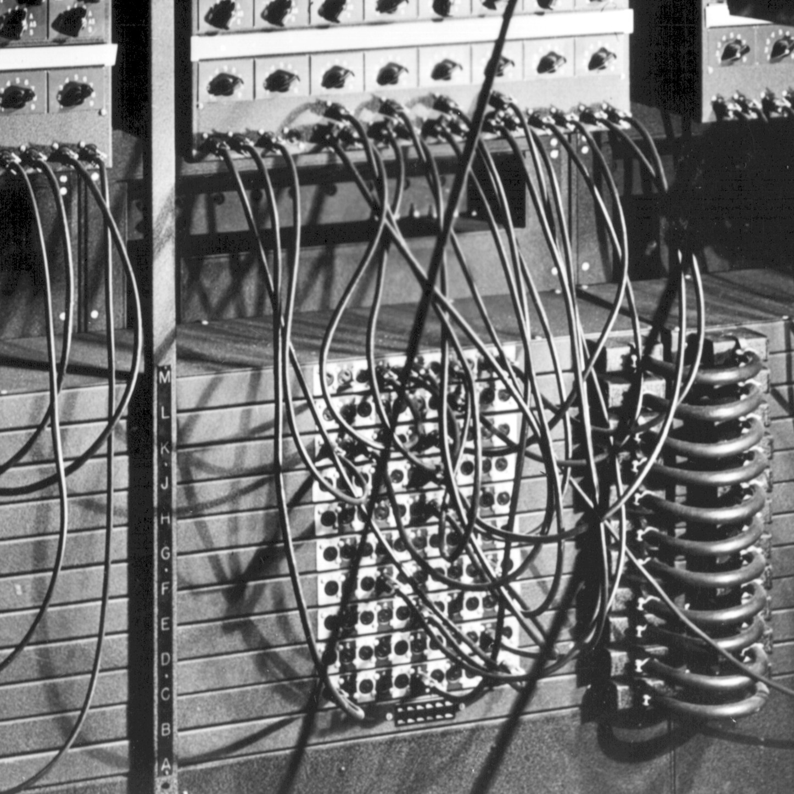

---

<strong>...to languages?</strong> 
Algol language definition
  

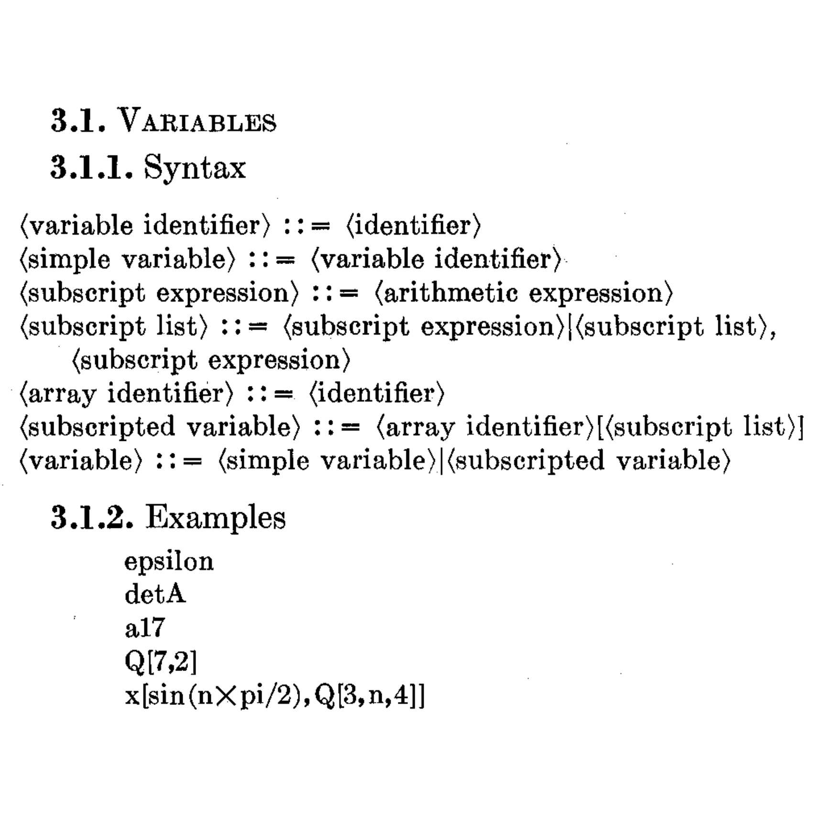

****************************************************************************************************
- template: subtitle

# Metaphors
## Computers as giant electronic brains

----------------------------------------------------------------------------------------------------
- template: image

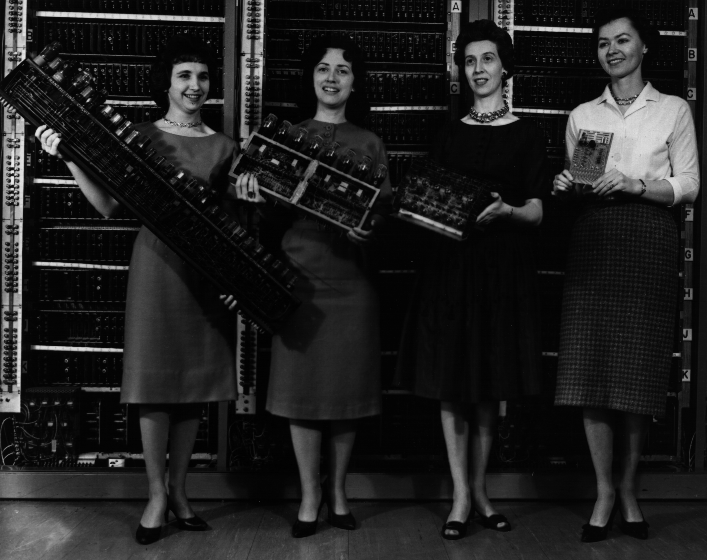

# What was a com&shy;puter in the 1940s?

**Female computers doing numerical calculations by hand!**

Patsy Simmers, Mrs. Gail Taylor, Mrs. Milly Beck, Mrs. Norma Stec

----------------------------------------------------------------------------------------------------
- template: image

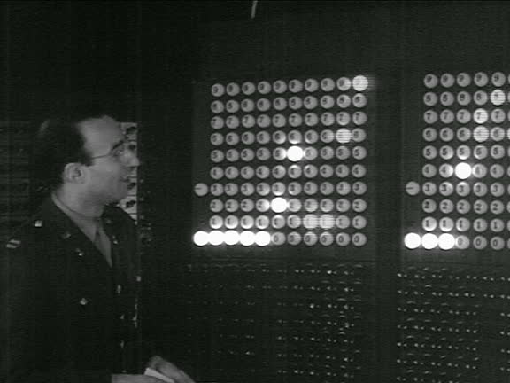

# ENIAC 1945 demonstration

Trajectory of a shell in
20 sec, not 40 hours

Labeled ping pong balls showing the "memory"

----------------------------------------------------------------------------------------------------
- template: lists
- style: .body img { max-height:450px !important; max-width:500px !important; margin-top:-100px !important; }

# Electronic brains

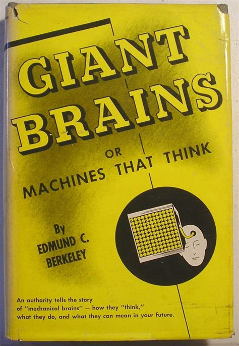

## Popular imagination

- Anthropomorphic metaphor
- Portrayal in media
- Berkeley's 1949 book

## Cybernetics movement

- Post-World War II movement
- Self-regulative control systems
- Electronic and biological alike

****************************************************************************************************
- template: subtitle

# Collaboration
## Hacker programming tricks

----------------------------------------------------------------------------------------------------
- template: lists
- class: bigger
- style: h1 { margin-bottom:20px;}

# EDSAC computer (1949)

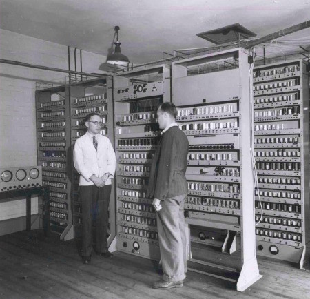

## Initial orders
- Read program from the tape
- Support for sub-routines

## External orders
- Non-standard codes
- Interpretive routines

## Debugging tricks
- Step-by-step execution
- Postmortem tapes

----------------------------------------------------------------------------------------------------
- template: image

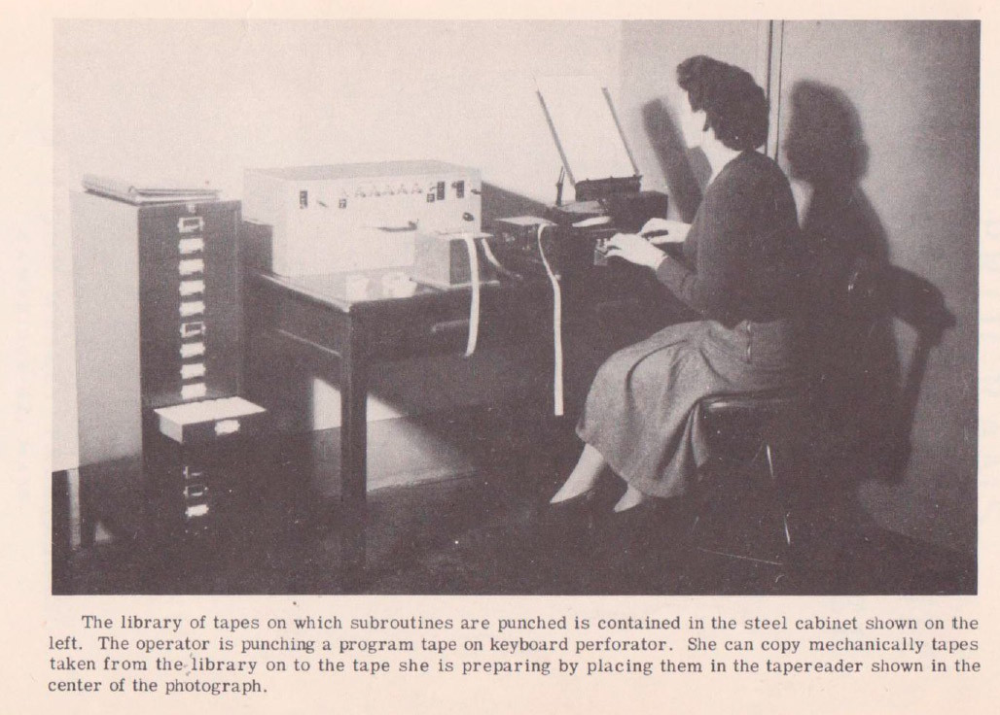

# Sub-routine library

**Open sub-routines**  
Copied at each point

**Closed sub-routines**  
Using control transfer

----------------------------------------------------------------------------------------------------
- template: icons

# Program coding
## Before a language

- *fa-arrows-to-circle* **Brief Code** - John Mauchly (BINAC, 1949)
- *fa-greater-than-equal* **A-0** - Grace Hopper (UNIVAC, 1951-2)
- *fa-square-root-variable* **Autocode** - Alick Glennie (Manchester, 1952)

----------------------------------------------------------------------------------------------------
- template: image
- class: noborder

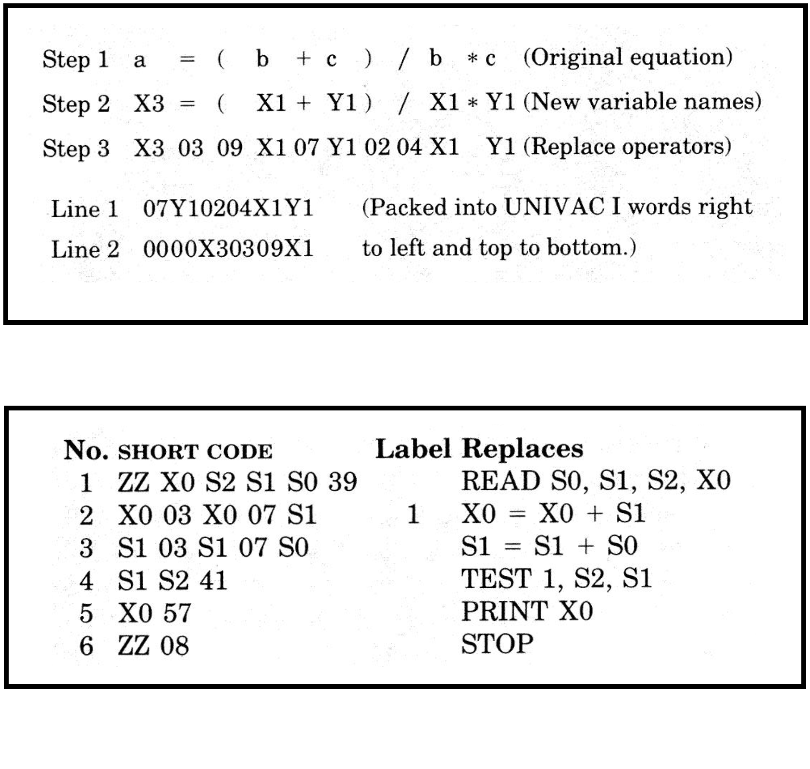

# Brief Code /  Short Code

Step 2 to Step 3 translation done automatically  by an editor

---

**Not exactly a   language yet...**

****************************************************************************************************
- template: subtitle

# Collaboration
## Mathematical theories

----------------------------------------------------------------------------------------------------
- template: lists
- style: .body img { margin-top:-50px !important; }

# Formal language

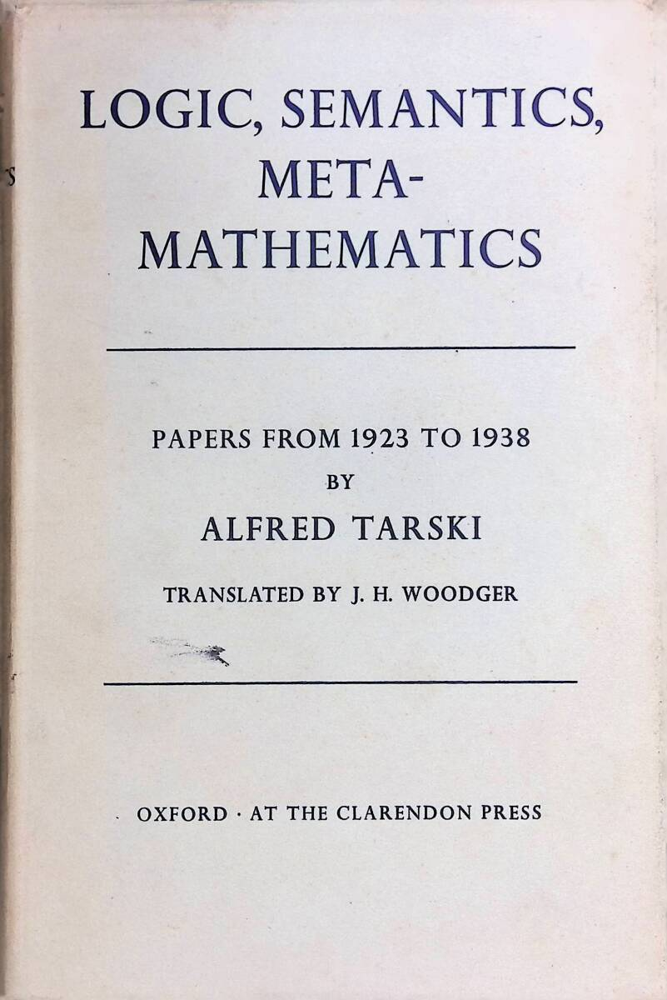

## Language models in logic
- Tarski, Carnap, early 20th century
- Language starts with a set of symbols

## Language models in linguistics
- Formal structural linguistics
- Ongoing research on machine translation
- Chomsky's grammars (late 1950s)

----------------------------------------------------------------------------------------------------
- template: image
- class: smaller

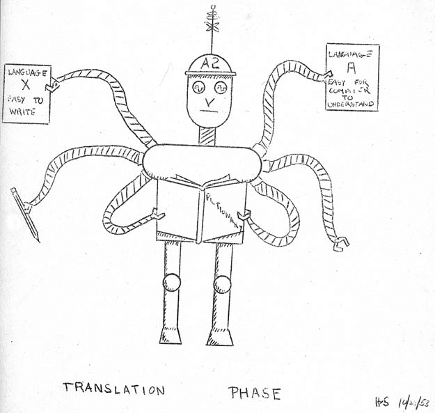

# Translation metaphor

Hopper's illustration of the A-2 compiler (1954)

---

**From giant electronic brains to logic and linguistics**

Formal languages and grammars for description

****************************************************************************************************
- template: subtitle

# Collaboration
## Managerial need

----------------------------------------------------------------------------------------------------
- template: lists
- class: bigger

# Software gap

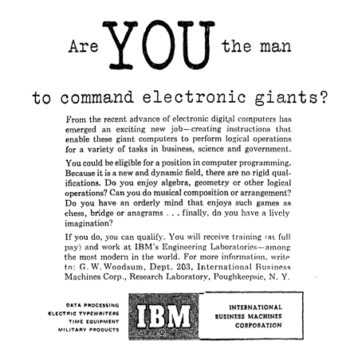

## More software needed

- Industry crisis perception
- Getting the computers  
  to do what we need!

## Programming is the limit

- Creating software is hard
- Hiring programmers is hard
- Also, excluding women did not help!

----------------------------------------------------------------------------------------------------
- template: image
- class: smaller

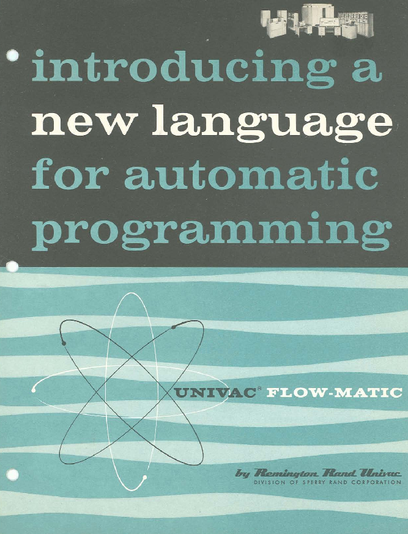

# Automatic coding

User groups and computer installation managers

**Solve the software gap!**

---

Common universal notations  
Cross-machine compatibility  
Allow program exchange  
Teaching at universities

----------------------------------------------------------------------------------------------------
- template: content

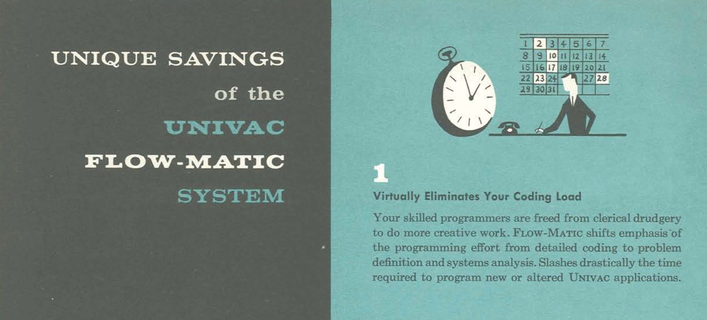

**Would you guess the publication year (1957)?**

****************************************************************************************************
- template: subtitle

# Collaboration
## Programming language

----------------------------------------------------------------------------------------------------
- template: image
- class: smaller

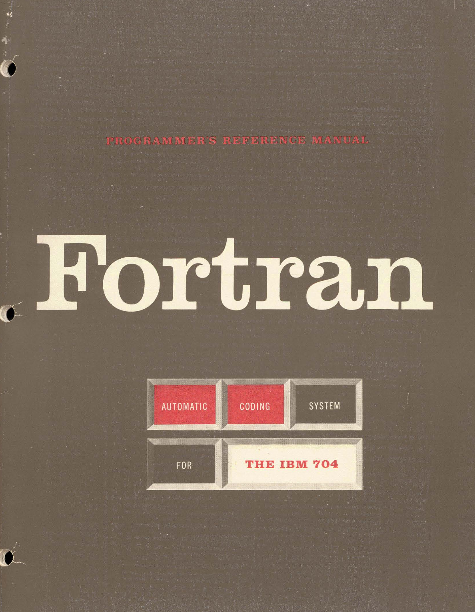

# IBM FORTRAN  FORmula TRANslator

John Backus (IBM, 1957)

Translation metaphor, hacker tricks, managerial need

---

**Not referred to as a programming language!**

----------------------------------------------------------------------------------------------------
- template: content

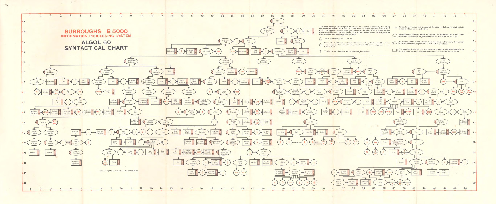

**International Algebraic Language (IAL, 1958)**

----------------------------------------------------------------------------------------------------
- template: lists
- style: .body img { max-width:230px !important; margin-bottom:30px !important; }

# Algol - Algorithmic Language

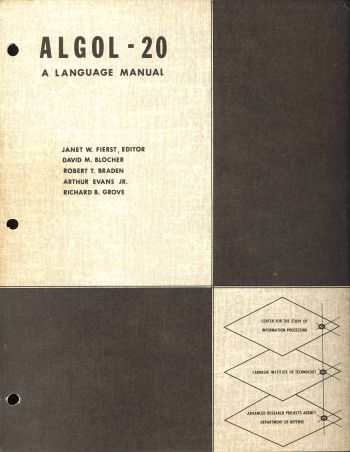

## Scientific notation

- Extension of mathematical language
- Description of algorithms in publication
- Translatable into machine programs

## Independent of a computer

> A formal mathematical, linguistic object, not just a
messy adjunct to the technical business of getting a computer to run.

****************************************************************************************************
- template: largeicons

# Programming language
## Remarkable new idea

- *fa-keyboard* **Hacker culture**  
   Implementation tricks, sub-routines, external codes
- *fa-hard-drive* **Managerial culture**  
   Needs to simplify programming and universal codes
- *fa-right-long* **Mathematical culture**  
   Formal description using language of logic

----------------------------------------------------------------------------------------------------
- template: lists
- class: noborder nologo
- style: .body img { margin:-50px -50px 0px 0px !important; max-width:1000px !important; max-height:500px !important; }

# Limits of collaboration

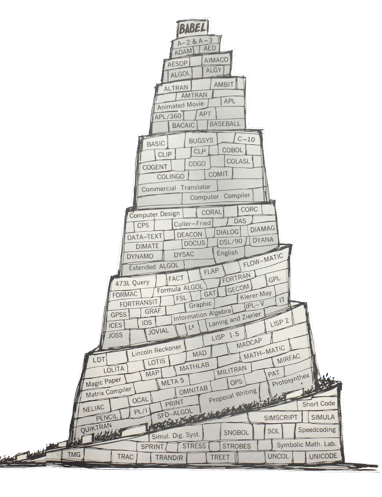

## Meeting of cultures but...

- **Algol** for mathematical theory
- **COBOL** for managerial business use
- **LISP** for symbolic AI and hackers

## Boundary object

- Shared understanding
- Exchange of ideas between cultures
- Failure of universal languages

****************************************************************************************************
- template: subtitle

# Cultures of Programming
## [<i class="fa fa-house"></i> Home](/) &nbsp;&nbsp;  [<i class="fa fa-arrow-right"></i>Continue to Part 4](04-structured.html)
