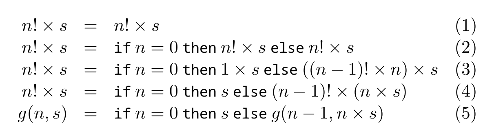
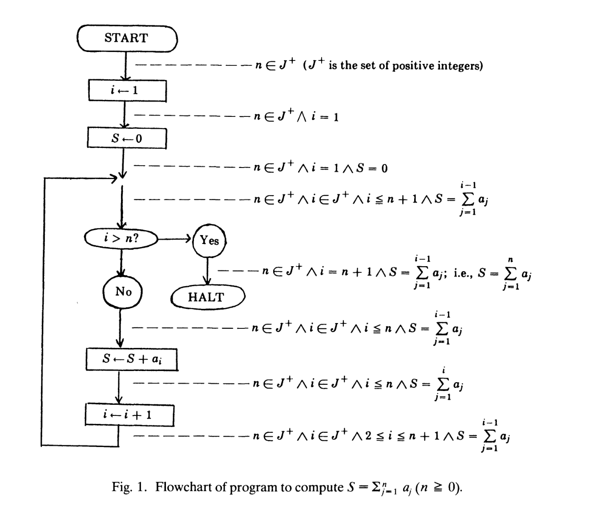
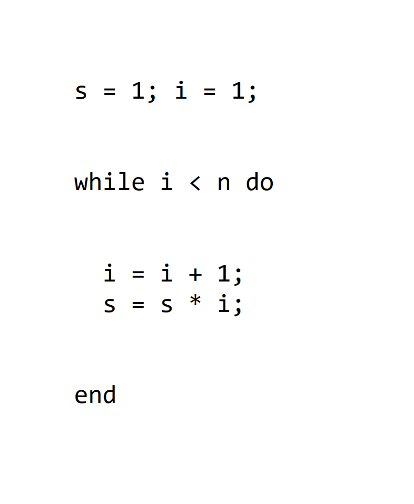
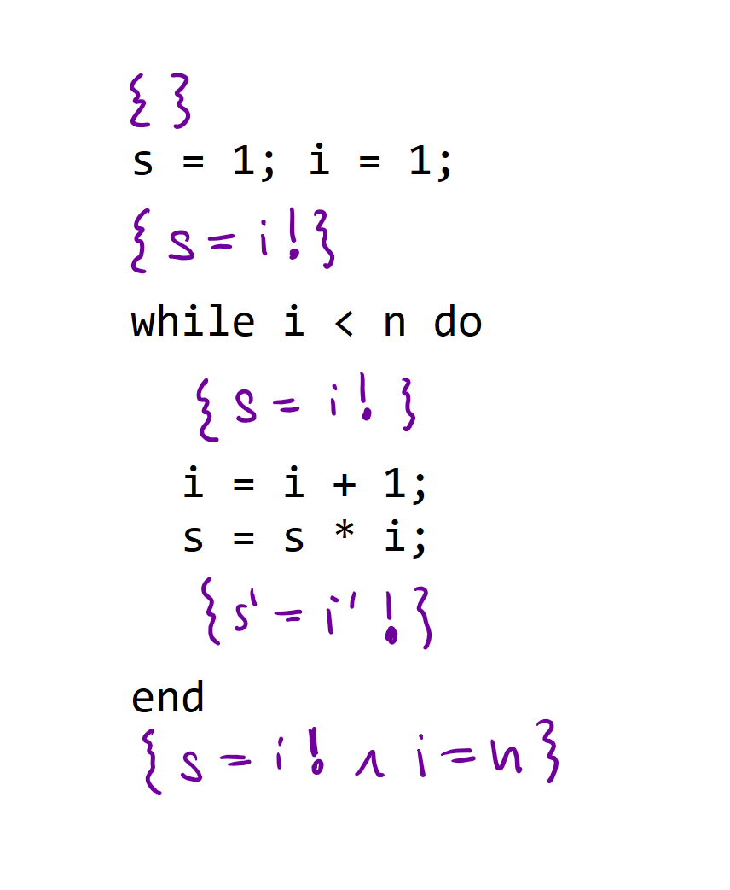
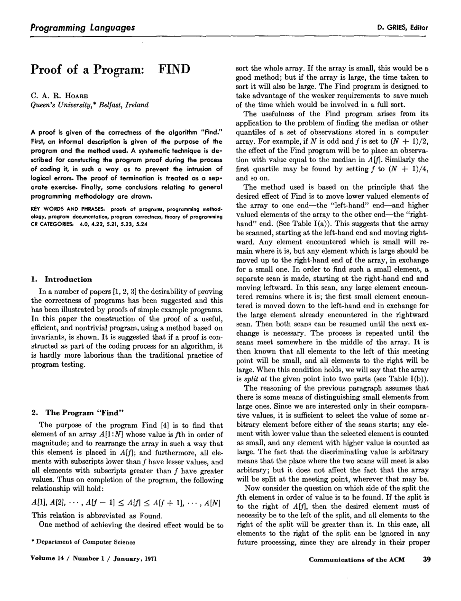
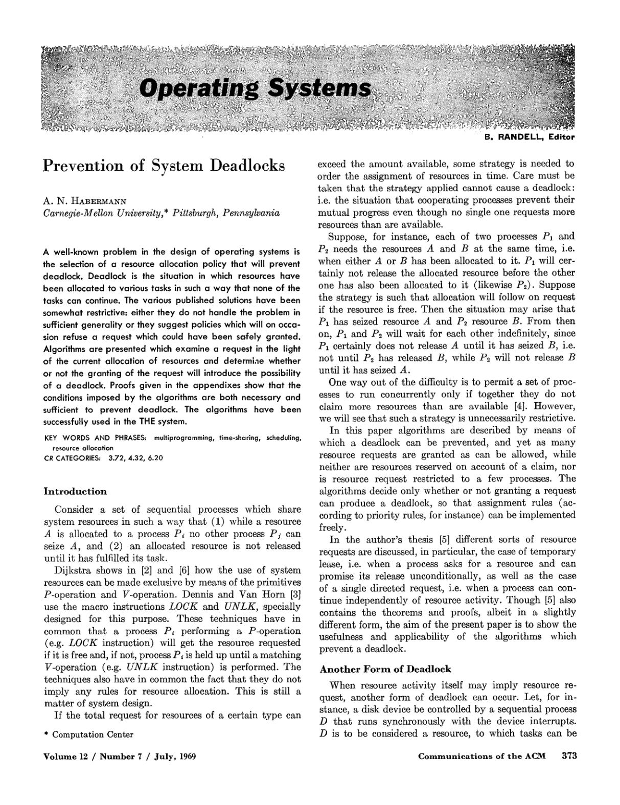
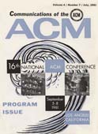

- title: Cultures of Programming - Part 2 - Hackers, engineers, managers, mathematicians and humanists

****************************************************************************************************
- template: title

# Mathematical science of computation  and structured programming
## Cultures of Programming &mdash; Part 4

---

**Tomas Petricek**, Charles University, Prague  

_<i class="fa fa-envelope"></i>_ [tomas@tomasp.net](mailto:tomas@tomasp.net)  
_<i class="fa fa-globe"></i>_ [https://tomasp.net](https://tomasp.net)  
_<i class="fa-brands fa-bluesky"></i>_ [@tomasp.net](https://bsky.app/profile/tomasp.net)    

****************************************************************************************************
- template: subtitle

# Mathematical culture
## Proving program properties

----------------------------------------------------------------------------------------------------
- template: image
- class: smaller
- style: .body1 { max-width:400px; }

# Mathematical science  of computation

Programs as formal entities  
Algorithms as objects to study  
Formal mathematical reasoning  

**Algol paradigm**

----------------------------------------------------------------------------------------------------
- template: icons

# Algol paradigm
## Mathematical Science (McCarthy, 1962)

- *fa-equals* Two procedures (functions) are equivalent
- *fa-circle-stop* Procedure terminates for all input data
- *fa-language* Translation correctly translates procedures
- *fa-gauge-high* Translation increases efficiency

----------------------------------------------------------------------------------------------------
- template: content
- style: h1 { font-size:40pt; } img { max-width:90%; }

# McCarthy's factorial proof

---

----------------------------------------------------------------------------------------------------
- template: icons
- class: nologo

# Algol paradigm
## Proving programs correct

- *fa-cog* **Peter Naur (1966)**  
   Proofs of algorithms by general snapshots
- *fa-cog* **Robert Floyd (1967)**  
   Assigning meaning to programs
- *fa-cog* **Tony Hoare (1969)**  
   An axiomatic basis for computer programming

----------------------------------------------------------------------------------------------------
- template: image

# Floyd (1967)

Cites McCarthy and uses a subset of Algol

**But uses flowcharts!**

Common visual representation of programs at the time

----------------------------------------------------------------------------------------------------
- template: image
- style: .body1 { width:380px; } .body1 img { max-width:340px; }

# Hoare (1969)

Annotate programs using  
tripes $\{P\} \,c\, \{Q\}$ where:

- $P$ pre-condition holds before
- $c$ command to run
- $Q$ post-condition holds afterwards

Using modern notation for  
(now called) Hoare-triples

----------------------------------------------------------------------------------------------------
- template: image
- style: .body1 { width:380px; } .body1 img { max-width:340px; }

# Hoare (1969)

Reasoning about programs  
using Hoare triples

**Composition rule!**

If $\{P\}\,c_1\,\{Q\}$  
and $\{Q\}\,c_2\,\{R\}$  
then $\{P\}\,c_1;c_2\,\{R\}$

----------------------------------------------------------------------------------------------------
- template: content
- style: img { max-width:48%; margin-right:20px; }

# Proofs of programs in practice

----------------------------------------------------------------------------------------------------
- template: lists
- class: nologo
 
# Proofs of programs in practice

## Prevention of deadlocks (1969)

- Abstract algorithm written as pseudocode
- Model using states and transitions
- Not actual source code!

## Proof of FIND (1971)

- Part of Hoare's QuickSort algorithm
- Find $f^{th}$ element in an array and rearrange
- $A[1],\ldots,A[f-1]\leq A[f]\leq A[f+1],\ldots,A[N]$
- ... it may be possible to enlist the aid of a computer

****************************************************************************************************
- template: subtitle

# Mathematical culture
## Structuring programs

----------------------------------------------------------------------------------------------------
- template: content

TODO

****************************************************************************************************
- template: subtitle

# Managerial culture
## Structuring teams

----------------------------------------------------------------------------------------------------
- template: content

TODO

****************************************************************************************************
- template: subtitle

# Cultures of Programming
## [<i class="fa fa-house"></i> Home](/) &nbsp;&nbsp;  [<i class="fa fa-arrow-right"></i>Continue to Part 5](05-xx.html)
