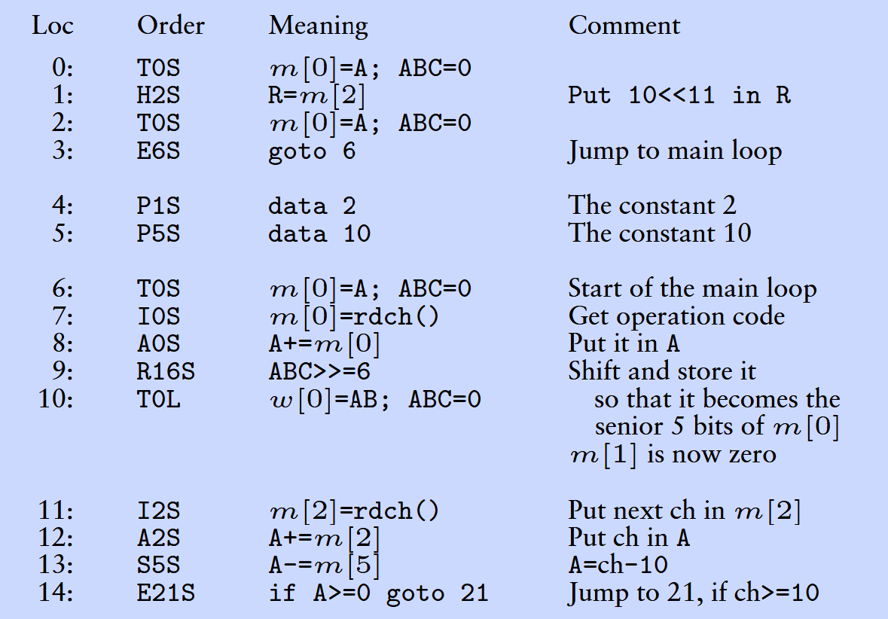
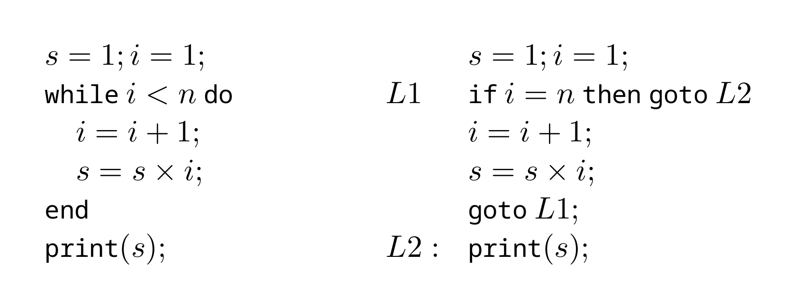
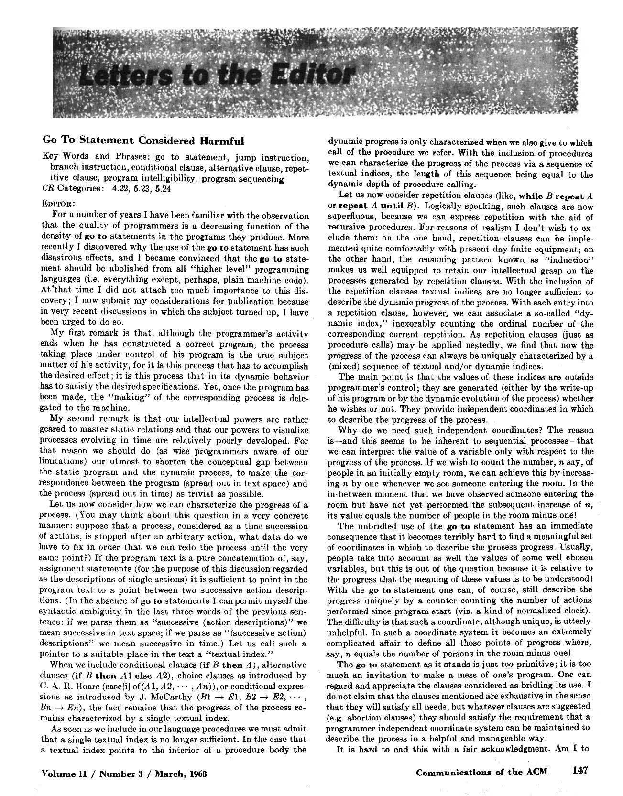
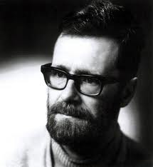
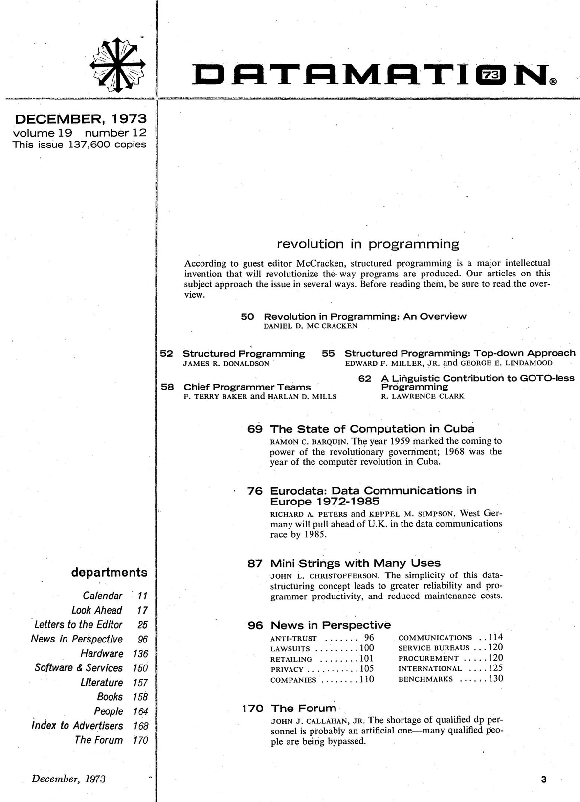
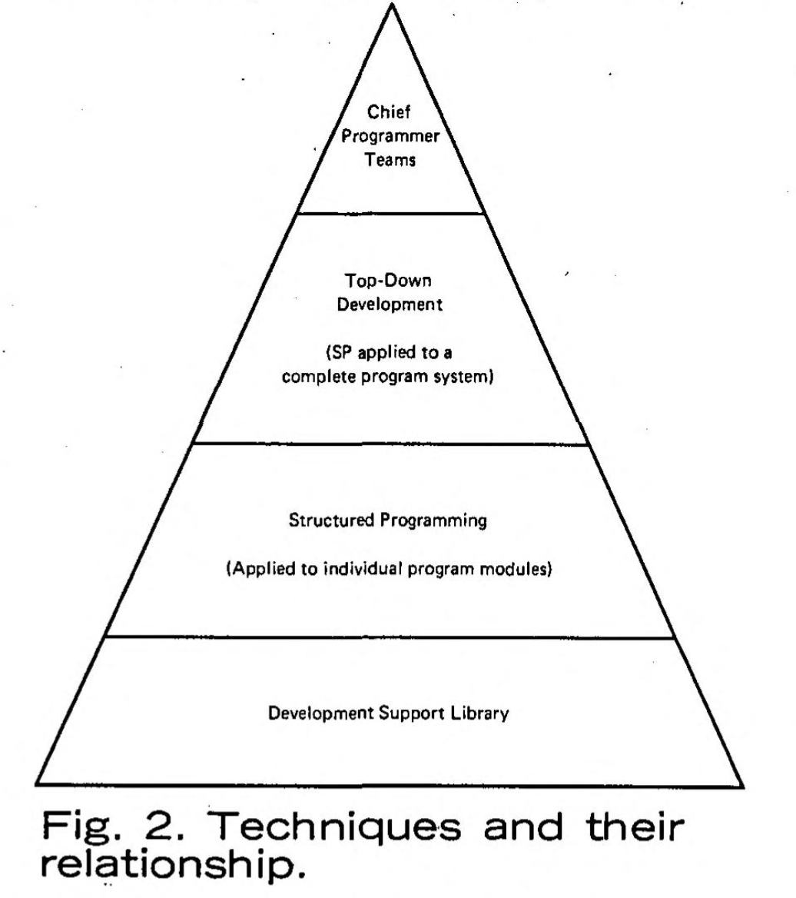
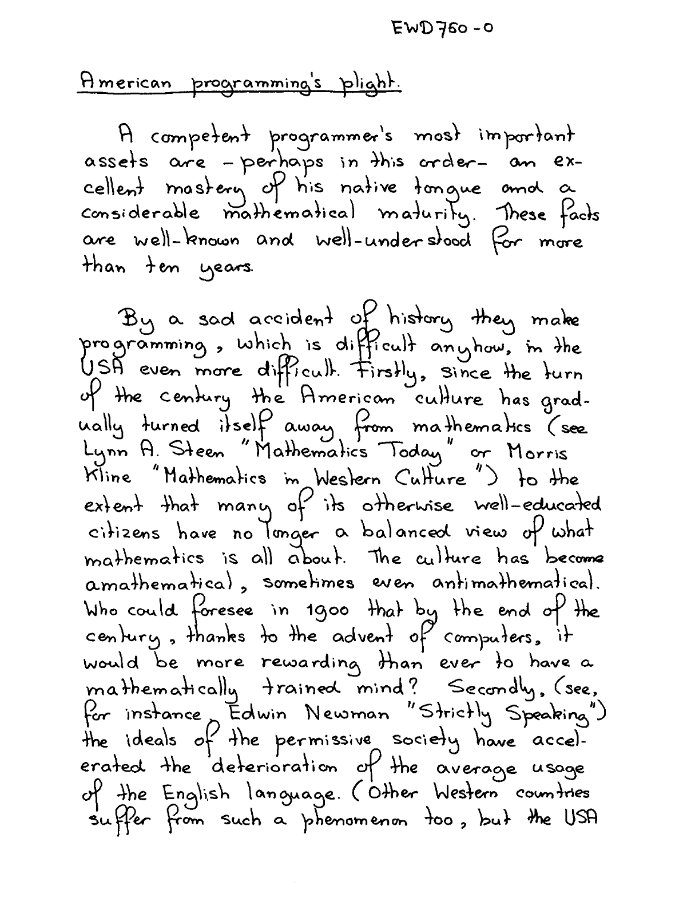
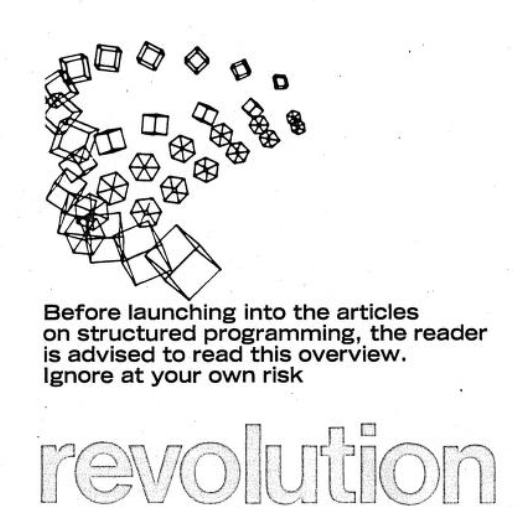

- title: Cultures of Programming - Part 4 - Mathematical science of computation and structured programming

****************************************************************************************************
- template: title
- class: blue
- background-image: img/part4/syntax-blue.png

# Mathematical science of computation  and structured programming
## Cultures of Programming &mdash; Part 4

---

**Tomas Petricek**, Charles University, Prague  

_<i class="fa fa-envelope"></i>_ [tomas@tomasp.net](mailto:tomas@tomasp.net)  
_<i class="fa fa-globe"></i>_ [https://tomasp.net](https://tomasp.net)  
_<i class="fa-brands fa-bluesky"></i>_ [@tomasp.net](https://bsky.app/profile/tomasp.net)    

****************************************************************************************************
- template: subtitle

# Mathematical culture
## Structuring programs

----------------------------------------------------------------------------------------------------
- template: image

# EDSAC instructions

EDSAC initial orders (first few instructions)

**Low-level assembly-like**  
Write to register  
Transfer control (jump)  
Basic arithmetic

[See the EDSAC poster](https://www.cl.cam.ac.uk/~mr10/Edsac/edsacposter.pdf)

----------------------------------------------------------------------------------------------------
- template: lists
- style: .body img { max-width:430px !important; } h1 { margin-bottom:20px; }

# Structured programming

## Block-based languages

- Control structures like `while` and `if` instead of `goto`
- Popularized by Algol

## For structured programming

- Supports reasoning and readability

## Against structured programming

- Can we trust compiler generated code?
- Can we really express everything well?

----------------------------------------------------------------------------------------------------
- template: image
- class: smaller

# Dijkstra (1968)

"...the quality of program&shy;mers is a decreasing function of the
density of `go to` statements in the programs they produce."

"...the `go to` statement should be abolished from all 'higher level'
programming languages"

----------------------------------------------------------------------------------------------------
- template: lists

# Dijkstra on the go to statement

## Making programs understandable

- Programs are read more than written
- Shorten conceptual gap between static program and dynamic process

## You do not need go to

- Structured program theorem (Böhm–Jacopini)
- Any flowchart can be encoded using just three control structures (sequence, selection, iteration)

----------------------------------------------------------------------------------------------------
- template: content
- style: .body img { max-width:600px; }

# Formal reasoning about programs

---

**Why structured programming helps**

- Works better with block-based languages!
- No need to model register and memory states

****************************************************************************************************
- template: subtitle

# Mathematical culture
## Proving program properties

----------------------------------------------------------------------------------------------------
- template: image
- class: smaller
- style: .body1 { max-width:400px; }

# Mathematical science  of computation

Programs as formal entities  
Algorithms as objects to study  
Formal mathematical reasoning  

**Algol paradigm**

----------------------------------------------------------------------------------------------------
- template: icons

# Algol paradigm
## Mathematical Science (McCarthy, 1962)

- *fa-equals* Two procedures (functions) are equivalent
- *fa-circle-stop* Procedure terminates for all input data
- *fa-language* Translation correctly translates procedures
- *fa-gauge-high* Translation increases efficiency

----------------------------------------------------------------------------------------------------
- template: content
- style: h1 { font-size:40pt; } img { max-width:90%; }

# McCarthy's factorial proof

---

----------------------------------------------------------------------------------------------------
- template: icons
- class: nologo

# Algol paradigm
## Proving programs correct

- *fa-image* **Peter Naur (1966)**  
   Proofs of algorithms by general snapshots
- *fa-paperclip* **Robert Floyd (1967)**  
   Assigning meaning to programs
- *fa-square-check* **Tony Hoare (1969)**  
   An axiomatic basis for computer programming

----------------------------------------------------------------------------------------------------
- template: image

# Floyd (1967)

Cites McCarthy and uses a subset of Algol

**But uses flowcharts!**

Common visual representation of programs at the time

----------------------------------------------------------------------------------------------------
- template: image
- style: .body1 { width:380px; } .body1 img { max-width:340px; }

# Hoare (1969)

Annotate programs using  
tripes $\{P\} \,c\, \{Q\}$ where:

- $P$ pre-condition holds before
- $c$ command to run
- $Q$ post-condition holds afterwards

Using modern notation for  
(now called) Hoare-triples

----------------------------------------------------------------------------------------------------
- template: image
- style: .body1 { width:380px; } .body1 img { max-width:340px; }

# Hoare (1969)

Reasoning about programs  
using Hoare triples

**Composition rule!**

If $\{P\}\,c_1\,\{Q\}$  
and $\{Q\}\,c_2\,\{R\}$  
then $\{P\}\,c_1;c_2\,\{R\}$

----------------------------------------------------------------------------------------------------
- template: content
- style: img { max-width:48%; margin-right:20px; }

# Proofs of programs in practice

----------------------------------------------------------------------------------------------------
- template: lists
- class: nologo

# Proofs of programs in practice

## Prevention of deadlocks (1969)

- Abstract algorithm written as pseudocode
- Model using states and transitions
- Not actual source code!

## Proof of FIND (1971)

- Part of Hoare's QuickSort algorithm
- Find $f^{th}$ element in an array and rearrange
- $A[1],\ldots,A[f-1]\leq A[f]\leq A[f+1],\ldots,A[N]$
- ... it may be possible to enlist the aid of a computer

****************************************************************************************************
- template: subtitle

# Managerial culture
## Structuring teams

----------------------------------------------------------------------------------------------------
- template: image
- style: p { font-size:24pt; } .body1 { width:380px !important;}

# Revolution in programming
(Datamation magazine, 1973)

According to guest editor McCracken, structured programming is a major intellectual invention that will revolutionize the way programs are produced. Our articles on this subject approach the issue in several ways. Before reading them, be sure to read the overview.

----------------------------------------------------------------------------------------------------
- template: lists

# Chief Programmer Teams

## Project management at IBM
- New York Times data bank project
- Overall structure by one person
- Chief programmer + support

## Structured programming
- Top-down design of programs vs.  
  top-down management of teams

----------------------------------------------------------------------------------------------------
- template: image
- style: p { font-size:24pt; } .body1 { width:400px !important;}

# Dijkstra's response

**How to program if you cannot**

"the prevailing management philosophy [makes] companies as independent as possible of the competence of their employees"

----------------------------------------------------------------------------------------------------
- template: lists

# Structured programming

## Mathematical culture

- Mathematical reasoning
- Compositional semantics

## Engineering culture

- Understanding code
- Individual responsibility

## Managerial culture

- Top-down software development
- Structuring teams

****************************************************************************************************
- template: subtitle

# Cultures of Programming
## [<i class="fa fa-house"></i> Home](/) &nbsp;&nbsp;  [<i class="fa fa-arrow-right"></i>Continue to Part 5](05-proofs.html)
