- title: Cultures of Programming - Part 5 - Fundamental limits of proofs of programs

****************************************************************************************************
- template: title
- style: h1 { letter-spacing:-1px; }
- class: blue
- background-image: img/part5/thule-blue.jpg

# Fundamental limits of proofs of programs
## Cultures of Programming &mdash; Part 5

---

**Tomas Petricek**, Charles University, Prague  

_<i class="fa fa-envelope"></i>_ [tomas@tomasp.net](mailto:tomas@tomasp.net)  
_<i class="fa fa-globe"></i>_ [https://tomasp.net](https://tomasp.net)  
_<i class="fa-brands fa-bluesky"></i>_ [@tomasp.net](https://bsky.app/profile/tomasp.net)    

****************************************************************************************************
- template: subtitle

# Algol
## Object of mathematical beauty

----------------------------------------------------------------------------------------------------
- template: image
- class: smaller

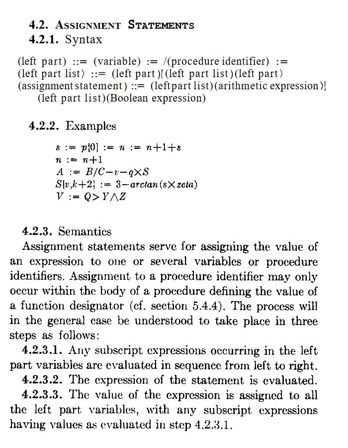

# Algol report (1960)

Formally describes language syntax

**What about semantics?**  
What happens when programs are executed?

---

**Turns out to be harder!**

----------------------------------------------------------------------------------------------------
- template: lists

# Early semantics of Algol

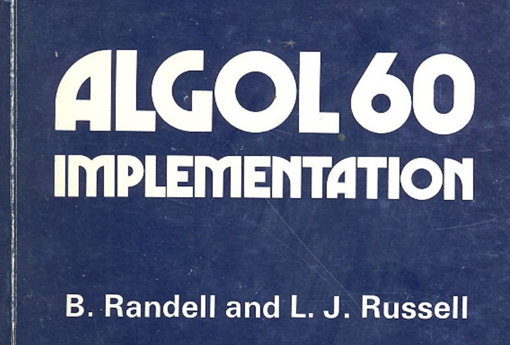

## Microalgol (McCarthy, 1964)
- Small subset, but includes `goto`
- Defined as a function $\texttt{micro}(\pi,\xi)$
- Mathematically-defined interpreter

## Axiomatic basis (Hoare, 1969)
- Axioms of fortran constructs
- For example: $\{ p(f) \} x := f \{ p(x) \}$.
- Admits that `goto` is difficult

----------------------------------------------------------------------------------------------------
- template: content

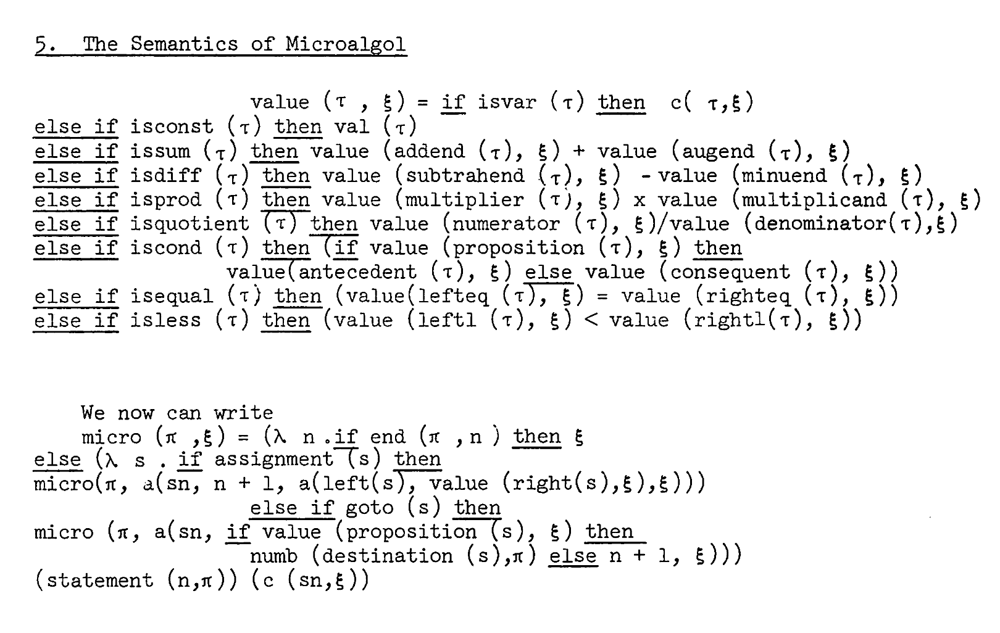

**Microalgol definition by McCarthy**  
Program $\pi$, execution state $\xi$

----------------------------------------------------------------------------------------------------
- template: content
- class: nologo
- style: blockquote p { text-align:right; font-style:normal; } .body img { float:right; max-width:250px; margin-left:70px; } p em { font-style:normal; font-weight:400; }

# Early days optimism

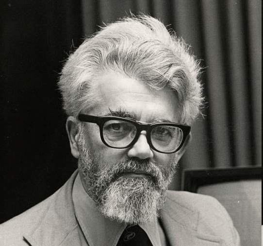

_"Those difficulties can be resolved and that a clear description
of the state of an Algol computation will clarify the problem of compiler design."_

> (McCarthy, 1964)

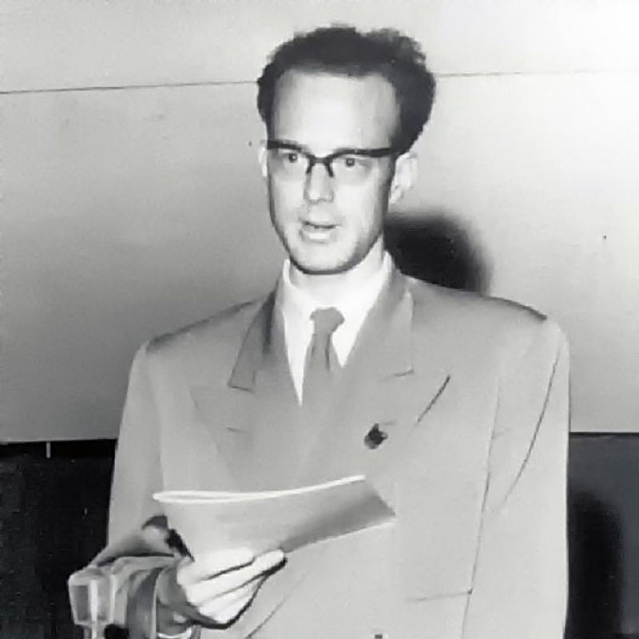

_"The practical advantages of program proving will eventually outweigh
the difficulties."_

> (Hoare, 1969)

----------------------------------------------------------------------------------------------------
- template: image

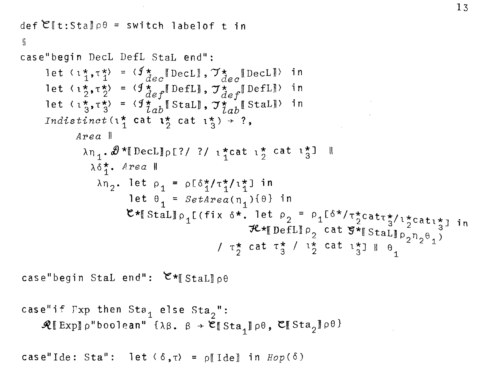

# Mosses (1974)

Method by Strachey

**Assign mathematical object to constructs**

Terms of $\lambda$ calculus!

----------------------------------------------------------------------------------------------------
- template: lists
- style: .body img { max-width:230px !important; }

# Vienna Development Method

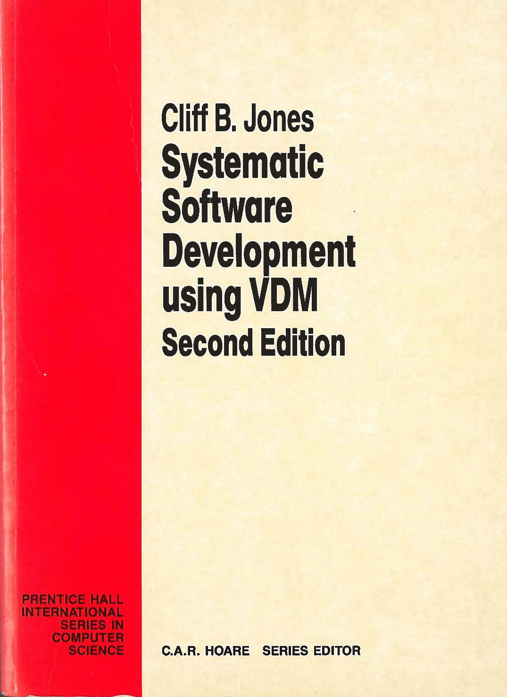

## Tool-supported definition

- Aim to model more complex PL/1
- Vienna Definition Language (VDL)
- Algol as the starting point

## Formalising Algol in VDL

- Machine-checked definition
- 67 page definition (1968) ala McCarthy
- Book-chapter length (1978) ala Mosses

----------------------------------------------------------------------------------------------------
- template: icons

# Algol
## Many formal definitions

- *fa-circle-dot* Small subset vs. full language
- *fa-book-skull* Surprised "is's as long as it is"!
- *fa-arrows-turn-to-dots* "Algol 60 is just not nearly as well-behaved"
- *fa-square fa-regular* 60 pages of definitions, no theorems!

----------------------------------------------------------------------------------------------------
- template: lists
- style: .body img { max-width:220px !important; }

# From Algol 60 to Algol 68

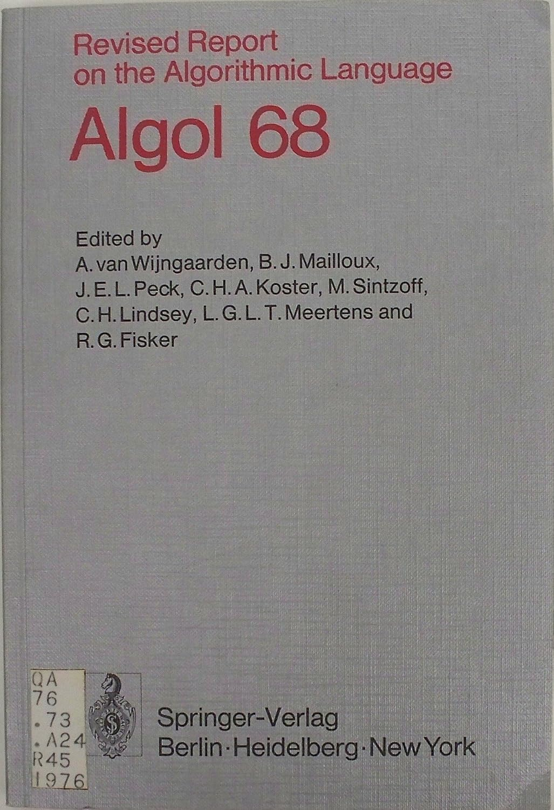

## Further development
- Universal language aims
- More orthogonal definitions

## Sources of complexity
- Using meta-grammar and grammar
- Modes (`ref`,`proc`,`struct`,`union`,`flex`)
- Coercions (dereferencing, deproceduring, uniting, widening, rowing, and voiding)

## Maybe not so bad today!

----------------------------------------------------------------------------------------------------
- template: lists
- style: p { margin-bottom:10px; } h2 { margin:20px 0px; }

# Minority report

## Programming problems

- Many see Algol 68 as a failure
- "Facing tasks of completely different  
and still growing scope and scale."

## Responses to complications

- IFIP WG 2.3 on Programming Methodology
- NATO Software Engineering conference (1968)
- From "expressing programs in a language"  
  to "language to support good practices."

****************************************************************************************************
- template: subtitle

# Proofs of programs
## Social processes

----------------------------------------------------------------------------------------------------
- template: lists
- style: p { margin-bottom:10px; } h2 { margin:20px 0px 10px 0px; }

# De Millo, Lipton & Perlis

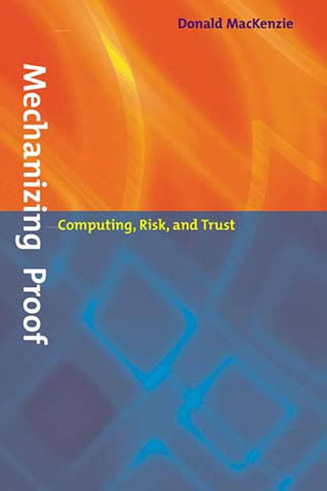

## Met at Yale University seminar
- De Millo visiting Lipton
- Presenting verification research
- Extensive algorithm proof

## Perlis' question
"Why does it take 20 pages to prove a program
that is obviously correct?"

**What does it take to convince a human?**

----------------------------------------------------------------------------------------------------
- template: content
- style: img { max-width:600px; } p { letter-spacing:-0.5px; }

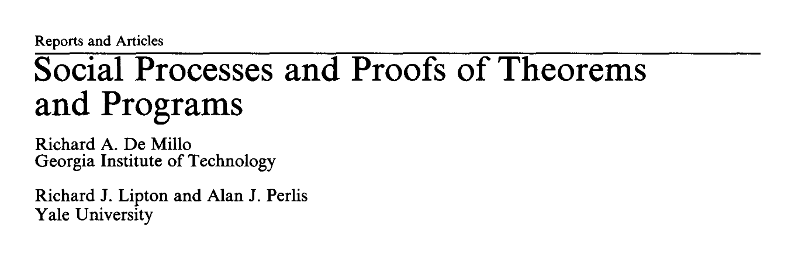

**Proofs in logic**  
Finite sequences of propositions, each of which is  
an axiom, an assumption or follows from earlier  
propositions by a rule of inference.

**Proofs in practice**  
Mix of natural and formal language, aimed to  
convince another qualified colleague

----------------------------------------------------------------------------------------------------
- template: lists

# Source of confidence

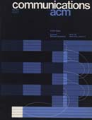

## Central to mathematical practice
- Taught at universities
- Discussed at whiteboard sessions
- Mathematicians enjoy elegance & tricks
- Believe it could be elaborated

## Proofs of programs differ
- Bound to be secondary
- Programs are written to be run
- Certification does not play the same role
- Repetitive, large number of cases

----------------------------------------------------------------------------------------------------
- template: lists

# Letters to the editor

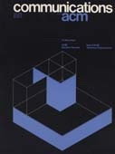

## Computer scientists
- A pamphlet from the Middle Ages (Dijkstra)

## Industry readership

- Wisdom, fairness, style, rigour, and wit
- First article enjoyed since joining the ACM
- Cannot recall a single instance in which a proof of a program's correctness would have been useful

****************************************************************************************************
- template: subtitle

# Proofs of programs
## Engineering and managerial answers

----------------------------------------------------------------------------------------------------
- template: largeicons

# Proofs of programs

- *fa-shapes* **De Millo et al. mix many cultures**  
   Mathematical with humanistic and engineering twist
- *fa-subscript* **Purely mathematical verification bound to fail**  
   Real-world software systems are too complex
- *fa-pen-to-square* **1960s proofs by hand no longer suffice**   
   Response comes from different perspectives!
- *fa-industry* **Managerial and engineering approaches**  
   Scaling proof methods to real-world systems

----------------------------------------------------------------------------------------------------
- template: image
- class: smaller

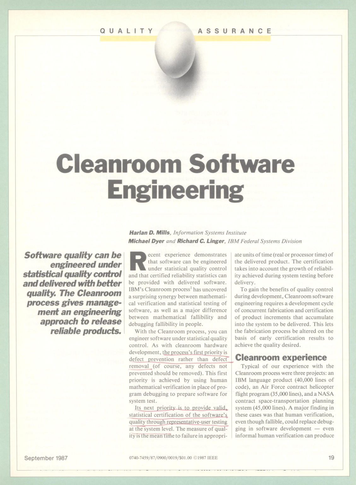

# Cleanroom Software Engineering

Harlan Mills at IBM    
PhD in game theory

**Extension of Chief Programmer Teams**

"Software engineering without mathematical verification is no more than a buzzword."

----------------------------------------------------------------------------------------------------
- template: lists

# Cleanroom Software Engineering

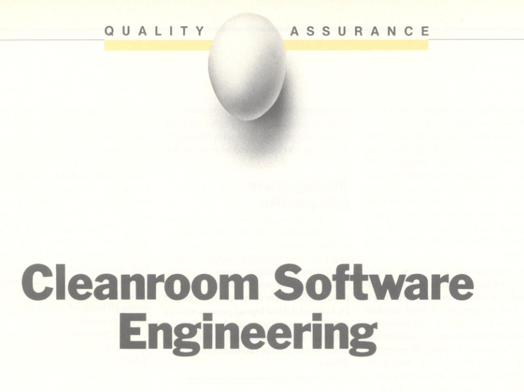

## Surgical team model
- Extends Chief Programmer Teams
- Lead surgeon, supported by assistants
- Controlled environment (cleanroom)

## Managing reliability
- Review conformance to specification rigorously
- Degree of rigor a managerial choice
- Statistical control of _reliability over a  
  probability distribution of usage scenarios_

----------------------------------------------------------------------------------------------------
- template: content

# Mechanical proof checking

----------------------------------------------------------------------------------------------------
- template: content
- class: nologo
- style: blockquote p { text-align:right; font-style:normal; } .body img { float:right; max-width:230px; margin-left:40px; } p em { font-style:normal; font-weight:400; }

# Mechanical proof checking

_"One should prove that [a program]
meets its specifications, and this proof should be checked by a computer program."_

> (McCarthy, 1963)

---

  

_"A mechanical theorem prover does not act as an oracle ... but as an implacable
sceptic that insists on all assumptions being stated and all claims justified."_

> (Rushby & Von Henke, 1990)

----------------------------------------------------------------------------------------------------
- template: largeicons

# Mechanical proof checking

- *fa-chalkboard* **Logic theorist** (Newell & Simon, 1950-1960s)  
  AI will be able to do more than just check!
- *fa-cog* **Robert Boyer & J Strother Moore** (1970s)  
  Proves (with luck) properties of LISP-like programs  
- *fa-chess-rook* **LCF prover** (Milner, 1970s)   
  Motivated by compiler proofs, ML meta-langauge
- *fa-table-columns* **Separation logic** (2000s)  
  Infer static analyser by Facebook

----------------------------------------------------------------------------------------------------
- template: content
- style: .body img { float:right; max-width:480px; }

# Formal verification in practice

**sel4 microkernel**  
A range of mission  
critical projects

**CompCert compiler**  
Faster than gcc without (untrusted) optimizations

**Verification tools**  
Static Driver Verifier at Microsoft, Infer at Facebook

****************************************************************************************************
- template: subtitle

# Proofs of programs
## Fundamental limitations

----------------------------------------------------------------------------------------------------
- template: content
- style: img { max-width:650px; } blockquote p { text-align:right; font-style:normal; } p em { font-style:normal; font-weight:400; }

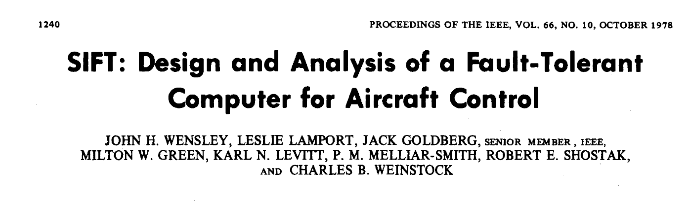

**Software Implemented Fault Tolerance**

---

_Proof could only be completed if they also had a precise specification of how the
underlying microprocessor executes instructions and also the timing of such execution._

> Boyer and Moore (1983)

----------------------------------------------------------------------------------------------------
- template: lists
- class: nologo
- style: h1 { font-size:42pt; }

# Ballistic Missile Early-Warning System

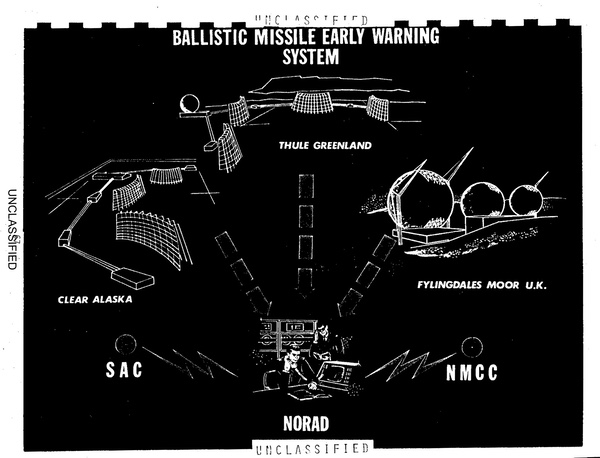

## Brian Cantwell Smith (1985)

- Mistook rising moon for a missile
- If it was verified, should it be trusted?

## Inherent limitations
- Models ignore timing or the moon
- Programs are not abstract mathematical entities

## Proofs check compatibility of two descriptions!

----------------------------------------------------------------------------------------------------
- template: lists

# Hardware verification

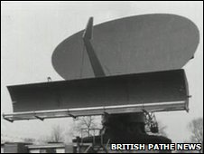

## VIPER microprocessor
The first commercial microprocessor with both
a formal specification and a proof that the chip conforms to it

## Avra Cohn's comment
Device can be described ... and the description verified; but ...there
is no way to assure the accuracy of the description

## Lawsuit about the nature of the proof!

----------------------------------------------------------------------------------------------------
- template: icons

# Proofs
## Programs vs mathematics

- *fa-not-equal* Programs are not mathematical entities
- *fa-microchip* Real hardware and real world!
- *fa-clock* Non-determinism, temperature, etc.
- *fa-search* Mathematical model is never fully detailed

----------------------------------------------------------------------------------------------------
- template: lists
- class: bigger

# The very idea (Fetzer, 1987)

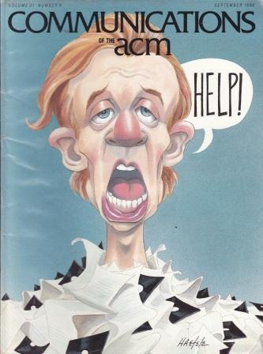

## Verification is nonsensical
- Program is a different kind of   
  thing than mathematics
- Category mistake

## What can verification mean?

- **Machine as formal entity**  
  Valid, but does not say anything
- **Machine as empirical description**  
  Proof is empirical knowledge

----------------------------------------------------------------------------------------------------
- template: lists
- class: bigger

# Reaction to the paper

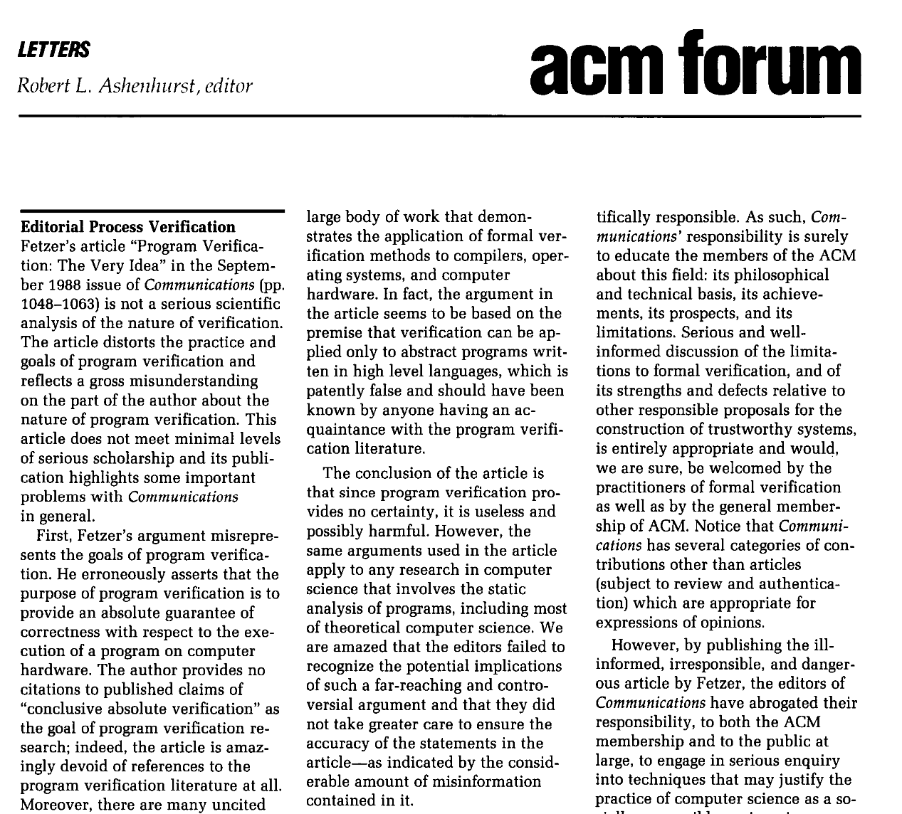

## Letter by computer scientists
- Attacks a parody of verification
- Not a serious scientific analysis
- Ill-informed, irresponsible,   
  and dangerous article

## Reveals something true
- Earlier critiques say similar thing!
- Ignored or hidden in long reports...

****************************************************************************************************
- template: largeicons

# Beyond mathematical culture

- *fa-chalkboard* **Old-school proofs on whiteboard**  
  Do not scale for problems like Algol definition!
- *fa-stethoscope* **Response involves other cultures**  
  Managerial Cleanroom, engineering tools
- *fa-user-group* **Shifting meaning of proofs**  
  From social activity to checkmark with caveats
- *fa-language* **Different kinds of proofs**  
  CompCert vs. programming language theory

****************************************************************************************************
- template: subtitle

# Cultures of Programming
## [<i class="fa fa-house"></i> Home](/) &nbsp;&nbsp;  [<i class="fa fa-arrow-right"></i>Continue to Part 6](06-xxx.html)
