- title: Cultures of Programming - Part 6 - Interactive programming at MIT

****************************************************************************************************
- template: title
- class: blue
- background-image: img/part6/tx-0-blue.jpg

# Interactive programming at MIT
## Cultures of Programming &mdash; Part 6

---

**Tomas Petricek**, Charles University, Prague  

_<i class="fa fa-envelope"></i>_ [tomas@tomasp.net](mailto:tomas@tomasp.net)  
_<i class="fa fa-globe"></i>_ [https:/<span style="margin:0px 0px 0px -12px">/</span>tomasp.net](https://tomasp.net)  
_<i class="fa-brands fa-bluesky"></i>_ [@tomasp.net](https://bsky.app/profile/tomasp.net)    

****************************************************************************************************
- template: subtitle

# Spacewar!
## TX-0 and PDP-1 computers

----------------------------------------------------------------------------------------------------
- template: lists
- class: bigger

# Computing in the late 1950s

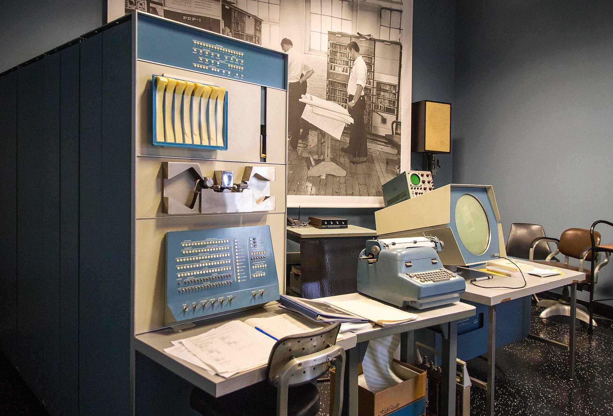

## Batch processing
- Hand punched cards to operator
- Get "Expects a comma. Abort"

## TX-0 (1956) and TX-2 (1958)
- Test transistor technology
- Donated to MIT RLE, available for interactive use

## DEC PDP-1 (1959)
- More powerful TX-inspired commercial computer
- Available at BBN and donated to MIT

----------------------------------------------------------------------------------------------------
- template: image

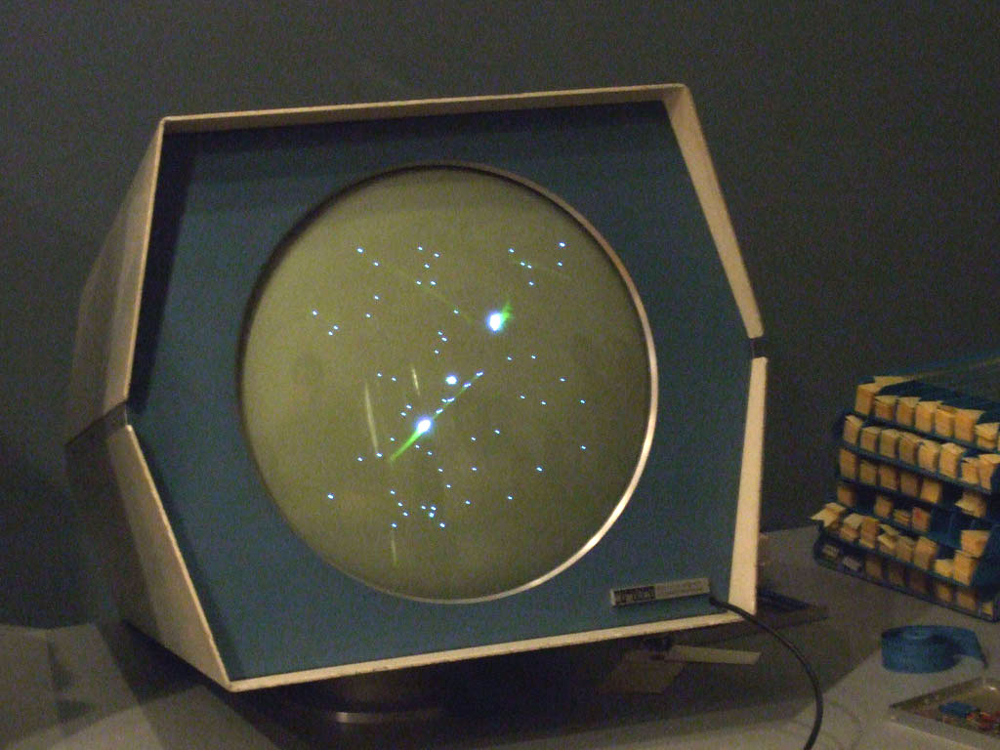

# Spacewar!

**Steve "Slug" Russell** &
Tech Model Railroad Club (TMRC) members

---

Sine and cosine story...  
"What's your excuse?"

---

**Demo showcasing PDP-1 capabilities**

----------------------------------------------------------------------------------------------------
- template: lists
- class: bigger

# Spacewar! and hacker culture

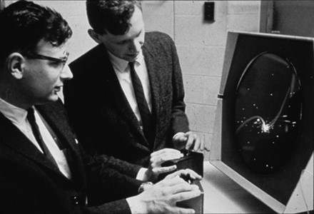

## Fun and late-night hacking
- Lowest priority thing to do!
- Less demand during the nights

## Technical challenges
- Starmap with 1000 real stars
- Generating instructions to draw rotated spaceship

## Information sharing culture
- Improvements to code encouraged!
- Practical hands-on knowledge

----------------------------------------------------------------------------------------------------
- template: largeicons

# Interactive computers

* *fa-pen* **Whirlwind computer for SAGE** (1951)  
  Cathode-ray-tube (CRT) screen and light pen input

* *fa-toggle-off* **Transistorized experimental computer (TX-0)**  
  Interactive use, toggle switch storage, core memory

* *fa-memory* **Transistorized experimental computer (TX-2)**  
  64k of 36bit word memory, graphics and light pen

* *fa-computer* **LINC "personal computer"** (1962)  
  Real-time processing, medical applications

****************************************************************************************************
- template: subtitle

# Interactive programming
## TX-0 and PDP-1 computers

----------------------------------------------------------------------------------------------------
- template: image
- class: smaller nologo

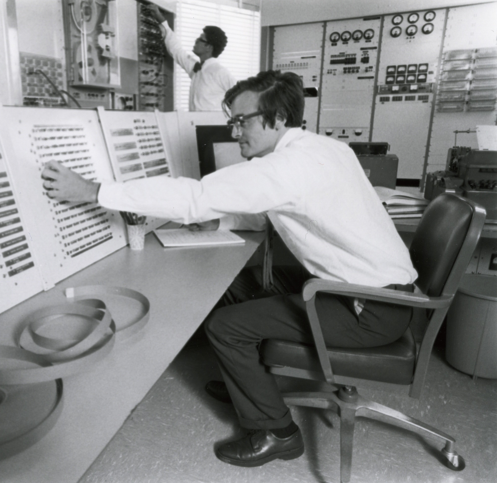

# On-line debugging

"For the past few years it has been regarded as a great professional sin, but like most sins, it still exists, is rarely talked about, and hardly ever admitted."

---

**Technical innovations**

- Toggle switch storage
- Flexowriter terminal
- CRT screen

----------------------------------------------------------------------------------------------------
- template: lists

# TX-0 Direct Input

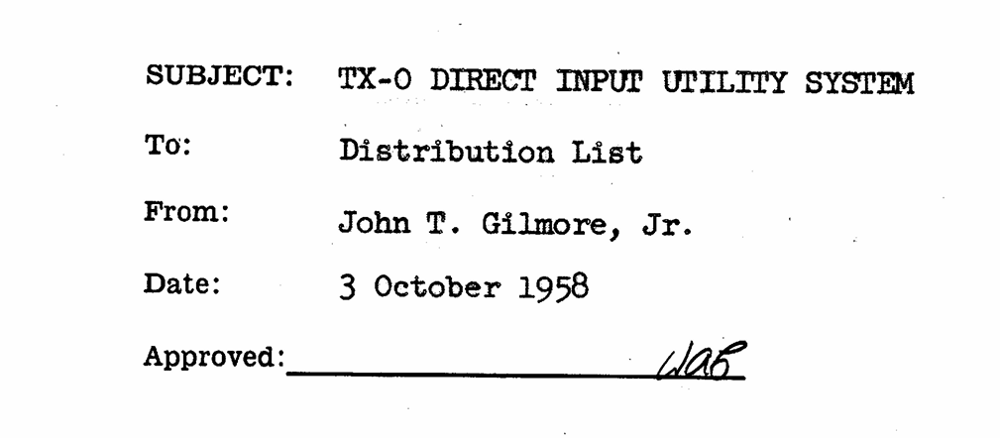

## Utility Tape 3 (UT-3)
- Accept commands from Flexotype
- Modify memory through switch storage
- Search memory, edit, run, print diff

## TX-0 Direct Input Utility System
- Try "some new programming techniques"
- Conversion of symbolic in-memory program
- Provide "immediate information" to help find errors

----------------------------------------------------------------------------------------------------
- template: largeicons

# Interactive programming
## TX-0 Direct Input Utility System features

- *fa-ear-listen* **Hark** - modify in-memory instruction and dump diff
- *fa-search* **Find** - search memory for a value (20 seconds)
- *fa-user-secret* **Outlaw** - how did control get to a given point
- *fa-diagram-project* **Flow Chart Display** - visually trace program execution

----------------------------------------------------------------------------------------------------
- template: image

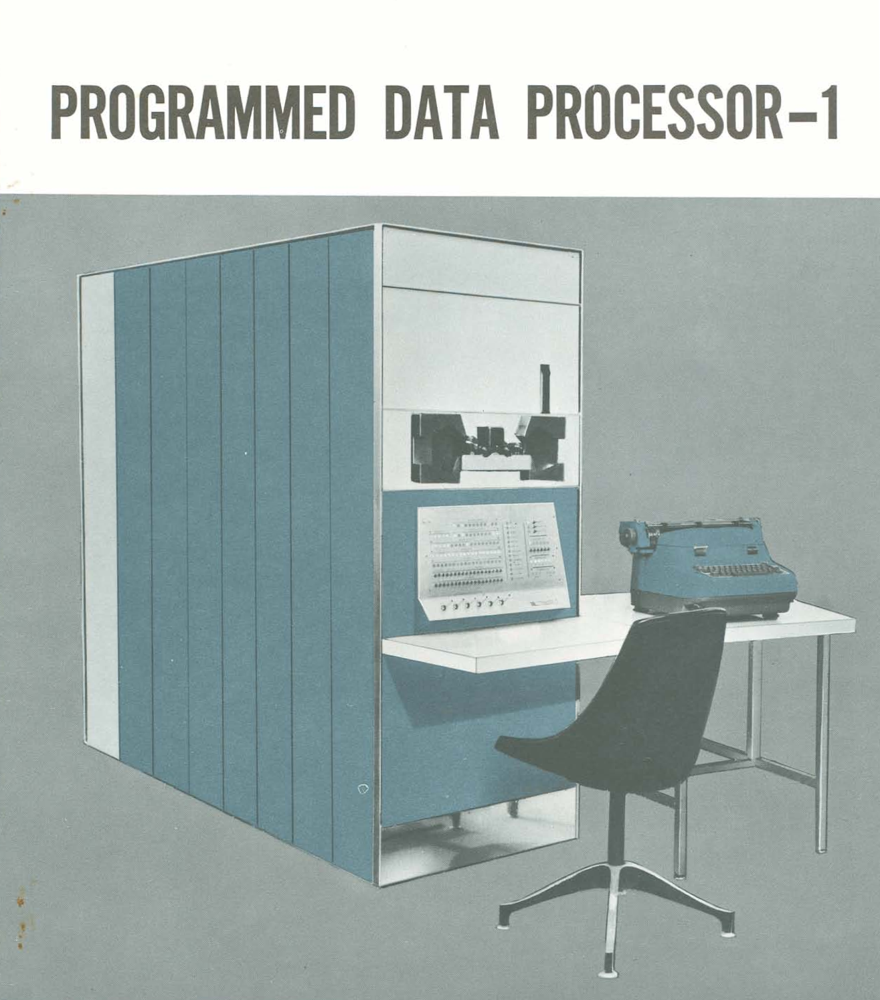

# Costs of direct use

**PDP-1 costs $120,000 in 1960 (~1.2M now)**

Interactive use too expensive in practice!

---

**Reflected by nicknames**

- Expensive Synthesiser
- Expensive Typewriter
- Expensive Planetarium

****************************************************************************************************
- template: subtitle

# Time-sharing
## Making interactive use practical

----------------------------------------------------------------------------------------------------
- template: icons

# Time-sharing
## A Time Sharing Operator Program

- *fa-network-wired* Let multiple users interact with a single machine
- *fa-keyboard* Most of the time spent thinking and typing!
- *fa-file-lines* Idea "seemed quite inevitable" (McCarthy)
- *fa-users* Thought "everybody had in mind to do" it

----------------------------------------------------------------------------------------------------
- template: image
- class: smaller

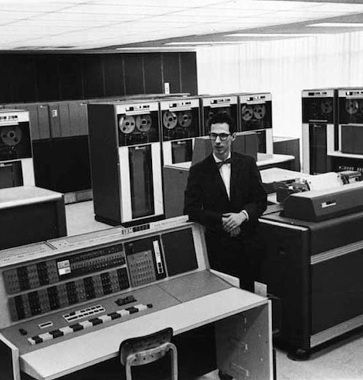

# Major undertaking, but eventually...

Compatible Time-Sharing System (CTSS), funded by Project MAC (ARPA)

---

**IBM 7094 (mid-1960s)**

- Over 100 terminals
- 30 concurrent user

----------------------------------------------------------------------------------------------------
- template: image
- class: smaller

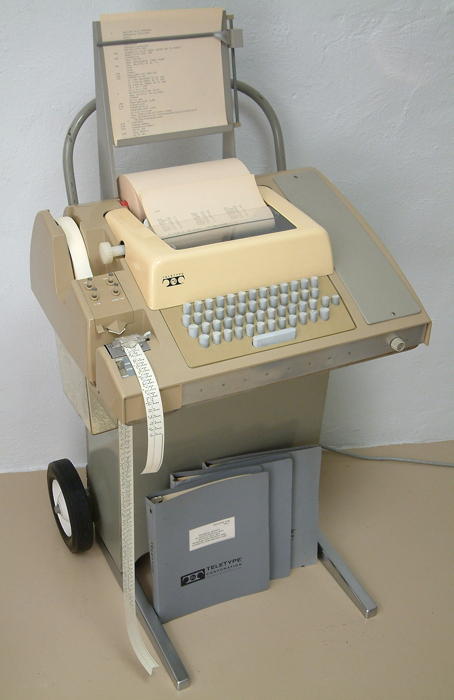

# Teletype terminal

Way more limited interaction than TX-0!

Slow line-based  
input and output

Initially no screen

**Different kind of pro&shy;gramming is needed...**

****************************************************************************************************
- template: subtitle

# Lisp
## As a language for hackers

----------------------------------------------------------------------------------------------------
- template: icons
- class: nologo

# History of Lisp
## Correcting misconceptions

- *fa-not-equal* **Lisp is the first functional language**  
  Started as FORTRAN library & is imperative!
- *fa-robot* **Lisp was based on the lambda calculus**  
  Motivated by needs of symbolic AI
- *fa-code* **Code as data motivates S-expressions**   
  First versions had more ordinary M-expressions

----------------------------------------------------------------------------------------------------
- template: content
- style: h1 { font-size:32pt; } img { max-width:560px; }

# An Algebraic Language for the Manipulation of Symbolic Expressions (McCarthy, 1958)

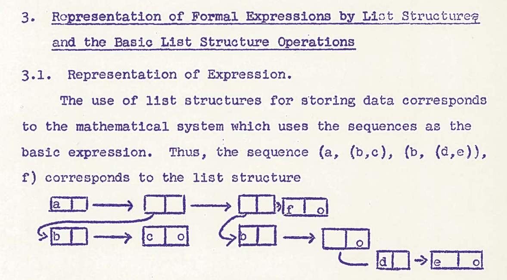

Code as data becomes an appealing feature for AI!  
Meta-programming (aka Recursive Self Improvement)

----------------------------------------------------------------------------------------------------
- template: image
- style: h1 { font-size:30pt; margin-bottom:10px; } ul { margin-bottom:50px;}

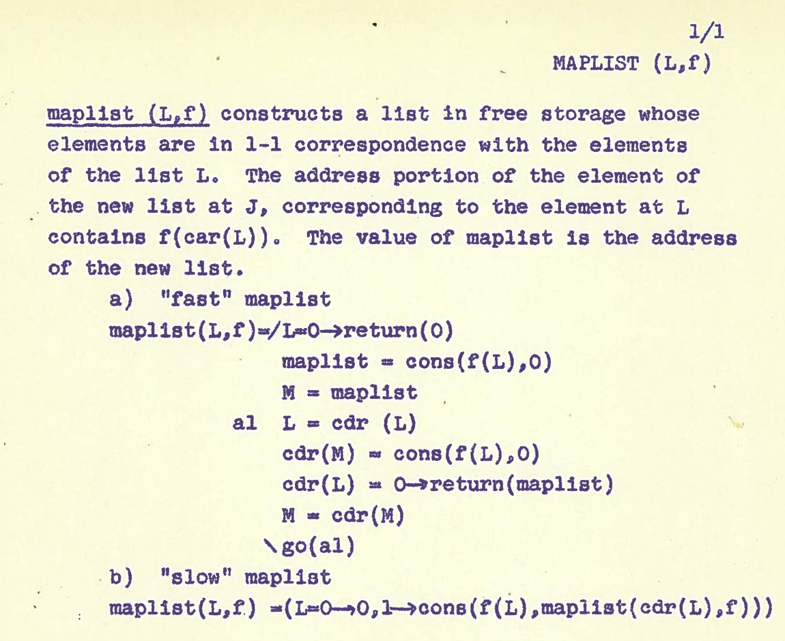

# LISP 1 (1959)

- List processing
- Imperative features
- High-level language

# LISP 1.5 (1961)

Programmer's Manual published in 1961

----------------------------------------------------------------------------------------------------
- template: icons

# Lisp hackers
## The birth of the eval function

- *fa-rocket* Implementation by Steve "Slug" Russell
- *fa-note-sticky* Function `eval` written as mathematical model
- *fa-cog* Russell points out this is an interpreter
- *fa-arrow-rotate-right* Lisp becomes "meta-circular" by accident!

----------------------------------------------------------------------------------------------------
- template: lists

# Towards interactive Lisp

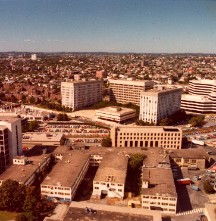

## Non-interactive Lisp
- Prefix program with 11 cards from "Utility Desk" drawer (room 26-265)

## Testing time-sharing on IBM 704
- Evaluates entered expression
- "TEN-Mode" to make entry easier

## Interactive Lisp for PDP-1
- L Peter Deutsch at BBN
- Needs mechanism for rapid program editing!

----------------------------------------------------------------------------------------------------
- template: code
- style: .hljs-name { color:white; } .hljs-number { color:white; } pre { max-width:440px; }

```lisp
(LAMBDA (X) Y
  (COND ((NULL X) Y)
  (T (CONS (CAR X)
    (APPEND (CDR X) Y)))))

*P
   (LAMBDA (X) Y (COND & &)).
*2 P
   (X)
*(3)
*(2 (X Y))
*P
   (LAMBDA (X Y) (COND & &)).
```

# Interactive Lisp editor (1963)

**Fixing wrong argument list `(X) Y` to `(X Y)`**

`P` to print outline  
`2 P` to focus and print  
`(3)` to delete third item  
`(2 (..))` to replace

****************************************************************************************************
- template: largeicons

# Interactive programming at MIT

- *fa-hand* **Hacker culture dominant**  
  Direct access to computers, liberal policies
- *fa-clipboard* **Mostly documented in informal memos**  
  Disregard for conventional academic values
- *fa-user-tie* **Contrast to traditional business use**  
  Using computer interactively is a waste of money!
- *fa-plug* **Enabled by new computer interfaces**  
  Direct use of TX-0 and time-sharing teletype


****************************************************************************************************
- template: subtitle

# Cultures of Programming
## [<i class="fa fa-house"></i> Home](/) &nbsp;&nbsp;  [<i class="fa fa-arrow-right"></i>Continue to Part 7](07-visions.html)
