- title: Cultures of Programming - Part 7 - Visions for the future of computing

****************************************************************************************************
- template: title
- class: blue
- background-image: img/part7/memex-blue.jpg

# Visions for the future of computing
## Cultures of Programming &mdash; Part 7

---

**Tomas Petricek**, Charles University, Prague  

_<i class="fa fa-envelope"></i>_ [tomas@tomasp.net](mailto:tomas@tomasp.net)  
_<i class="fa fa-globe"></i>_ [https://tomasp.net](https://tomasp.net)  
_<i class="fa-brands fa-bluesky"></i>_ [@tomasp.net](https://bsky.app/profile/tomasp.net)    

****************************************************************************************************
- template: subtitle

# Humanistic essays
## Imagining the future of computing

----------------------------------------------------------------------------------------------------
- template: image
- style: .body1 { width:400px; }

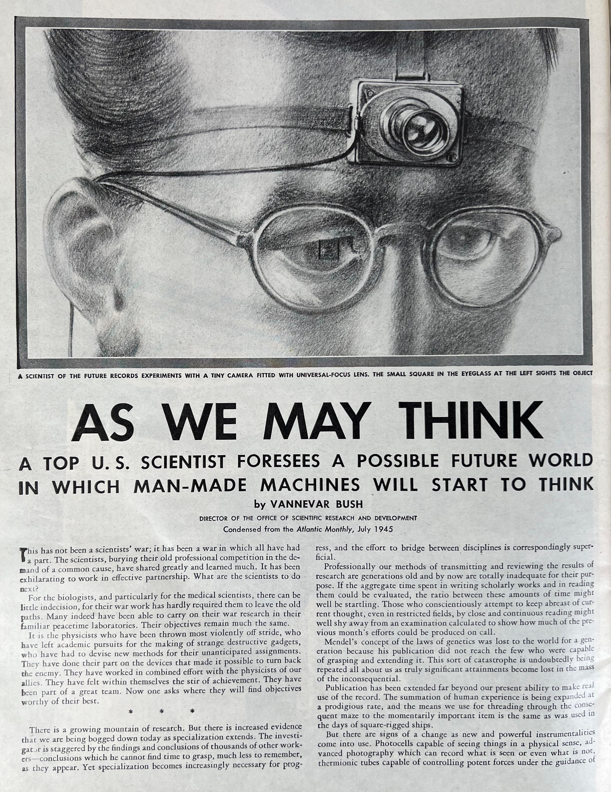

# As we may think (1945)

"Consider a future device ... in which an individual stores all his books .. and communications, and which is mechanized so that it may be consulted with exceeding speed and flexibility. It is an enlarged intimate supplement to his memory."

----------------------------------------------------------------------------------------------------
- template: lists

# Vannevar Bush

## Background
- Electrical Engineering at MIT (1919)
- Analog differential analyzer
- Inventor, science administrator

## Library problem
- Modern scientific enterprise
- Need to "plough through hundreds of materials"
- Analog vision, based on microfiche

----------------------------------------------------------------------------------------------------
- template: image
- class: smaller

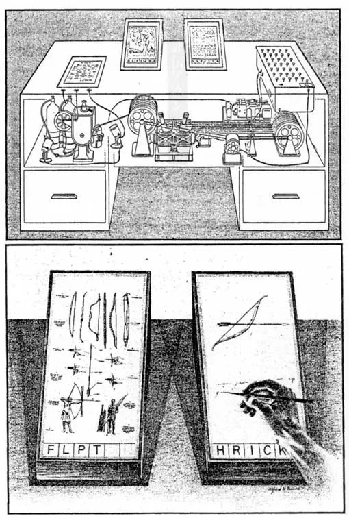

# Bush's Memex system

Electromechanical device for information management

**Associative trails**  
Allows "linking" of files across human knowledge

**Personal annotations**  
Drawn on the desk, photographed and linked

----------------------------------------------------------------------------------------------------
- template: image
- style: .body1 { width:400px; } h1 { font-size:26pt; letter-spacing:-1px; } p { font-size:25pt; }

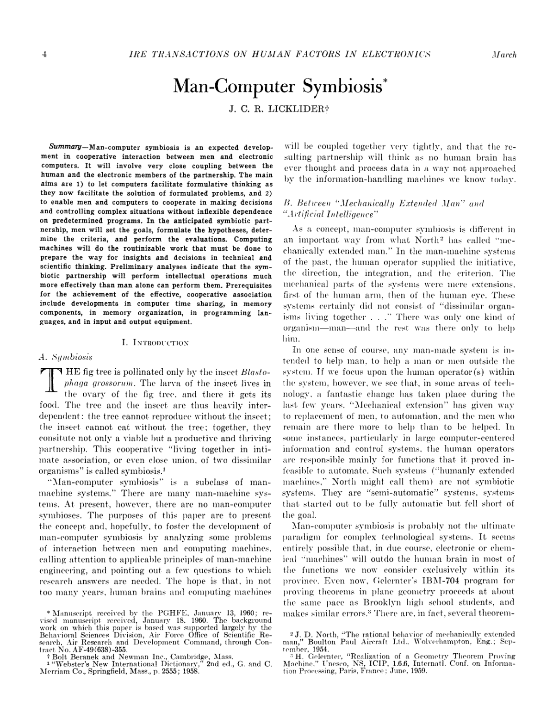

# Man-Computer Symbiosis (1960)

---

The hope is that, in not too many years, human brains and computing machines will be coupled together very tightly, and that the resulting partnership will think as no human brain has ever thought and process data in a way not approached by the information-handling machines we know today.

----------------------------------------------------------------------------------------------------
- template: lists

# J. C. R. Licklider

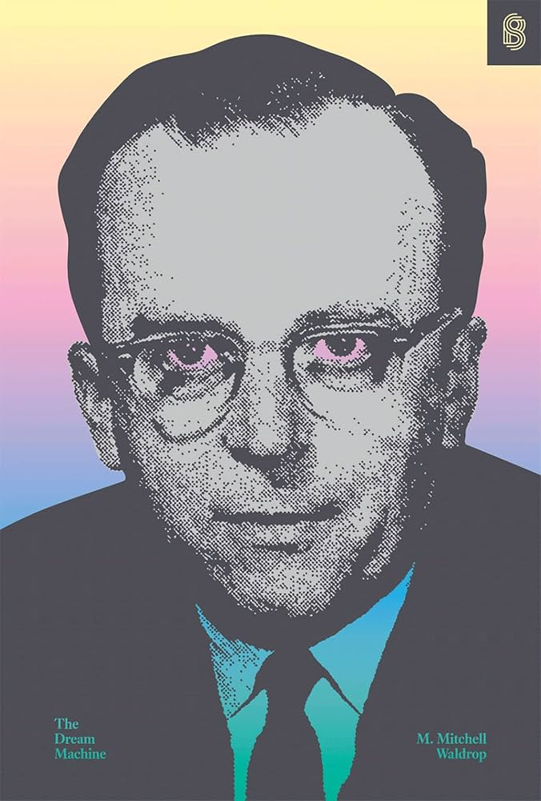

## Background

- PhD in psychoacoustics research
- Human factors of the SAGE system
- Moved from MIT to BBN

## Time-sharing systems

- Learned about the idea from  
  Christopher Strachey
- Prototyped BBN Time-Sharing System  
- Director at ARPA (1962, 1974)

----------------------------------------------------------------------------------------------------
- template: icons

# ARPA
## Information Processing Techniques Office

- *fa-jet-fighter* Command and control research for military
- *fa-keyboard* Time-sharing via Project MAC, CTSS & Multics
- *fa-network-wired* ARPANET, the predecessor of the Internet
- *fa-users-rectangle* Community behind NLS and Xerox PARC

----------------------------------------------------------------------------------------------------
- template: image

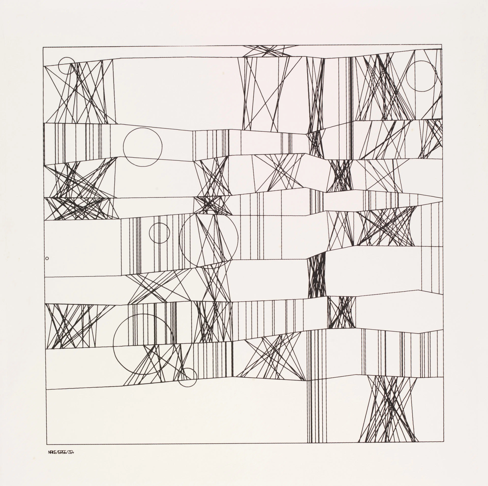

# Frieder Nake

---

**Computer art pioneer**

Two exhibitions  
in Stuttgart and  
New York in 1965

Noll's study with recon&shy;struction of Mondrian's "Composition with Lines"

----------------------------------------------------------------------------------------------------
- template: image
- style: .body1 { width:350px; } h1 { font-size:25pt; letter-spacing:-1.2px; } p { font-size:25pt; }

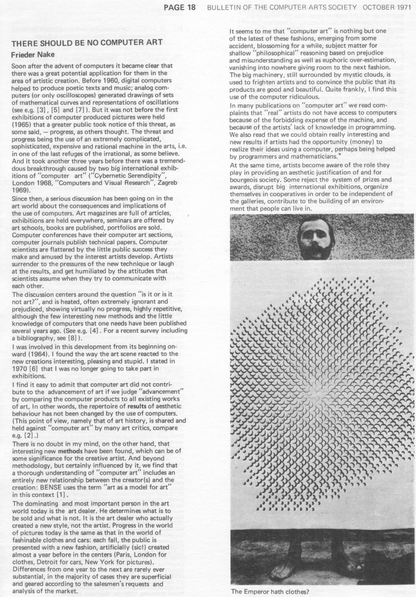

# There should be no computer art (1971)

"It seems to me that computer art is nothing but one of the latest fashions"

"Computers ought not to be used for the creation of another art fashion."

---

<strong>"Computers can and should be used in art in order to draw attention to new circumstances and connections and to forget art."</strong>

----------------------------------------------------------------------------------------------------
- template: icons

# Future of computing
## Humanistic perspectives

- *fa-earth-americas* What could computing do in the future?
- *fa-children* Human at the centre of these visions!
- *fa-brain* Empowering human to achieve more
- *fa-image* Critical of the current practice

****************************************************************************************************
- template: subtitle

# Programming
## Man-machine symbiosis

----------------------------------------------------------------------------------------------------
- template: image

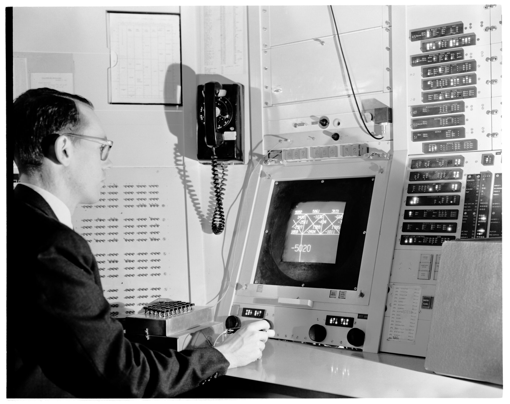

# Ivan Sutherland's Sketchapd (1963)

Predecessor of CAD systems for TX-2 with custom HW tweaks

- Light pen input
- Prototype-based abstraction model
- Visual constraints

----------------------------------------------------------------------------------------------------
- template: content

<iframe width="840" height="472" src="https://www.youtube.com/embed/6orsmFndx_o?si=yisLyHjg060JvcS-&amp;start=518" title="YouTube video player" frameborder="0" allow="accelerometer; autoplay; clipboard-write; encrypted-media; gyroscope; picture-in-picture; web-share" referrerpolicy="strict-origin-when-cross-origin" allowfullscreen></iframe>

----------------------------------------------------------------------------------------------------
- template: lists

# Ivan and Bert Sutherland

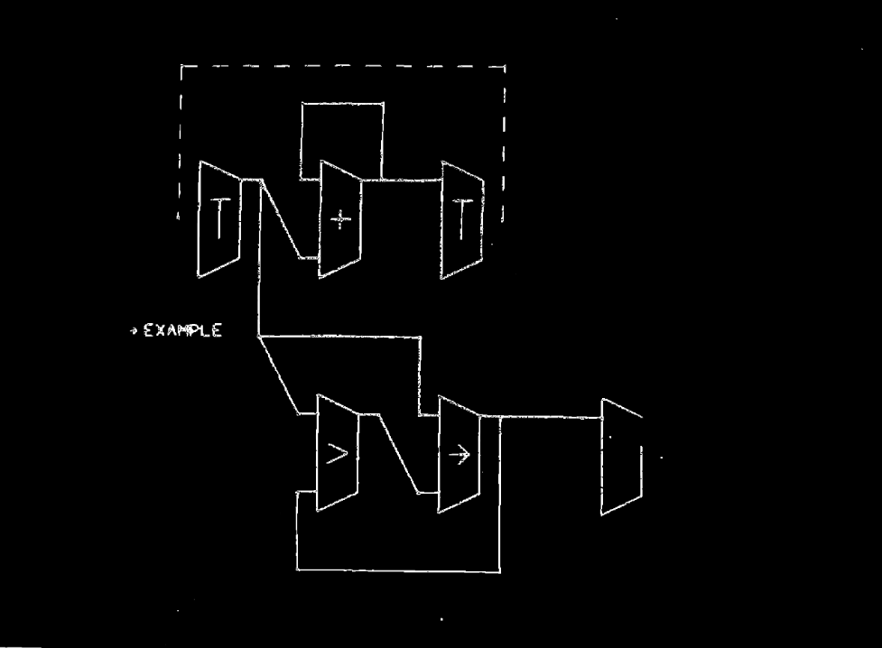

## Sketchpad project (1963)
- "Communication system" in a subtitle
- Sketching, drawing, modelling
- Most expensive computer at the time

## Follow up project (1966)
- Online graphical specification of computer procedures
- Programming using (then ubiquitous) flow-charts
- Inspired later tablet-based GRAIL system

----------------------------------------------------------------------------------------------------
- template: image
- class: smaller

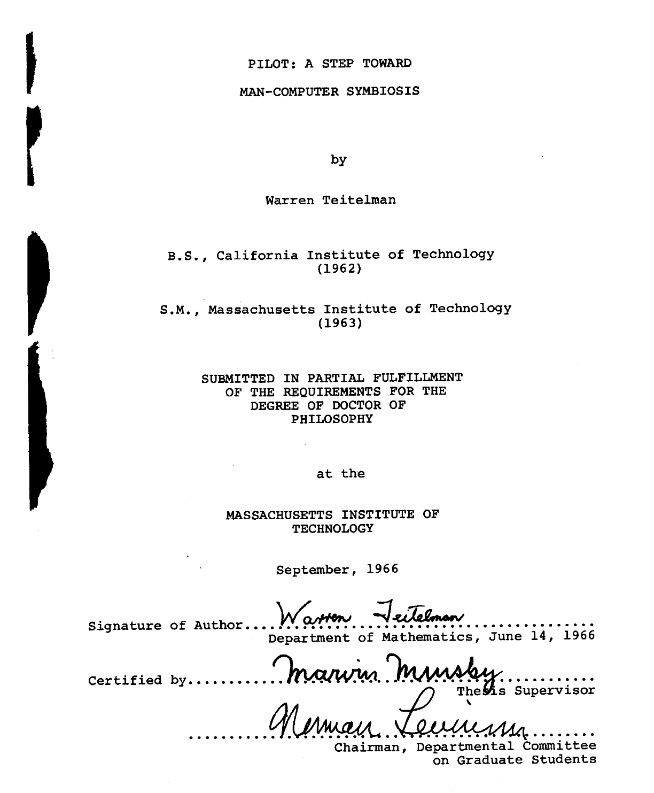

# A Step Toward Man-Computer Symbiosis

Warren Teitelman (1966)

**Sources of inspiration**

- Interactive LISP editor
- Man-Computer Symbiosis
- Experimenting with running program in AI context

----------------------------------------------------------------------------------------------------
- template: lists
- class: bigger

# Lisp programming systems

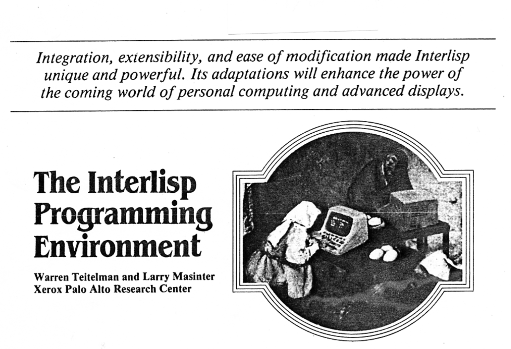

## PILOT
- List transformation language FLIP
- Advising to modify procedures
- Lisp as a programming system

## DWIM
- Auto-correction system for Interlisp
- Parenthesisation and typos fixed interactively at runtime
- "Damn Warren's Infernal Machine"

----------------------------------------------------------------------------------------------------
- template: image

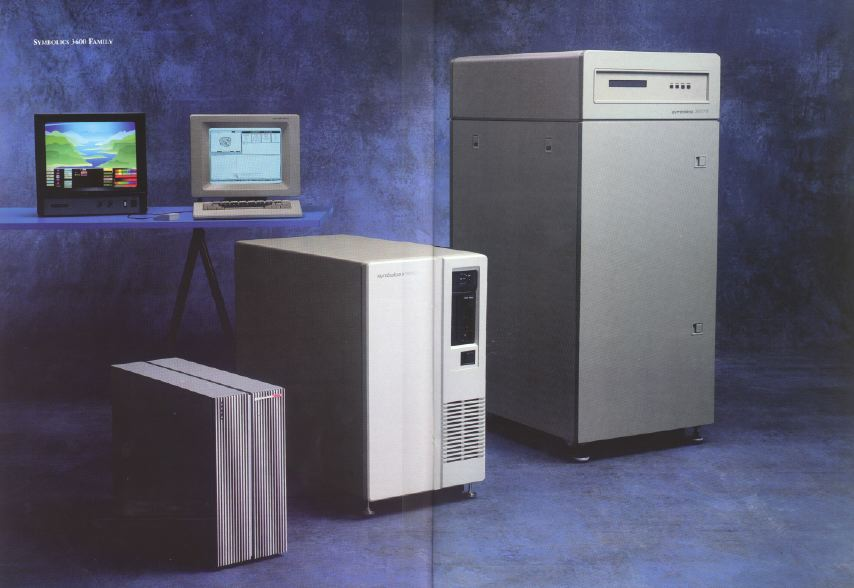

# Lisp machines

Lisp as the operating system with interactive programming support

---

**Accidental motivation**  
PDP-10 used 36-bit words, subsequent computers had less

****************************************************************************************************
- template: subtitle

# Programming
## Thinking about thinking

----------------------------------------------------------------------------------------------------
- template: image
- style: .body1 { width:350px; }

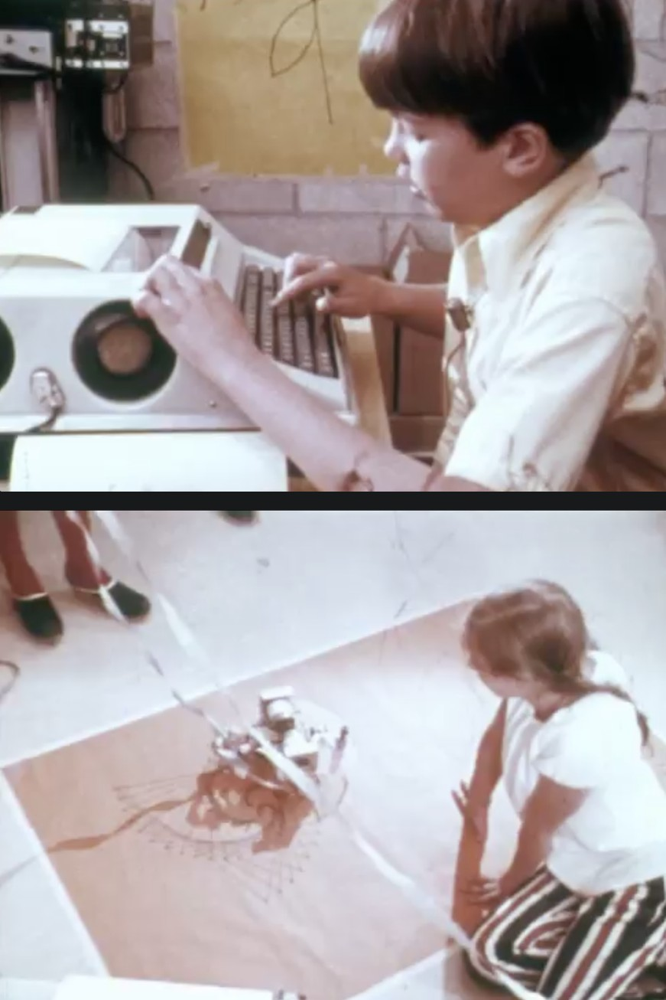

# Logo environment (1967)

"The computer can be a mathe&shy;matics-speaking and analphabetic-speaking entity.
We are learning how to make computers with which children love to communicate.
When this communication occurs, children learn mathematics as a living language."

**Piaget's theory of active learning**

----------------------------------------------------------------------------------------------------
- template: lists
- class: bigger

# MIT AI Lab

## Minsky and Papert

- Extraordinary learning   
  in the hacker community
- Education research at BBN
- Thinking in humans, thinking in machines

## LOGO research
- Teaching "powerful ideas" such as meta-language
- Microwords for linguistics and drawing (turtle)

----------------------------------------------------------------------------------------------------
- template: image

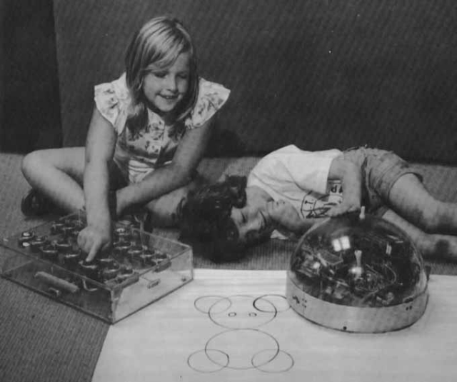

# "Revolutionary" educational ideas

Let children learn by working on their own

Button box to see how early can kids learn

----------------------------------------------------------------------------------------------------
- template: content

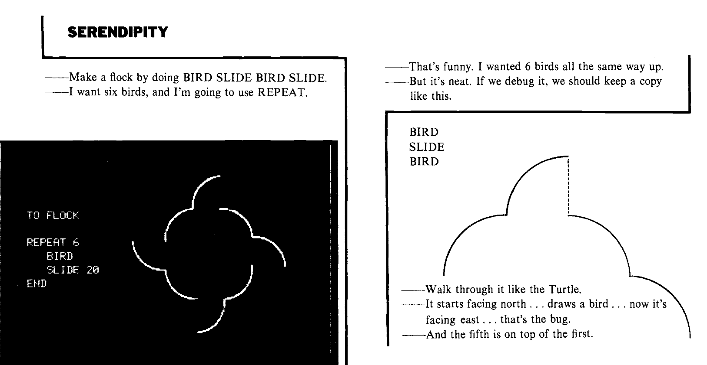

----------------------------------------------------------------------------------------------------
- template: content
- class: nologo

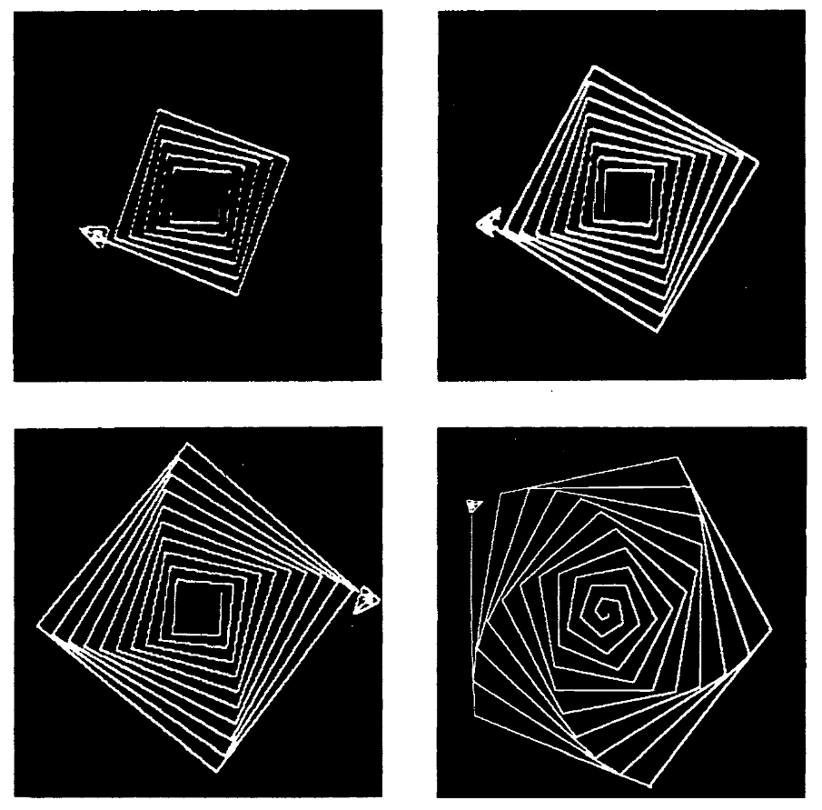

# Serendipity

Computer environment made up of people, things, ideas.
A way of thinking about computers and about learning
and about talking about what you were doing.

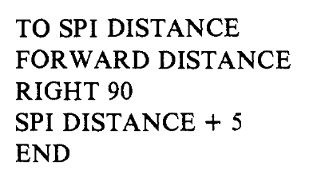

- Learning happens when  
  unexpected things happen
- Supportive environment
- Attention to wording

****************************************************************************************************
- template: largeicons

# Humanistic and hacker views

- *fa-hand* **Direct interaction with computer**  
  Supports human learning and understanding
- *fa-rotate-right* **Modifying programs live**  
  Rapid feedback, guides understanding
- *fa-money-bill-1* **At odds with managerial and engineering needs**  
  Too expensive, too easy to break
- *fa-computer-mouse* **Exploring novel interfaces**  
  Visual programming, leverage visual thinking

****************************************************************************************************
- template: content

Mother of All demos

****************************************************************************************************
- template: subtitle

# Cultures of Programming
## [<i class="fa fa-house"></i> Home](/) &nbsp;&nbsp;  [<i class="fa fa-arrow-right"></i>Continue to Part 8](08-xx.html)
