- title: Cultures of Programming - Part 8 - Personal interactive programming

****************************************************************************************************
- template: title
- class: blue
- background-image: img/part8/trinity-blue.jpg

# Personal interactive programming
## Cultures of Programming &mdash; Part 8

---

**Tomas Petricek**, Charles University, Prague  

_<i class="fa fa-envelope"></i>_ [tomas@tomasp.net](mailto:tomas@tomasp.net)  
_<i class="fa fa-globe"></i>_ [https://tomasp.net](https://tomasp.net)  
_<i class="fa-brands fa-bluesky"></i>_ [@tomasp.net](https://bsky.app/profile/tomasp.net)    

****************************************************************************************************
- template: subtitle

# Xerox
## Personal Dynamic Media

----------------------------------------------------------------------------------------------------
- template: lists
- class: bigger
- style: h1 { font-size:38pt; }

# Personal computer for children of all ages

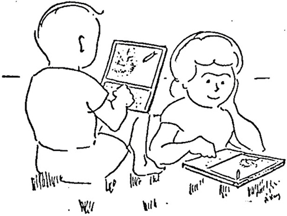

## Alan Kay
- Member of the ARPA community
- Cites many humanistic influences
- Dynabook project at Xerox PARC

## Humanistic vision
- Using a computer also means programming
- Looks like iPad but that's not it...
- Smalltalk as the medium for it

----------------------------------------------------------------------------------------------------
- template: image
- class: smaller2x

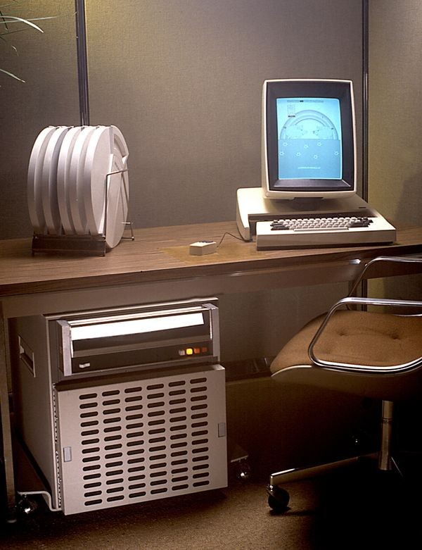

# Xerox Alto

(aka Interim Dynabook)

Xerox blocked proposal  
to buy PDP-10 for PARC

---

**We'll build our own**

Kay's vision meets Butler Lampson and Charles Thacker

Microcoded architecture  
No central processing unit

----------------------------------------------------------------------------------------------------
- template: lists

# Personal Dynamic Media

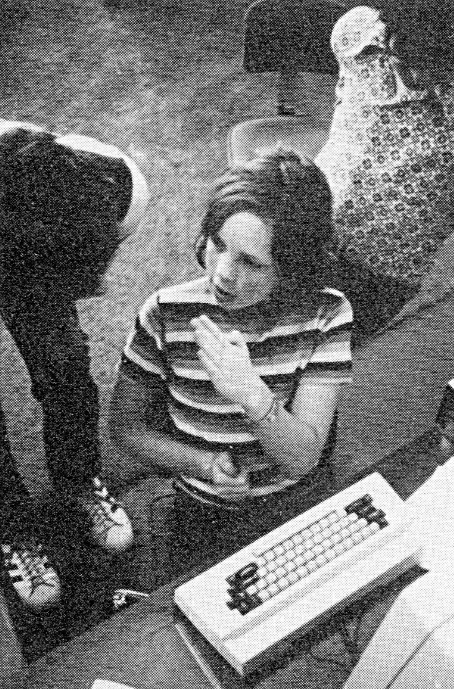

## Kay and Goldberg (1977)
- Kids use water colors, color TV, etc.
- "Medium is the message"
- Smalltalk as mode of interaction
- Adaptable meta-medium

## Meta-medium for communication
- Simulation system for a decision theorists
- Electronic circuit designer for a student
- Drawing & animation system for a child

----------------------------------------------------------------------------------------------------
- template: image
- class: smaller

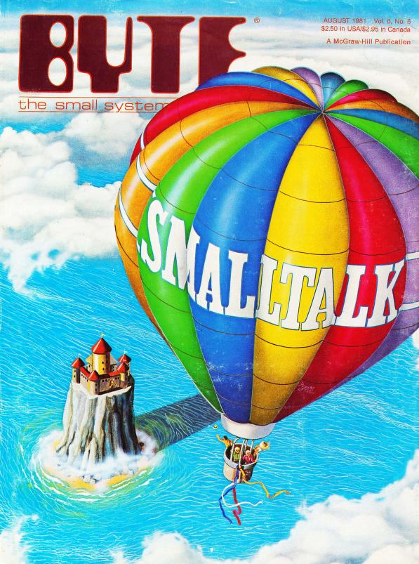

# BYTE (1981)

Releasing Smalltalk  
to the wider public

**Conceptual shift**

- Smalltalk design principles
- Object-oriented system
- Progress from end user  
  to system developer

----------------------------------------------------------------------------------------------------
- template: lists

# Let's burn our disk packs...

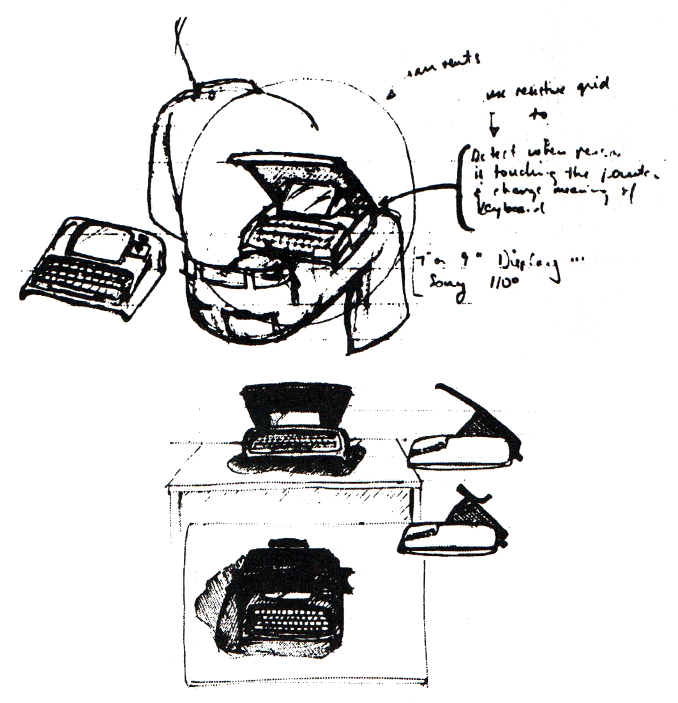

## Group meeting in 1976
- "Dynabook for children" losing
- No organism can live in its own waste
- Vision needs a fresh start!

## Two eras of Smalltalk
- Humanistic culture prior to 1976
- Engineering and hacker post 1976
- Kay continues working on Note Taker

****************************************************************************************************
- template: subtitle

# Xerox
## Research and business

----------------------------------------------------------------------------------------------------
- template: image
- class: smaller

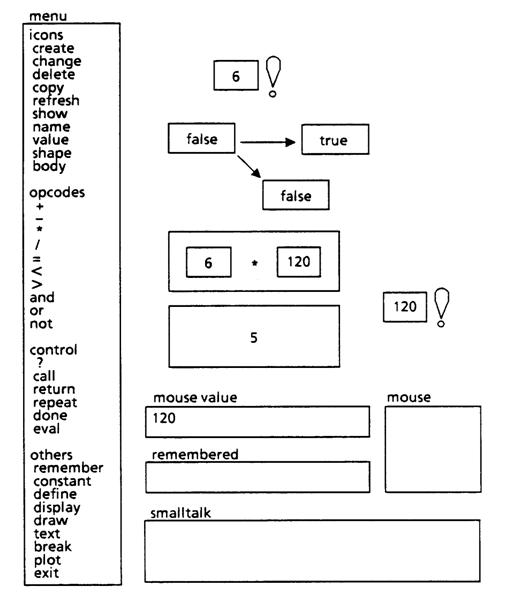

# Pygmalion

(David C. Smith, 1975)

Largest Smalltalk-72 program ever written

**Pioneered icons and programming by demonstration**

Thesis with humanistic links  
Art theory, cognitive science

----------------------------------------------------------------------------------------------------
- template: lists
- class: bigger

# Self programming system (1987)

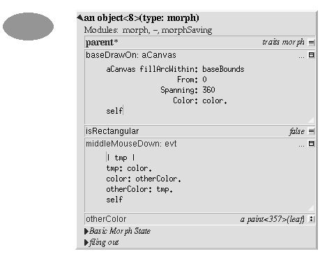

## Pure evolution of Smalltalk

- Simple prototype-based OO
- Unify fields and variables
- Objects exist in space

## Legacy of Self

- Mostly engineering results!
- Optimizing virtual machine
- Ideas adopted by V8 (in Chrome)

----------------------------------------------------------------------------------------------------
- template: image
- class: smaller nologo

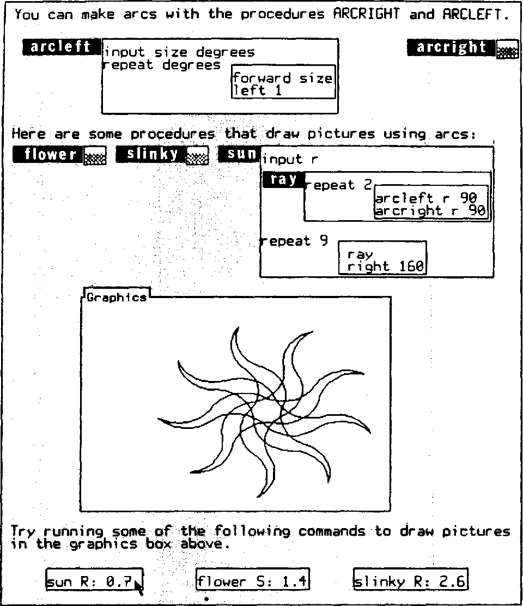

# Boxer (diSessa, 1985)

Integrated computational environment
for naive and inexperienced users

Interactive physics textbooks

**Two design principles**

- Spatial metaphor
- Naive realism

Educational humanistic focus

----------------------------------------------------------------------------------------------------
- template: image
- class: smaller2x

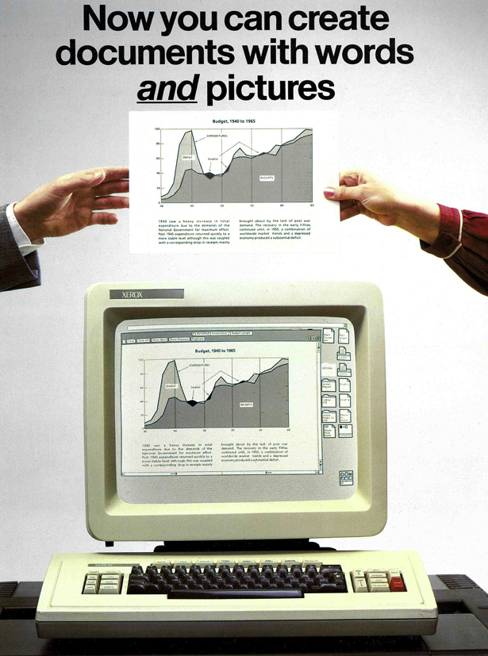

# Xerox Star

Commercialising Xerox PARC "office of the future" vision

- Graphical interface of Smalltalk
- Icons of Pygmalion
- Documents rather than apps!

---

**Commercial failure**  
Too expensive and too late?

****************************************************************************************************
- template: subtitle

# Microcomputers
## Programming for everyone

----------------------------------------------------------------------------------------------------
- template: image

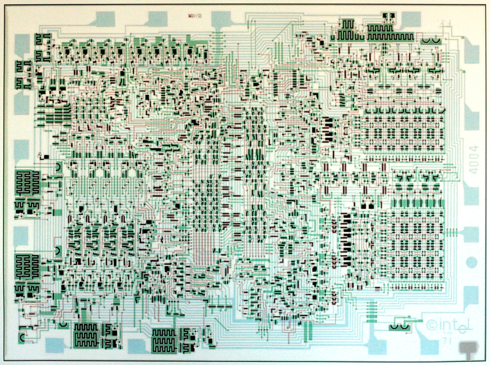

# Intel 4004 (1971)

First microprocessor
"computer on a chip"

"Calculator" compared with Xerox Alto!

Building a computer easier and cheaper

----------------------------------------------------------------------------------------------------
- template: lists
- class: nologo
- style: .body img { max-width:600px !important; max-height:480px !important; margin-top:-40px !important }

# Altair 8800

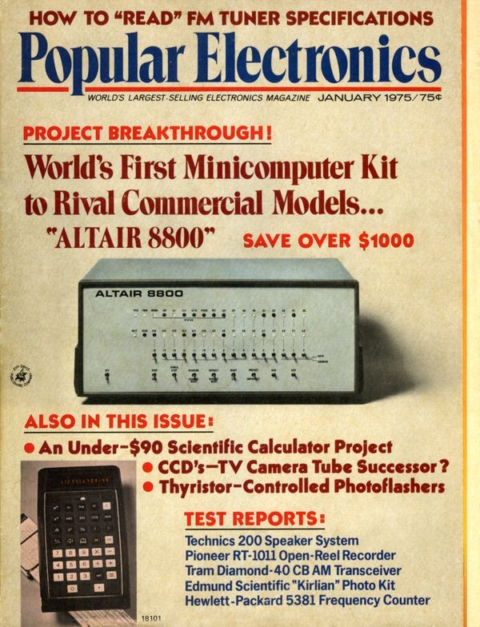

## Computer for tinkerers
- Kit with 8-bit Intel 8008 CPU
- Available for $397 (~2k now)

## Altair capabilities
- More like TX-0 than Alto!
- Switches to set memory values
- Extensible architecture for more!
- Affordable enough for fun

----------------------------------------------------------------------------------------------------
- template: image
- style: .body1 img { margin-top:30px; }

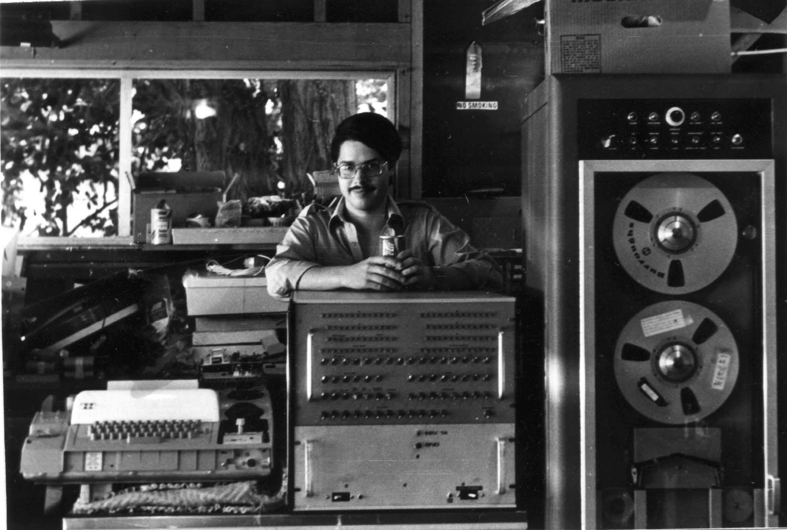

# Homebrew Computer Club
(Menlo Park, 1975)

Do it yourself culture
Kids with toys to Xerox

**Hacker culture without direct links to MIT**

Wozniak and Jobs found Apple Computers

----------------------------------------------------------------------------------------------------
- template: content
- style: h1 { font-size:38pt; margin:0px 0px 20px 0px; } .body img { max-width:870px; }

# Microcomputer "Trinity of 1977"

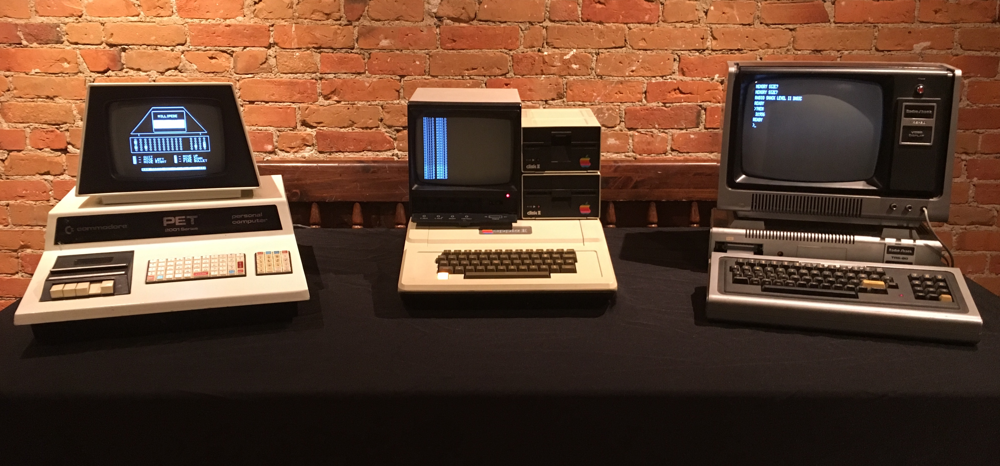

Make computers cheaply available to millions

****************************************************************************************************
- template: subtitle

# Homebrew
## The rise of BASIC

----------------------------------------------------------------------------------------------------
- template: lists
- class: bigger2x
- style: h1 { font-size:34pt; letter-spacing:-1px; }

# Beginner's All-purpose Symbolic Instruction Code

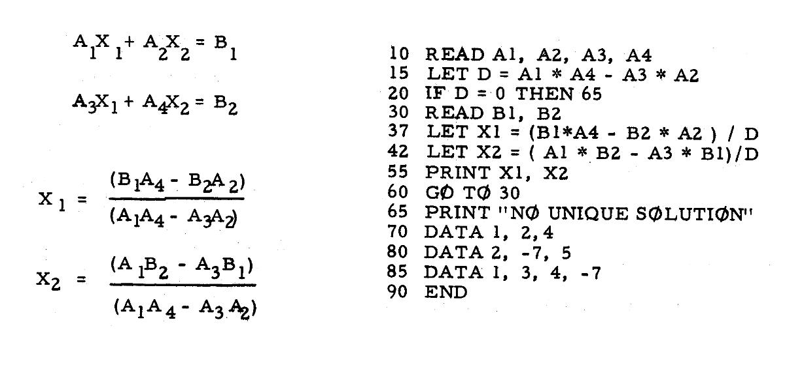

## Dartmouth time-sharing
- Every student should use it!
- Writing numerical programs
- Easier to use than FORTRAN

## BASIC on microcomputers
- Micro-Soft BASIC for Altair 8800
- Later `PEEK`, `POKE` and `SYS` makes it more powerful
- More than a language...

----------------------------------------------------------------------------------------------------
- template: lists

# BASIC as a language

## Dijkstra (1975)

It is practically impossible to teach good programming to students that have
had a prior exposure to BASIC: as potential programmers they are mentally
mutilated beyond hope of regeneration.

## Basic as a programming system

- Great fit for machines it ran on
- Enabled active learning culture

----------------------------------------------------------------------------------------------------
- template: image

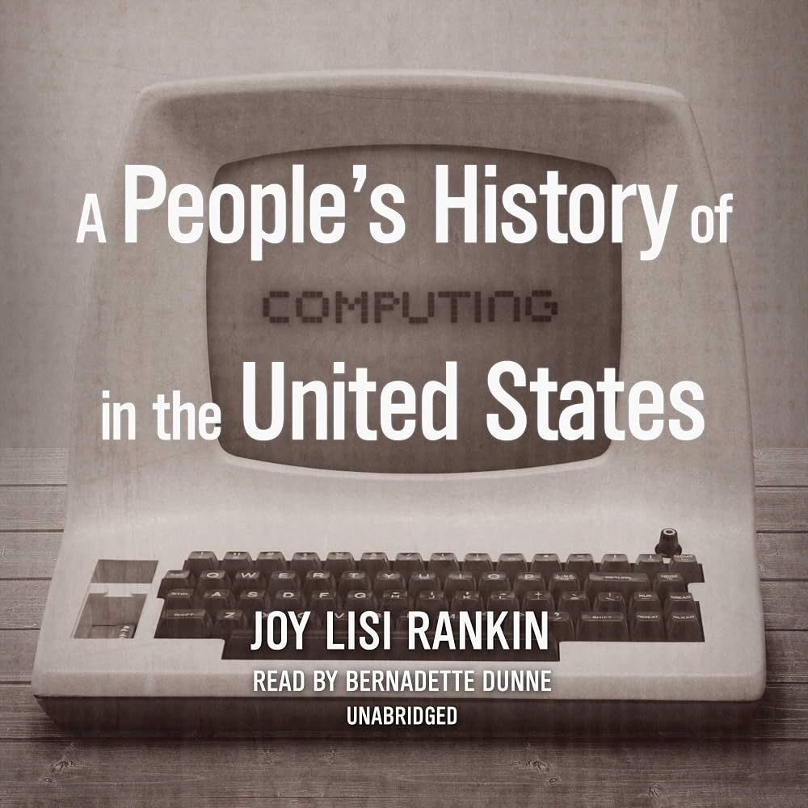

# Timesharing BASIC

New Hampshire, Minnesota & Illinois

Dispersed diverse communities around education & games

**Humanistic culture distinct from the Silicon Valley hackers**

----------------------------------------------------------------------------------------------------
- template: content
- style: img { margin-left:30px; }

# Hobbyist computing magazines

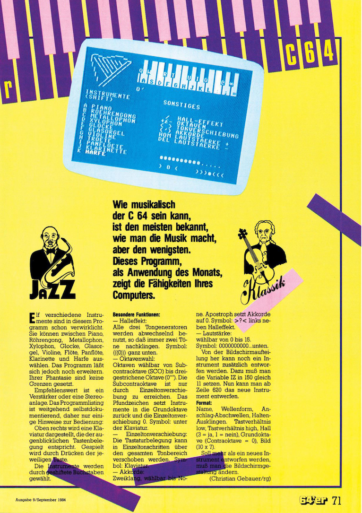
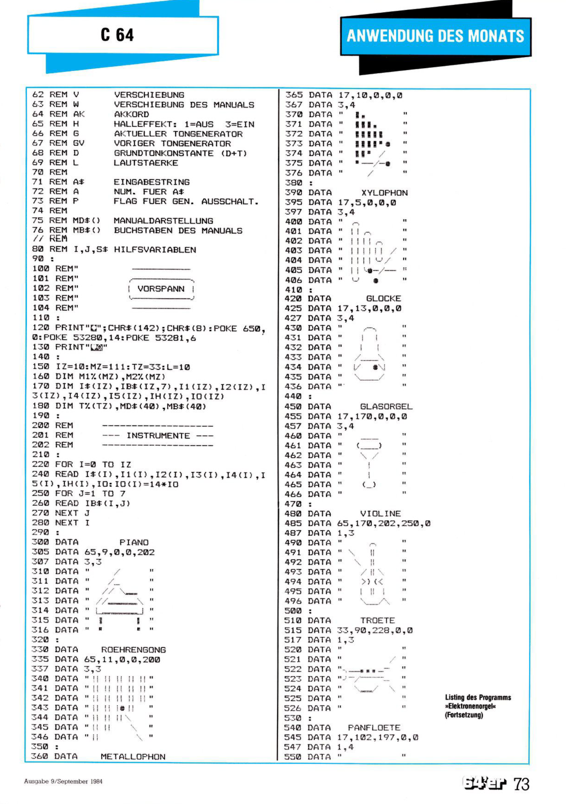

----------------------------------------------------------------------------------------------------
- template: icons

# Microcomputers
## Fulfilling the Dynabook dream

- *fa-terminal* Microcomputers boot into BASIC terminal
- *fa-gamepad* Engagement with code encourages curiosity
- *fa-memory* Simple language with escape hatches
- *fa-user-graduate* Progress from user to programmer

****************************************************************************************************
- template: subtitle

# Struggle
## Interactive programming

----------------------------------------------------------------------------------------------------
- template: image

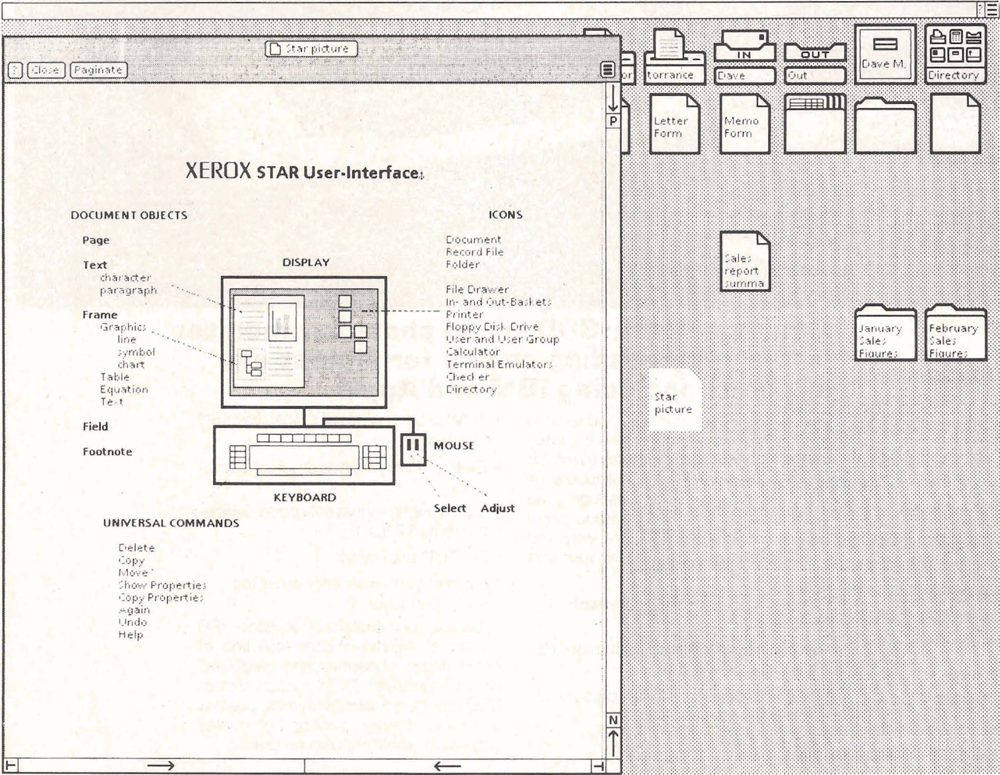

# Commercialization of Xerox research

Interactive programming not desirable for office applications

---

**Engineering and managerial culture**

Too fragile, protecting intellectual property

----------------------------------------------------------------------------------------------------
- template: image
- class: smaller

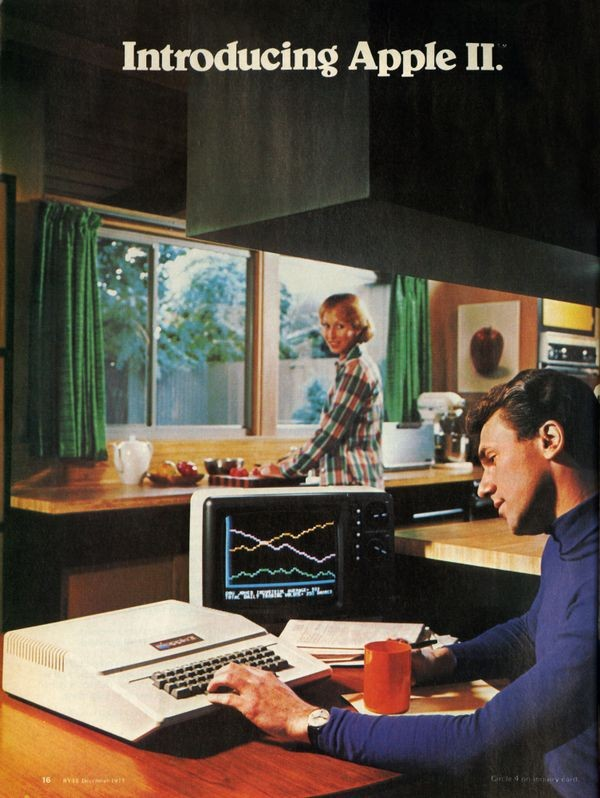

# Commercialization  of microcomputers

Apple II increasingly bought for running existing apps

**Called the VisiCalc machine by Wall Street traders**

VisiCalc and Hypercard still visionary, but more narrow

----------------------------------------------------------------------------------------------------
- template: subtitle

# Struggle
## Computer generated music

----------------------------------------------------------------------------------------------------
- template: content
- style: .body img { height:380px; max-height:380px !important; } h1 { font-size:36pt; margin:0px 0px 20px 0px; }

# The League of Automatic Music Composers

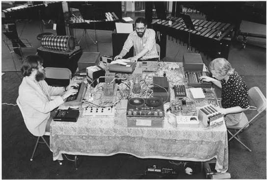
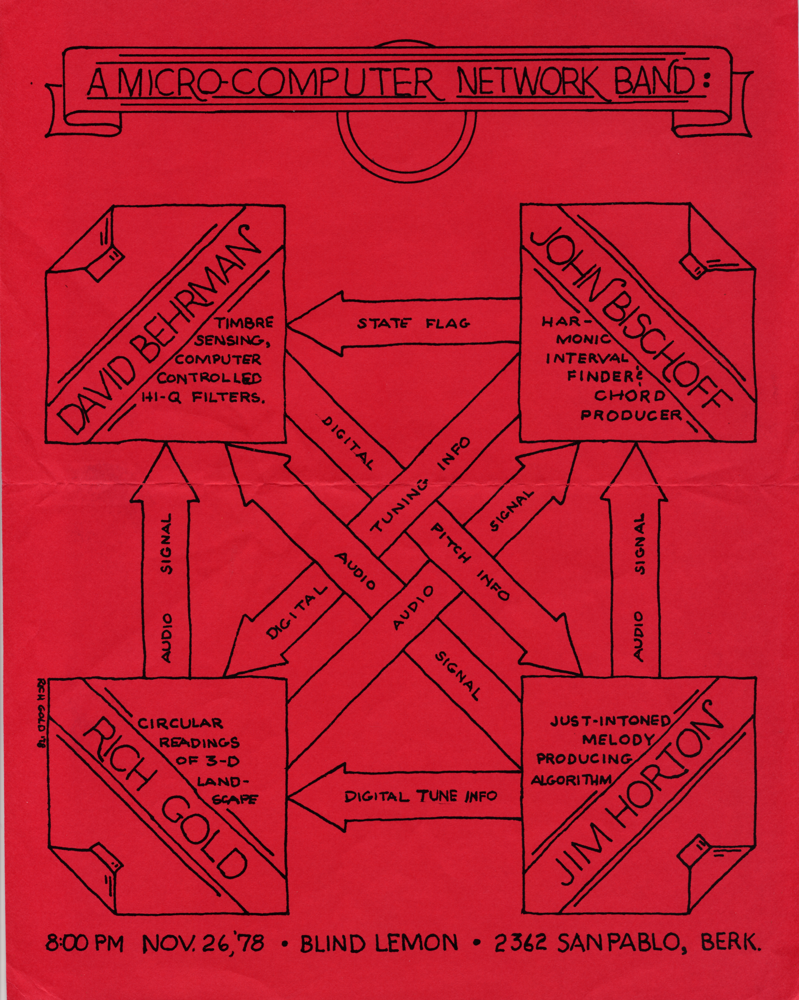

**Using KIM-1 microcomputer (1978)**  
Network of microcomputers to synthesize music  
Composition through unexpected interactions

----------------------------------------------------------------------------------------------------
- template: content

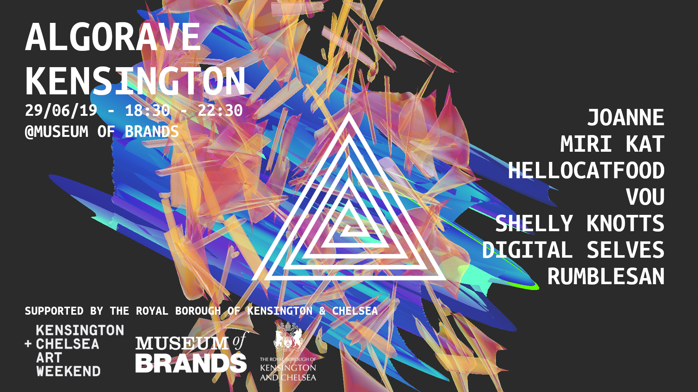

**Live coding - TOPLAP manifesto (2004)**   
"Obscurantism is dangerous. Show us your screens"

****************************************************************************************************
- template: largeicons

# Interactive programming

- *fa-floppy-disk* **Innovation linked to new technologies**  
  Interactive way of programming appears first
- *fa-desktop* **Humanistic and hacker reasons**   
  Empowerment for education and technical reasons
- *fa-brands fa-black-tie* **Engineers and managers kill it?**  
  Intellectual property, reliability, predictability
- *fa-lightbulb* **Reinvented across many disciplines**  
  From TX-0 to microcomputers and live coding

****************************************************************************************************
- template: subtitle

# Cultures of Programming
## [<i class="fa fa-house"></i> Home](/) &nbsp;&nbsp;  [<i class="fa fa-arrow-right"></i>Continue to Part 9](09-debugging.html)
