- title: Cultures of Programming - Part 9 - Early days of debugging and testing

****************************************************************************************************
- template: title
- class: blue
- background-image: img/part9/eniac-women-blue.jpg

# Early days of debugging and testing
## Cultures of Programming &mdash; Part 9

---

**Tomas Petricek**, Charles University, Prague  

_<i class="fa fa-envelope"></i>_ [tomas@tomasp.net](mailto:tomas@tomasp.net)  
_<i class="fa fa-globe"></i>_ [https://tomasp.net](https://tomasp.net)  
_<i class="fa-brands fa-bluesky"></i>_ [@tomasp.net](https://bsky.app/profile/tomasp.net)    

----------------------------------------------------------------------------------------------------
- template: image
- class: smaller2x

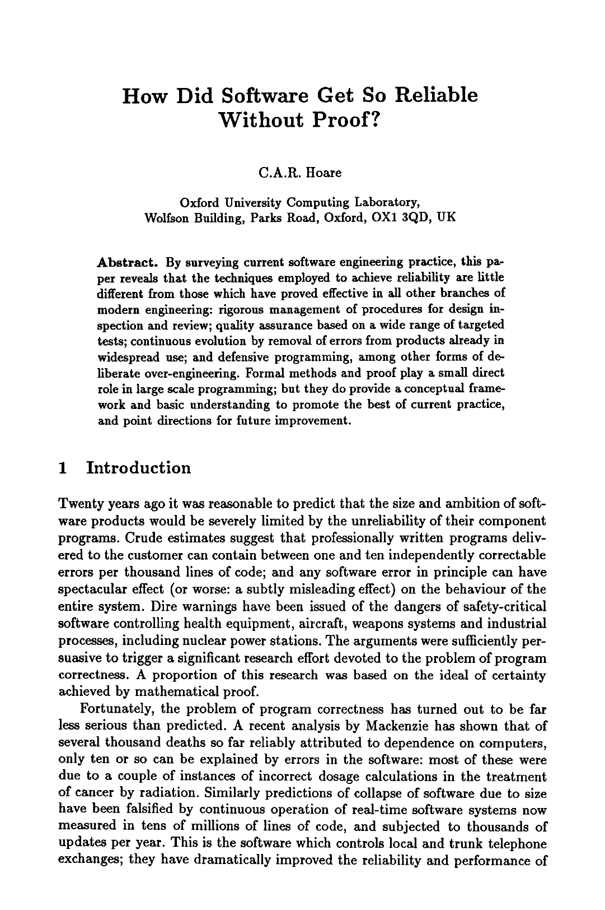

# Hoare's question

"Of several thousand deaths reliably attributed to computers,
only ten or so can be explained by errors in the software."

---

**Engineers seem to manage!**

- Good management practices
- Testing and debugging
- Programming methodology
- Over-engineering

****************************************************************************************************
- template: subtitle

# Debugging
## Early digital computers

----------------------------------------------------------------------------------------------------
- template: image
- class: smaller

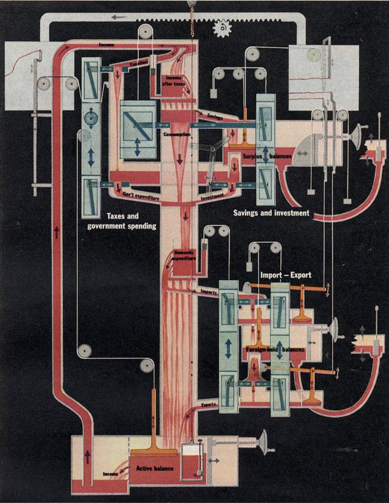

# Analog computers

"Monetary National Income Analogue Computer"

- Internal state directly visible  
- Just watch water flows...

---

**Digital computer problems**

- Non-linear effects
- No state visibility

----------------------------------------------------------------------------------------------------
- template: image
- class: smaller

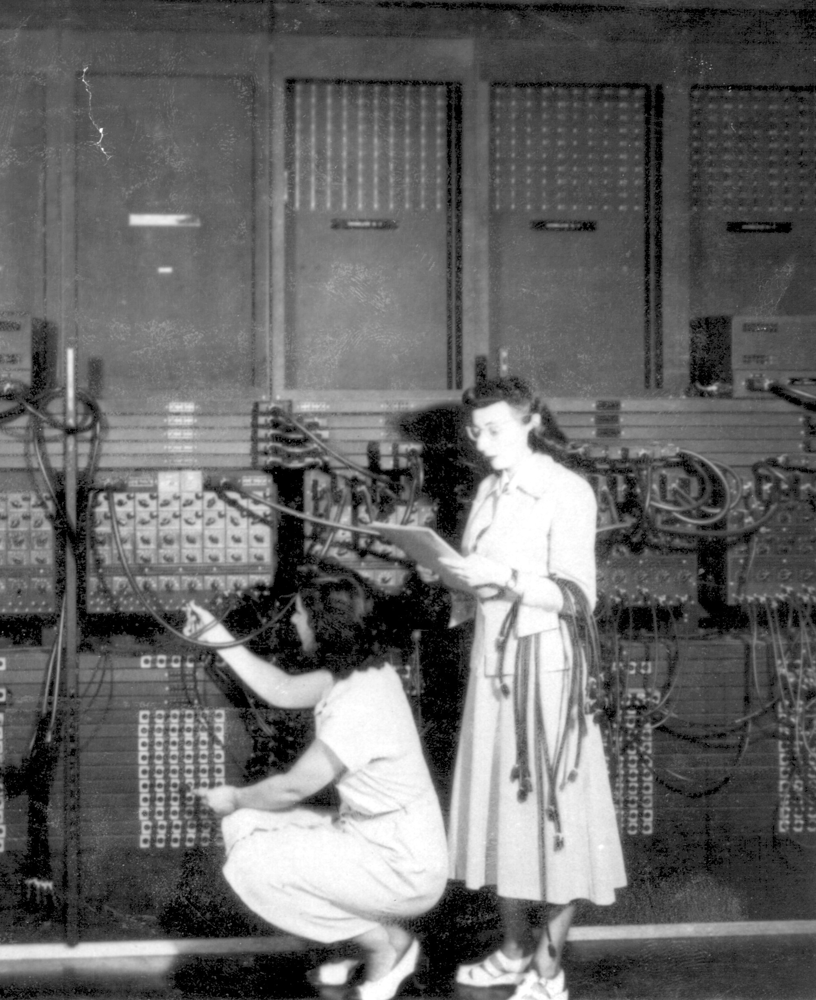

# Debugging the ENIAC

Adele [Goldstine] was an active type of programmer, trying things very quickly.

I [Betty Jean Jennings] was more laid back and given to attempting to figure
out things logically before doing anything.

----------------------------------------------------------------------------------------------------
- template: icons

# Lessons
## Debugging the ENIAC

- *fa-hand-back-fist* Hackers still favor active approach & intuition
- *fa-chalkboard-user* Mathematical culture still favors reasoning
- *fa-share* Testing against manually calculated trajectory
- *fa-tape* Reprogramming to simplify (60 order code)
- *fa-eye* Observing the state still matters

----------------------------------------------------------------------------------------------------
- template: content
- style: h1 { font-size:40pt; margin:0px 0px 20px 0px; } img { max-width:800px; margin-bottom:30px; }

# Observing system state

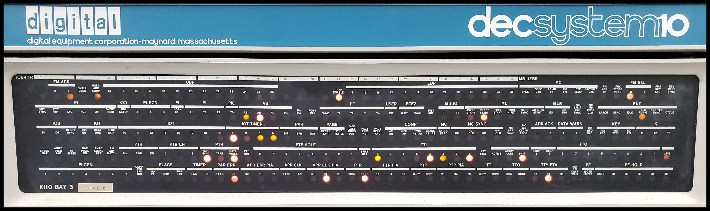

---

**BINAC (1949) connected to radio**

"Al Auerbach said he’d quickly discovered that he  
could tell whether the BINAC was running correctly  
by the sounds coming out of the radio."

----------------------------------------------------------------------------------------------------
- template: image
- class: smaller nologo
- style: img { margin-top:50px; }

# Maurice Wilkes

"The realization came over me with full force that a good part of the remainder of my life was going to be spent in finding errors in my own programs."

---

**The Airy tape**

"approximately twenty errors in the 126
lines of the program" (Campbell-Kelly)

----------------------------------------------------------------------------------------------------
- template: icons

# Mechanisms
## Debugging programs on the EDSAC

- *fa-shoe-prints* Step-by-step program execution (peeping)
- *fa-spinner* Initial orders that provided subroutines
- *fa-skull* Postmortem (memory) dump routine
- *fa-clock* Interpretive checking routine (50x slower)

----------------------------------------------------------------------------------------------------
- template: content
- style: img { max-height:360px; }

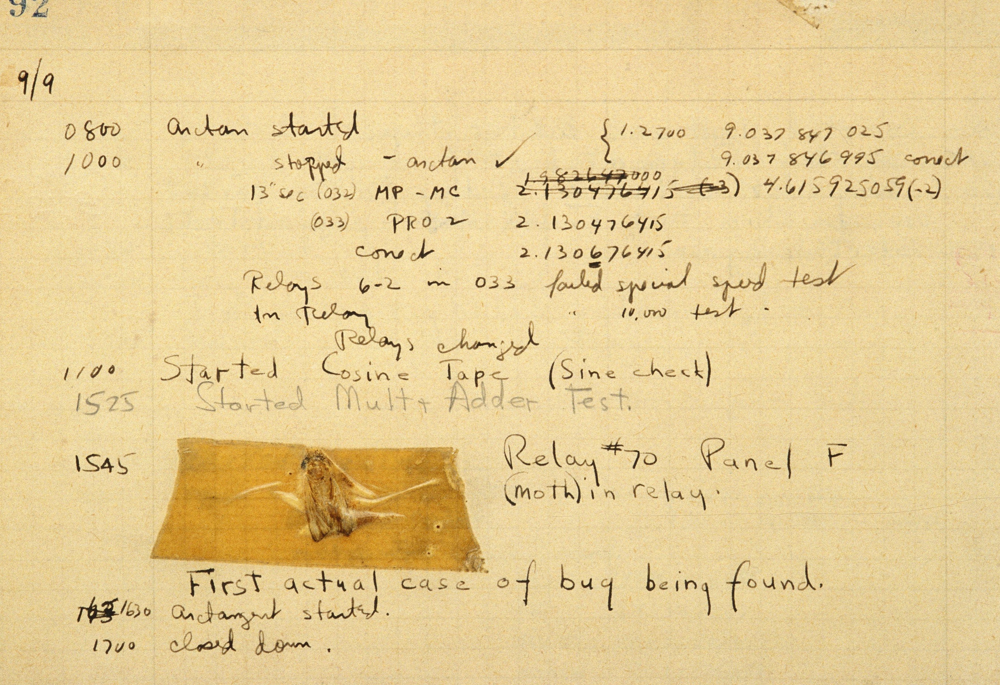

**Where did the term 'bug' come from?**  
Not the moth attributed to Grace Hopper  
Engineering term for malfunctions since 19th century  
At odds with large sums spent on fixing bugs!

----------------------------------------------------------------------------------------------------
- template: lists
- class: bigger2x
- style: h1 { font-size:42pt; }

# Debugging and testing terminology

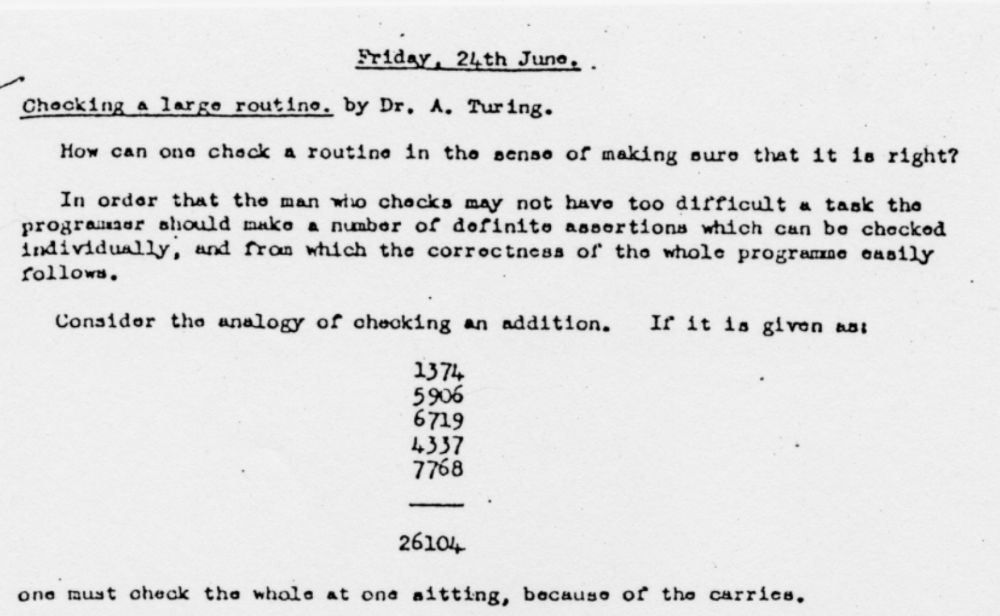

## Debugging and testing
- Making sure a program runs
- No clear distinction

## Program checkout
- Going back to Turing (1949)
- Check it produces correct results

## Error handling
- Not commonly used prior to 1960s

****************************************************************************************************
- template: subtitle

# Debugging
## On-line debugging techniques

----------------------------------------------------------------------------------------------------
- template: icons

# MIT
## Debugging on TX-0 and PDP-1

- *fa-tape* **UT-3** - Interactive program and memory editing
- *fa-spray-can* **FLIT** - Symbolic assembly, `break` command
- *fa-spray-can-sparkles* **DDT** - FLIT for PDP-1 (DEC Debugging Tape)
- *fa-bug* **DEBUG** - Program relocation, dump new code

----------------------------------------------------------------------------------------------------
- template: lists

# Debugging techniques (1966)

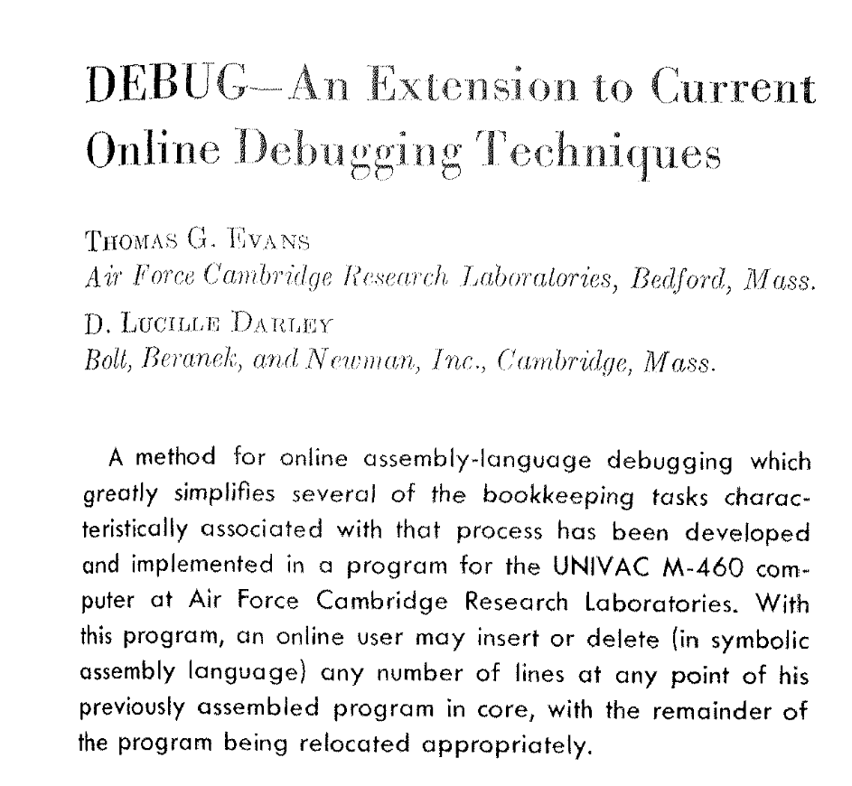

## Typical hacker knowledge

"Much of the work in this field has been described only in
unpublished reports or passed on through the oral tradition."

## Low and high level
- TX and PDP tools worked with assembly
- Less existed for high-level languages
- QUICKTRAN interpreter for FORTRAN

----------------------------------------------------------------------------------------------------
- template: image
- class: smaller2x nologo

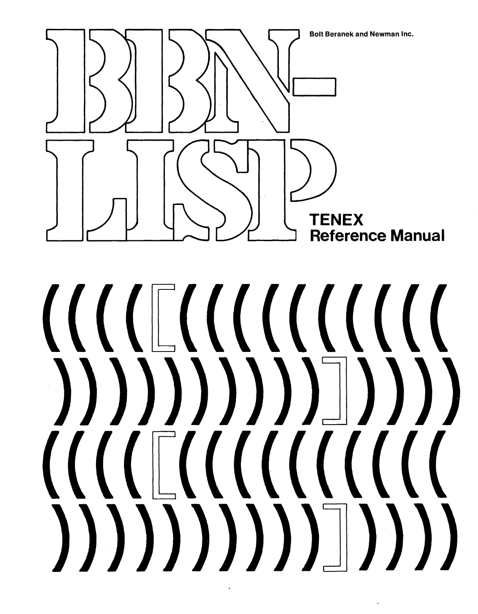

# Debugging in LISP

"With some care, it has been possible, for example, to find a bug while at a
breakpoint in running a test case, call the [structure] editor to make a
correction, run the program on a simpler test case to verify the correctness of the
change, then resume execution of the original test case from the breakpoint."

----------------------------------------------------------------------------------------------------
- template: lists
- class: bigger

# Debugging using the BBN LISP

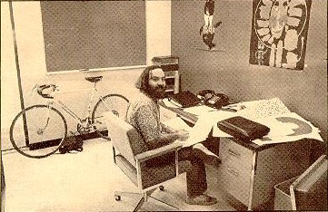

## Follows hacker traditions!
- L Peter Deutsch, Warren Teitelman, Daniel Bobrow, D. Lucille Darley

## Error handling and debugging
- $\overline{H}$ errors with "Help on the spot"
- Trigger manually to break program
- $H$ errors that stop all computation
- Latter handled in code using `errorset`

## Debugging and error handling mixed!

****************************************************************************************************
- template: subtitle

# Debugging
## The debugging epoch opens

----------------------------------------------------------------------------------------------------
- template: image
- style: h1 { font-size:30pt; letter-spacing:-1px;  }
- class: smaller2x

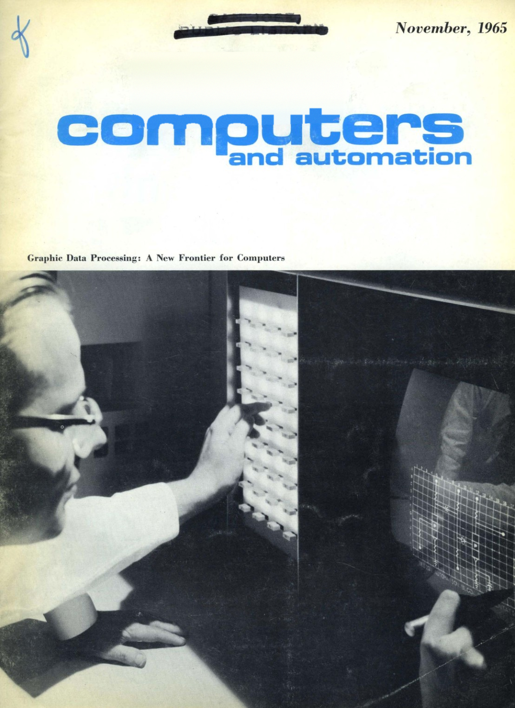

# The debugging epoch opens

(Halpern, 1965)

"We have machines big and fast enough to execute most useful programs, and software
varied and reliable enough to get those programs written;  
what now? Now: debugging"

**Debugging in a broad sense**

----------------------------------------------------------------------------------------------------
- template: content
- style: img { max-height:380px; float:right; margin:0px 0px 0px 20px; } h1 { font-size:34pt; letter-spacing:-1px; }

# NATO Software Engineering Conference (1968)

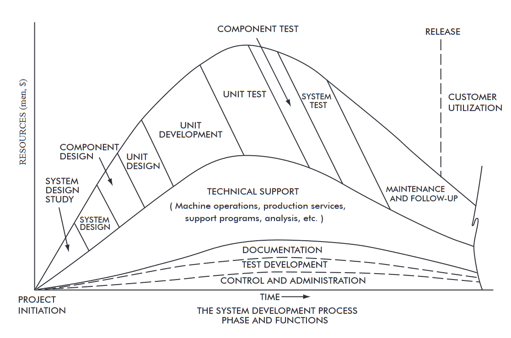

**From finding bugs to industry crisis**

Engineering culture overtakes hackers

**Rigorous testing**

- By producers to check it works
- By customers to justify paying

----------------------------------------------------------------------------------------------------
- template: lists
- class: nologo
- style: h1 { font-size:34pt; letter-spacing:-1px; }

# Mathematical culture at NATO conference

**Shift from formal proofs  
to development methodologies**

## Logical type of programmer

"There has been a very hectic trend towards development of [interactive programming systems]. Now this is certainly nice in a way, but it has its dangers ..
My worry is that the facility of quick response leads to sloppy working habits ..
detrimental to the  
field as a whole." (Niklaus Wirth)

****************************************************************************************************
- template: largeicons

# Debugging

- *fa-cog* **xx**  
  xxx

****************************************************************************************************
- template: subtitle

# Cultures of Programming
## [<i class="fa fa-house"></i> Home](/) &nbsp;&nbsp;  [<i class="fa fa-arrow-right"></i>Continue to Part 8](09-xx.html)
