- title: Functions, trees, processes (NPRG086)

****************************************************************************************************
- template: title
- style: h1 { font-size:42pt; } h2 { font-size:35pt; margin-top:-30px; }

# NPRG086: **Functions, trees, processes**
## Functions and functional programming

---

**Tomáš Petříček**, 204 (2nd floor)  
_<i class="fa fa-envelope"></i>_ [petricek@d3s.mff.cuni.cz](mailto:petricek@d3s.mff.cuni.cz)  
_<i class="fa-brands fa-bluesky"></i>_ [@tomasp.net](https://bsky.app/profile/tomasp.net)   
_<i class="fa fa-globe"></i>_ [https://tomasp.net](https://tomasp.net)  

****************************************************************************************************
- template: subtitle

# From Lisp
## Functional language?

----------------------------------------------------------------------------------------------------
- template: image
- style: blockquote { margin-left:0px; } .body1 { max-width:380px;}

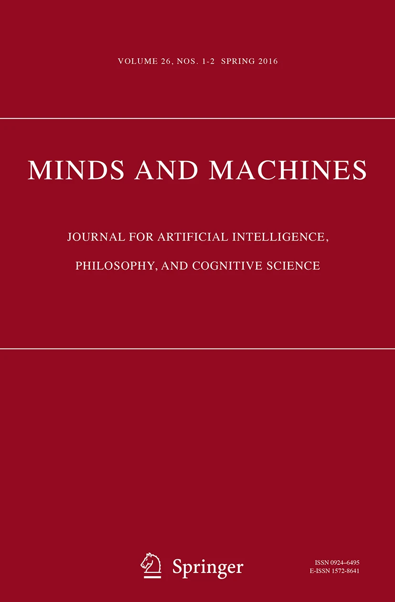

# Origins

## Mark Priestley on Lisp

> LISP was not based on the lambda calculus, despite using the word
"LAMBDA" to denote functions. ... McCarthy
was aware of (Church 1941) but had not studied it.

----------------------------------------------------------------------------------------------------
- template: lists
- class: bigger

# Real origins of Lisp

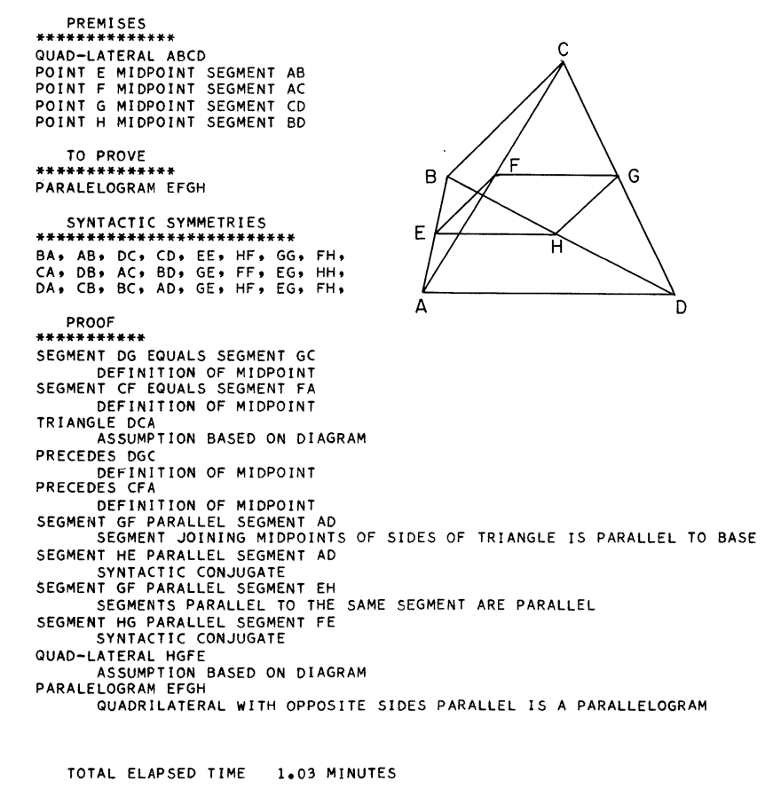

## Geometry theory machine

- Theorems in plane geometry
- Own research on AI topics

## FLPL (1958)

- FORTRAN-compiled List-Processing Language
- Using 36-bit words for linked lists
- No recursion and other limitations

<!--
https://instadeq.com/blog/posts/no-code-history-the-geometry-theorem-machine-1959/
https://github.com/amno1/as-powerful-as-possible/blob/master/04%20FLPL.org
-->

----------------------------------------------------------------------------------------------------
- template: image
- class: smaller

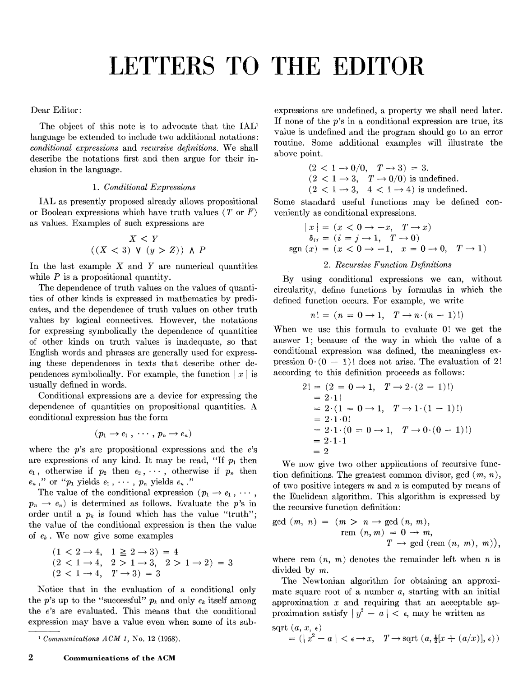

# Dear Editor:

Two proposed additions  
to IAL (later Algol)

*1. Conditional expression*  
*2. Recursive functions*

---

The first was added, the second not forbidden

----------------------------------------------------------------------------------------------------
- template: lists
- style: .body img { max-width:450px !important; }

# LISP I - Manual (1960)

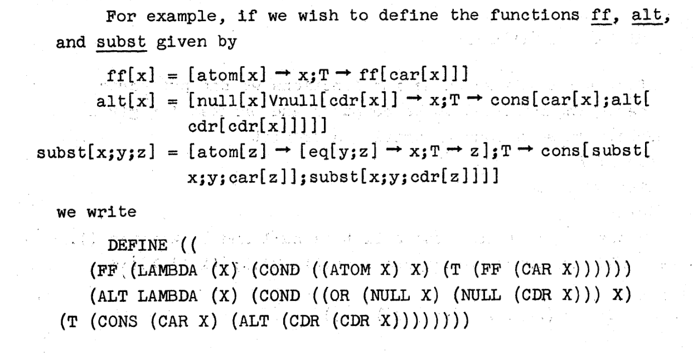

## Two notations
- "Normal" M-expressions
- List-based S-expressions
- `LAMBDA` in the latter

## Language features

- Lists based on FLPL
- First-class recursion support
- Imperative programming with `goto`
- Higher-order functions like `maplist`

----------------------------------------------------------------------------------------------------
- template:image

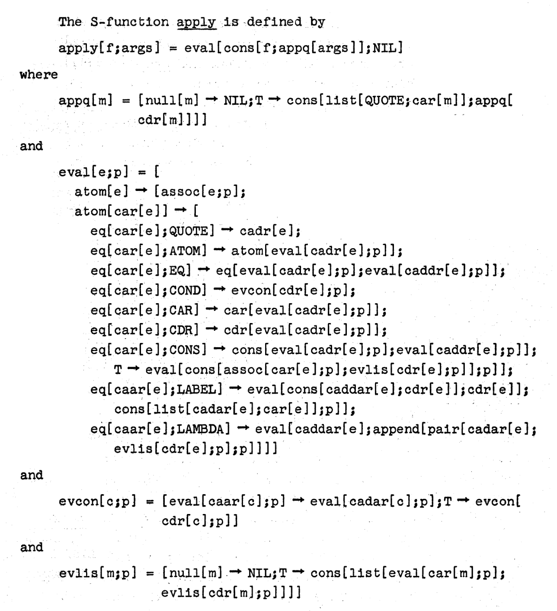

# Theoretical links

**Theory of recursive functions**  
Refernece to partial recursive functions

**Universal function**  
`eval` function - first theoretical idea, later implemented

_(No reference to ADES)_

----------------------------------------------------------------------------------------------------
- template: icons

# Lisp
## How functions and variables worked

- *fa-arrow-right* Reduction in lambda-calculus $(\lambda x.e_1) e_2 \rightarrow_\beta e_1[x/e_2]$
- *fa-microchip* Not practical for actual implementation!
- *fa-list* Variables stored in association list (a-list)
- *fa-list-check* Most recent variable from a-list used
- *fa-eye* Dynamic scoping - not as in lambda calculus!

----------------------------------------------------------------------------------------------------
- template: content
- style: img { float:right; max-height:350px; } ul li { font-size:20pt; }

### The Function of FUNCTION in LISP: Why the FUNARG problem Should be Called the Environment Problem

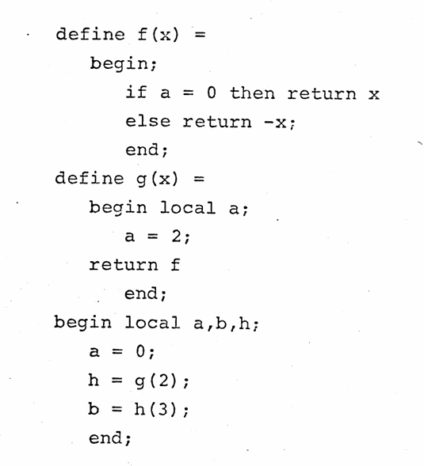

- `a` assigned `2` inside `g`
- function `f` is then returned
- `a` assigned `0` before calling it

  

---

### Not obvious!

- Weizenbaum (1968), _The FUNARG Problem Explained_
- Moses (1970), _The Function of FUNCTION in LISP Why the FUNARG problem..._
- Sandewall (1971), _A proposed solution to the FUNARG problem_
- Steele & Sussman (1975), _The Lambda papers_

----------------------------------------------------------------------------------------------------
- template: content
- style: img { max-width:60%; margin:0px 20% 20px 20%; } p { font-size:24pt; }

# Faulty function (LISP I)

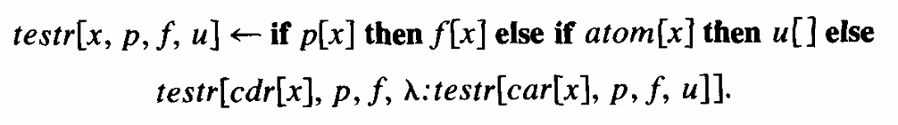

I must confess that I regarded this difficulty as just a bug and expressed confidence that
Steve Russell would soon fix it. He did fix it, but by inventing the so-called FUNARG
device that took the lexical environment along with the functional argument.

_(McCarthy, 1978)_

----------------------------------------------------------------------------------------------------
- template: content
- style: blockquote p { font-size:24pt; }

# Aside: Semantics of Algol
### The mechanical evaluation of expressions (1964)

> We represent the value of a $\lambda$-expression by a
bundle of information called a "closure," comprising the
$\lambda$-expression and the environment relative to which
it was evaluated.

### Language semantics motivation

- Landin's model of Algol using lambda calculus  
- Recall Mervyn Pragnell's reading group!
- "similar to FUNARG" and in contrast to "literal substitution"

<!-- https://www.cs.cmu.edu/~crary/819-f09/Landin64.pdf -->

----------------------------------------------------------------------------------------------------
- template: content

# Language semantics
### How to model `goto` and returns?

- _van Wijngaarden (1964)_: "Provide each procedure declaration with an extra formal
  parameter... and insert at the end [goto] leading to that formal parameter."

- Many names for the concept: _Landin (1964)_ SECD "dump",
  _Mazurkiewicz (1969)_ "tail function", _Morris (1970)_ "label values",
  _Abdali (1973)_ "program remainder"

- _Wadsworth (1970)_ "Once I'd coined the word [continuation] it all clicked and
  the rest followed."

----------------------------------------------------------------------------------------------------
- template: icons

# Continuations
## Shifting motivations

- *fa-person-chalkboard* **Programming language semantics**  
   Wijngaarden, Landin, Morris, Wadsworth

- *fa-not-equal* **Proving program properties**  
   Mazurkiewicz, Strachey

- *fa-cog* **Managing environments efficiently**  
  Fischer, Steele and Sussman

----------------------------------------------------------------------------------------------------
- template: largeicons

# Scheme: The Lambda papers

* *fa-terminal* **Scheme: An Interpreter for Extended LC** (1975)  
   Lexically scoped Lisp with closures, explaining actors
* *fa-code* **Lambda: The Ultimate Imperative** (1976)  
   GOTO, assignment and loops modelled with CPS
* *fa-tag* **Lambda: The Ultimate Declarative** (1976)   
   Lambda as naming; does not need to return!
* *fa-bolt* **Debunking the "Expensive Procedure Call" Myth** (1977)  
   Using tail calls to compile calls effectively

----------------------------------------------------------------------------------------------------
- template: lists
- style: .body img { max-width:260px !important; }
- class: nologo

# Lessons from the Lisp history

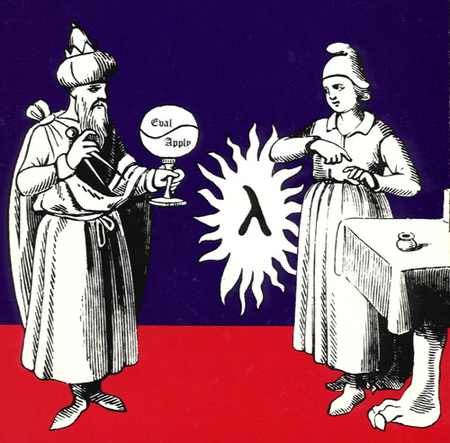

## Functions in Lisp
- Funarg problem fixed via workarounds
- "Monster" function to be "fixed"
- 15 years from Lisp to Scheme!
- Not a practical engineering problem?

## Influences across levels
- AI motivations, weak lambda calculus link
- Continuations move from semantics to implementation
- Theoretical influence leads to (successful) Scheme

****************************************************************************************************
- template: subtitle

# Towards Haskell
## Functional programming!

----------------------------------------------------------------------------------------------------
- template: content

# Peter Landin
### Actual lambda calculus influence

From Roger Penrose via Mervy Pragnell's reading group

---

### Lambda calculus for semantics and design

- The mechanical evaluation of expressions (1964)
- A correspondence between ALGOL 60 and LC (1965)
- A Generalization of Jumps and Labels (1965)  
- The next 700 programming languages (1966)

----------------------------------------------------------------------------------------------------
- template: lists

# Peter Landin

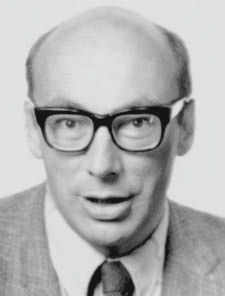

### Papers on semantics
- SECD (stack, env, control, dump)
- Language constructs translate to LC
- Closure = function + environment

### ISWIM and 700 PLs

- Design range of LC-based languages
- Prefers _denotative_ over _functional_ or _declarative_
- Function definitions in a modern functional sense

----------------------------------------------------------------------------------------------------
- template: lists
- style: li { font-size:24pt; } h2 { font-size:26pt; margin:10px 0px 5px 0px; } h1 { font-size:36pt; margin:0px 0px 20px 0px;} ul { margin-bottom:20px; }

# Early functional-style languages

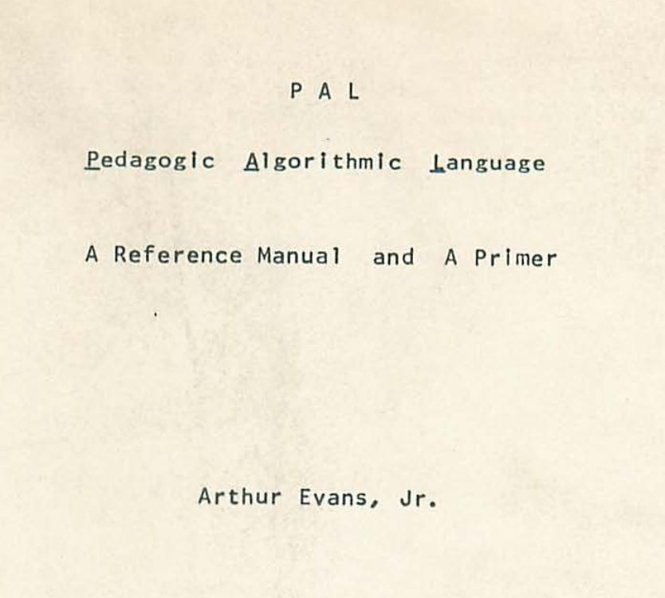

## PAL (MIT, 1967)

<!-- [manual](https://softwarepreservation.computerhistory.org/PAL/Pal-ref-man.pdf)-->

- ISWIM implementation in BCPL
- _Small applicative subset_ (lambdas, functions, tuples, conditional, let)
- _Imperative_ (assignment, goto)

## COWSEL/POP-1 (1966)

- Partial function application (misnomer)
- Dynamic scoping (for memory/engineering reasons)
- Frozen formals `(% ... %)` akin to `FUNARG`

<!-- https://web.archive.org/web/20010414045135/http://www-robotics.cs.umass.edu/~pop/pop_development.html -->

## POP-2 (Edinburgh, 1970)

- Algol-inspired with "functions first-class"
- Burstall addressing Strachey's complaint about Algol

----------------------------------------------------------------------------------------------------
- template: largeicons

# Theoretical work
## Typed lambda calculus

- *fa-file* Scott (1970s) - _Type-theoretical alternative to ISWIM_
- *fa-superscript* Typed LC model with denotational semantics
- *fa-heart-crack* Functions are partial (bottom element)
- *fa-arrow-rotate-left* Made unnecessary by model of untyped LC
- *fa-shapes* Morris, Reynolds (1970s) - _Theory of type structure_

----------------------------------------------------------------------------------------------------
- template: lists
- class: smaller nologo

# LCF/ML (Milner, late 1970s)

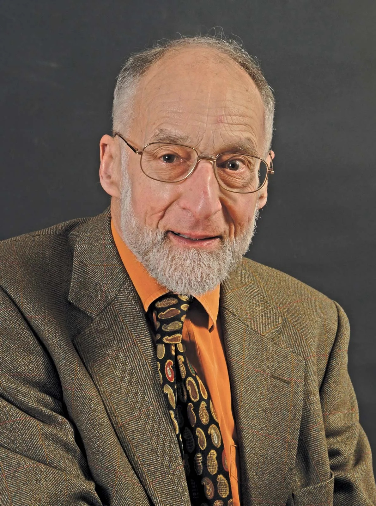

## LCF theorem prover

- Aims to prove compiler correctness
- Scott's _Logic for Computable Function_
- Interactive _Stanford LCF_ theorem prover  
  (made possible by time-sharing?)
- _Edinburgh LCF_ adds meta-language

## Meta-language

- Write code to construct theorems in LCF
- Types used to ensure correctness
- Becomes a programming language (HOPE, VAX ML, SML)

----------------------------------------------------------------------------------------------------
- template: largeicons

# Formal verification
## From PL/CV to NuPrl

- *fa-check* _PL/1_ language with support for correctness proofs
- *fa-arrow-right* Difficulties getting "functions right" (first-class)
- *fa-graduation-cap* _ALGOL 68_ does not; $\lambda$-calculus "not respectable"
- *fa-subscript* _Martin-Löf's_ theory to clarify "intuitionistic mathematics"
- *fa-square-check* Adopted by Constable for _Nuprl_ (PL/CV follow-up)

----------------------------------------------------------------------------------------------------
- template: content
- style: blockquote { margin-left:0px; } blockquote p { font-size:24pt; }

# Functional programming

### Can Programming Be Liberated from the von Neumann Style? A Functional Style and Its Algebra of Programs

Backus, Turing Award lecutre (1978)

---

> Just as structured programming eschews many control statements to obtain programs
> with simpler structure, better properties, and uniform methods for understanding their behavior,
> so functional programming eschews the lambda expression, substitution, and multiple
> function types.

**Functional programming terminology, but talks about
algebra of programs and formal reasoning**

----------------------------------------------------------------------------------------------------
- template: icons

# Backus lecture
## Unexpected effects

* *fa-hourglass* Agreement on _von Neumann bottleneck_
* *fa-users* Adoption of the term *functional programming*
* *fa-x* Most kept lambda functions and variables
* *fa-church* Presents past work from LC perspective

----------------------------------------------------------------------------------------------------
- template: content

<!--
-> Mythology
(ignores "styles" c.f. Priestley; only languages)
~
[Dijkstra](https://www.cs.utexas.edu/~EWD/transcriptions/EWD06xx/EWD692.html)
-->

# Caveats

### Dijkstra's criticism of the talk

> In short, the article is a progress report on a valid research effort but suffers badly from aggressive overselling of its significance, long before convincing results have been reached. This is the more regrettable as it has been published by way of Turing Award Lecture.

---

### Well-founded critique

- Algebra of programs exists, but more academic
- Later work on FP tries to develop optimizations...

----------------------------------------------------------------------------------------------------
- template: content

# Functional programming

### SASL (Turner, 1978), KRC (Turner, 1982)
Lazy, purely functional programming languages

### Miranda (Turner, 1985)
Purely functional, non-strict language with    
Hindley–Milner polymorphism in one system

### Haskell (1990)
Program is a function, mostly follows Miranda,  
Type classes as a main additional novelty

<!--
Also:
**"Why functional programming matter" (Hughes, 1984-89)** - builds more the FP intution
-->

****************************************************************************************************
- template: subtitle

# Conclusions
## Functional programming

----------------------------------------------------------------------------------------------------
- template: content

# Many ideas struggle

### Possibly before firm link across formal,   implementation and intuitive levels?

- _First-class functions_ (ALGOL, PL/CV, LISP)
- Links to _recursion_ & _lambda calculus_ (ADES, LISP)
- _Variable binding_ (von Neumann) and _scoping_ (LISP)
- _Continuations_ (from semantics to implementation)

----------------------------------------------------------------------------------------------------
- template: content

# Interactions across levels

### Between theory and practice

- Translation to a small formal model
- ISWIM as theory, Scheme as implementation
- Not obvious well-documented link

### From theory to intuition

- Backus' FP system and von Neuman bottleneck
- Main effect on thinking about functional programming!

----------------------------------------------------------------------------------------------------
- template: icons

# Monsters

- *fa-skull-crossbones* **Pseudo-functions with effects (print) in LISP 1.5**  
  Eliminated in pure functional languages
- *fa-dragon* **Laziness in LC, but not mathematical functions**  
  Simplifies calling conventions of Algol
- *fa-bugs* **Funarg problem seen as something to be fixed**  
  Fixes eventually replaced by different approach

----------------------------------------------------------------------------------------------------
- template: content

<!--
    - **pseudo**-functions (like print, and other effects) in [LISP 1.5](https://softwarepreservation.computerhistory.org/LISP/book/LISP%201.5%20Programmers%20Manual.pdf)
    - laziness is a funny aspect
    ~
    OTHER NOTES
    ~
    1. **Machine lineage** vs. **mathematical lineage**
    2. First attempt to use mathematics/LC fail (von Neuman & Goldstine; Landin & Strachey; ADES based on theory of recursive functions)
    3. Post-LIPS import of lambda succeeds - why? it is actually implemented and 'works'!
    ~
    1. Mathematical intuition and engineering implementation disconnected at first (function vs subroutine)
    2. Engineering notion develops without link to theory or intuition
    ~
    # Imports
    ~
    **Nothing is done properly though!**
    ~
    - free and bound variables imported by von neumann
    - everyone imports 'function' (sin, etc.)
    - Church imports lambda notation
    - as much from Recursive function theory as Lambda Calculuc
    (Later, Scheme does it right)
    ~
    # What is a function?
    - different operationalizations??
    # Naming
    ~
    - Routines and subroutines in the early days
    - Functions struggle to materialize before Bacus
    - Functional programming - shift after Backus
    - template: content
    ~
    # Interactions
    ~
    - Practice develops first from scratch (subroutines)
    - Intuition is imported from commonsense mathematics (functions implemented by subroutines)
    - Later intuition (lambda calculus) reveals gaps
    - Theory develops later, transforming practice (Scheme)
    - Purity is an attempt to make FP more "mathematical"
    - Laziness is an implementation aspect not existing in mathematical functions (but existing in LC)
-->
