- title: Functions, trees, processes (NPRG086)

****************************************************************************************************
- template: title
- style: h1 { font-size:42pt; } h2 { font-size:35pt; margin-top:-30px; }

# NPRG086: **Functions, trees, processes**
## Functions from the programming perspective

---

**Tomáš Petříček**, 204 (2nd floor)  
_<i class="fa fa-envelope"></i>_ [petricek@d3s.mff.cuni.cz](mailto:petricek@d3s.mff.cuni.cz)  
_<i class="fa-brands fa-bluesky"></i>_ [@tomasp.net](https://bsky.app/profile/tomasp.net)   
_<i class="fa fa-globe"></i>_ [https://tomasp.net](https://tomasp.net)  

****************************************************************************************************
- template: subtitle

# Functions
## Background

----------------------------------------------------------------------------------------------------
- template: icons

# Functions
## History of mathematics

- *fa-chart-line* **Leibniz (1680s)** - Functions live on a curve
- *fa-subscript* **Euler (1748)** - Functions as an analytical formula
- *fa-angle-up* **D'Alambert (1747)** - Plucked string outside math
- *fa-fire* **Fourier (1810s)** - Heat and combination of sines
- *fa-arrow-right* **Dedekind (1888)** - Mapping between collections

----------------------------------------------------------------------------------------------------
- template: image
- class: smaller

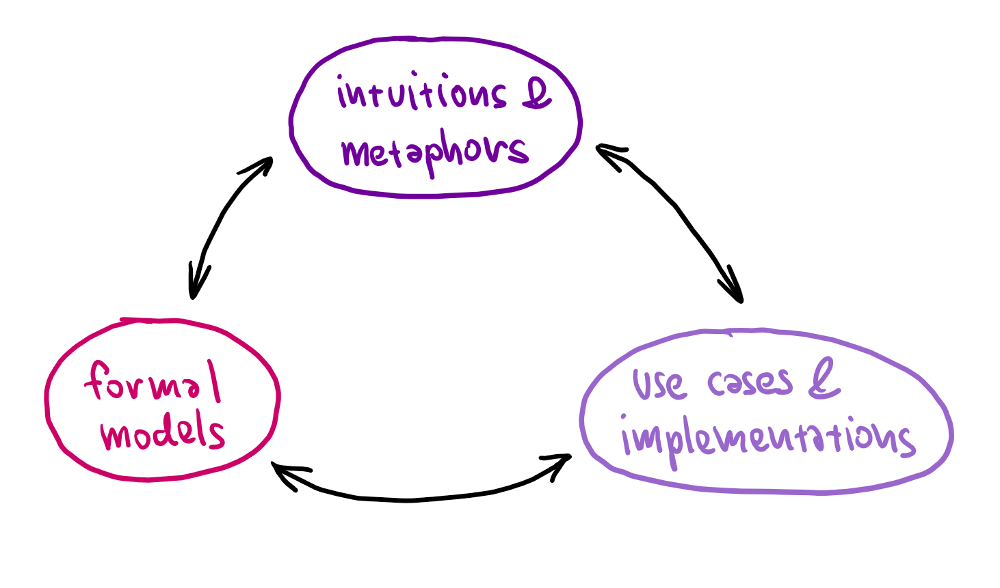

# How entities evolve

**Three levels**

Intuitions  
Formalisms  
Implementation  

---

**Concepts exist at  
all three levels**

When one changes   
others adapt

----------------------------------------------------------------------------------------------------
- template: lists

# Interactions in mathematics

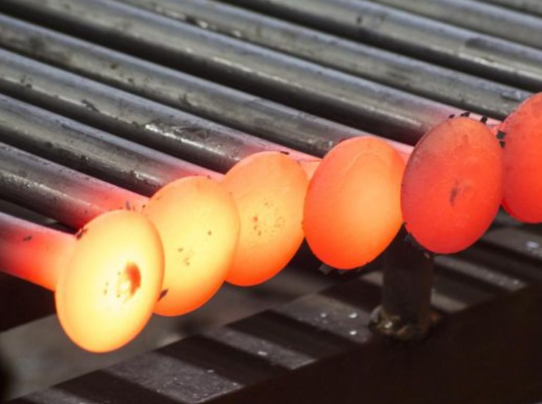

## Geometric motivation
- Intuitive idea about functions
- Leads to first definition attempts

## Physics challenges
- Plucked strings and heat
- Needs more than smooth functions!
- Function as a mapping

****************************************************************************************************
- template: subtitle

# Functions
## Early machines

----------------------------------------------------------------------------------------------------
- template: image

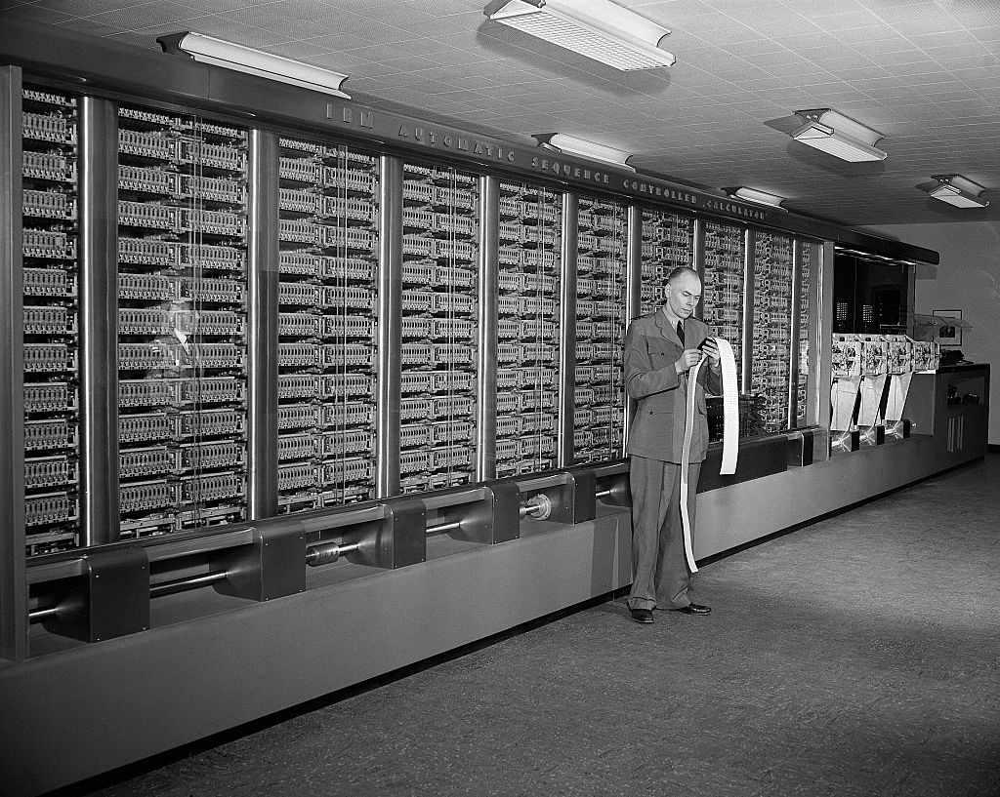

# Harvard Mark 1  ASCC (1944)

**Electromechanical general purpose computer**

Reads instructions from a punched tape

Synchronized by 15m rotating drive shaft

----------------------------------------------------------------------------------------------------
- template: lists

# Programming the ASCC (1944)

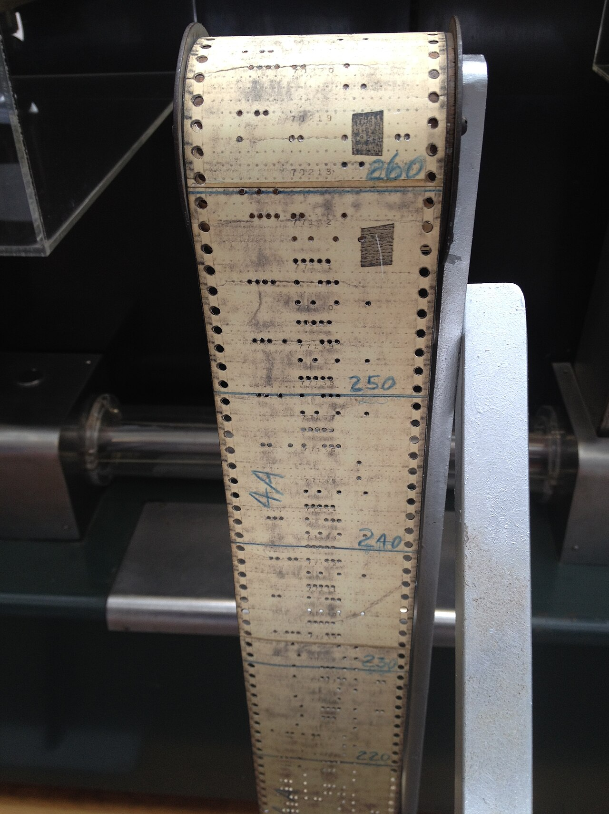

## Iteration and loops
- Load a starting tape
- Then endless tape (physical loop)

## Reusable sequences
- Implementing a function
- Held on physically different tapes

## Subsidiary sequence control
- Automating program execution
- Commands to switch control between units

<!-- todo find exact reference in manual for use of 'function'
https://www.bitsavers.org/pdf/harvard/MarkI_operMan_1946.pdf -->

----------------------------------------------------------------------------------------------------
- template: image
- class: smaller

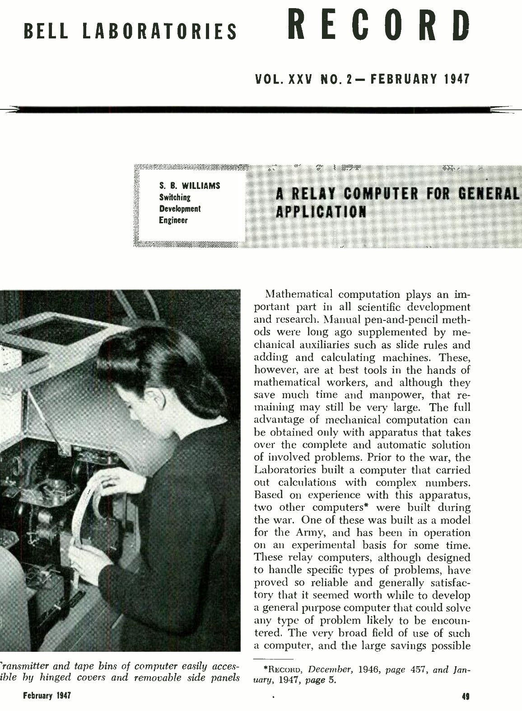

# Bell Labs Relay machines (1947)

**Routine tapes**

Usually endless loops of instructions that transfer control at the end

---

_"The solution of an equation
in general requires reference to tables of
functions, trigonometric, logarithmic, etc."_

<!-- Priestley talks about this and https://www.worldradiohistory.com/Archive-Bell-Laboratories-Record/40s/Bell-Laboratories-Record-1947-02.pdf has the quote -->

----------------------------------------------------------------------------------------------------
- template: lists

# Programming the ENIAC

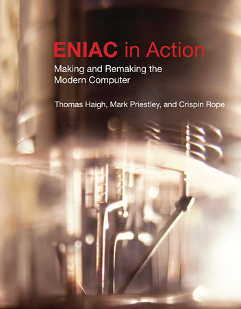

## Initial configuration (1945)
- Programmed by plugging cables!
- 3 function tables store 104 entities
- can be _set up for interpolation routines_
- A report mentions _sub-routine_

## After reprogramming (1948)
- Interprets instructions
- Monte Carlo simulation using a closed subroutine (via control transfer)

<!--
for the first info, see: https://pubs.ams.org/MCOM/1946-02-015/S0025-5718-1946-0018977-0
first subroutine see
https://computerhistory.org/blog/the-neverending-quest-for-firsts/
and more importantly:
https://lists.sigcis.org/archives/list/members@lists.sigcis.org/thread/VLING3E2G6MPNF4OZYZVR3YDBGHGMPK3/
-->

----------------------------------------------------------------------------------------------------
- template: content
- style: blockquote { margin:0px; }

### Curry's theory of program composition (1948-50)

> Principal bottleneck is the _planning of the computation_ [...]
Ways of shortening this process, and of systemizing it, so that a part
of the work can be done by the technically trained personnel or by
machines, are much desired. The present report is an attack on this
problem from the standpoint of _composition of computing schedules_ [...] This
problem is here attacked theoretically by using techniques similar to
those used in some phases of _mathematical logic_.

---

**Prefigures many later ideas, but not modern terms**

- Calculus of program composition
- Substitution with address adjustment

<!-- Haskell before Haskell paper (de Mol et al.)-->

----------------------------------------------------------------------------------------------------
- template: content
- class: two-column
- style: img { max-height:260px; margin:20px 0px; }

# EDVAC and ACE computers

**EDVAC (1949)**

Mauchly, Eckert, von Neu&shy;mann, First Draft 1945

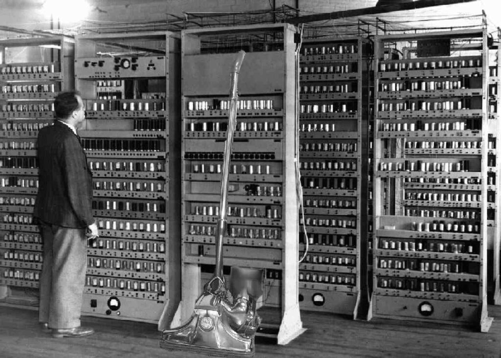

---

**ACE (1950)**

Automatic Computing Engine, designed by Turing in 1945

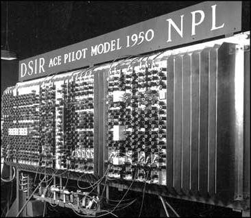

----------------------------------------------------------------------------------------------------
- template: content
- style: blockquote { margin:0px; }

# Engineering vs. logic foundations

> [W]hereas von Neumann set out to design
an _automatic calculator_, Turing was more concerned to produce a practical version
of the _universal machine_.

<br>

>  The ACE
(...) maintained a strict distinction between memory and control reminiscent
of the universal machine, whereas the EDVAC complicated this (..) with
special-purpose units.

(**from Priestley's Science of Operations**)

----------------------------------------------------------------------------------------------------
- template: content
- style: blockquote { margin:20px 0px; }

# Programming the ACE (1945)

### Subsidiary operations and BURY/UNBURRY

> When we wish to start on a _subsidiary operation_ we need only
make a note of where we left off the major operation and then
apply the first instruction of the subsidiary.

<!-- x -->

> When the subsidiary
is over we look up the note  
and continue with the _major operation_.

<!-- x -->

> the burying being done through a standard instruction table BURY,
and the disinterring by the table UNBURY.              

<!-- from https://mark.people.clemson.edu/subroutines.html -->

----------------------------------------------------------------------------------------------------
- template: image

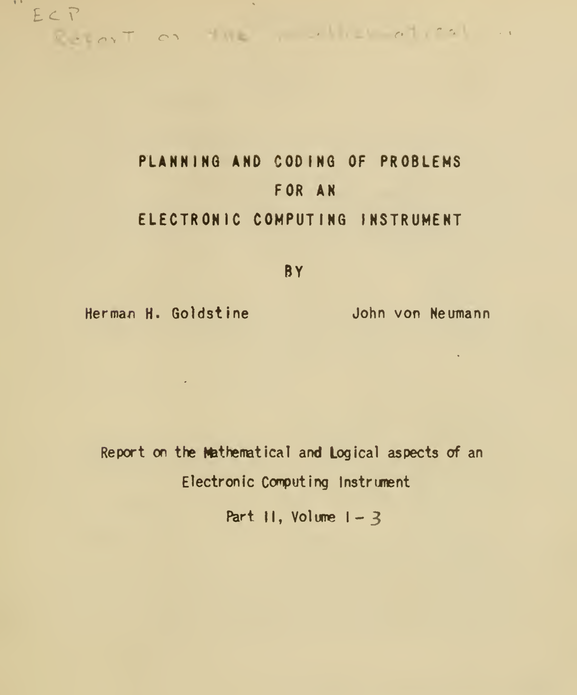

# Planning and Coding report

Started while ENIAC was still programmed by plugging cables

Later parts after ENIAC reprogramming & Manchester Baby

**Envisions a lot of later programming**

----------------------------------------------------------------------------------------------------
- template: content
- class: nologo
- style: h1 { margin-bottom:20px; } blockquote { margin:0px; }

# Subroutine terminology

### Preparation of Problems for EDVAC-Type Machines  (Mauchly, 1947)

> ... even fairly elementary processes should be made a matter of _subroutine_.
(...) those of any complexity presumably ought to be in a _library_ - that is, a set of magnetic
tapes <!-- in which previously coded problems of permanent value are stored. -->

### Planning and coding of problems for an electronic computing instrument (1947)

> We call the coded sequence of a problem a _routine_, and one which
is formed with the purpose of possible _substitution_ into other routines, a
_subroutine_. (...) properly organized automatic, high speed establishment will
include an extensive collection of such subroutines (...) i.e. a "library"

----------------------------------------------------------------------------------------------------
- template: lists

# Mathematical and logical influences


## Bound variable
- "assumes a sequence of different values in the course of the
procedure"
- impossible to set from the outside

## Free variable
- fixed throughout the procedure, essentially a parameter
- a value has to be substituted for it

## "Borrowed from formal logic"

<!-- von-neumann-1948-full.pdf, p.20 -->

----------------------------------------------------------------------------------------------------
- template: content
- style: img { float:right; max-width:300px; } blockquote { margin:0px; }

# EDSAC (Cambridge)

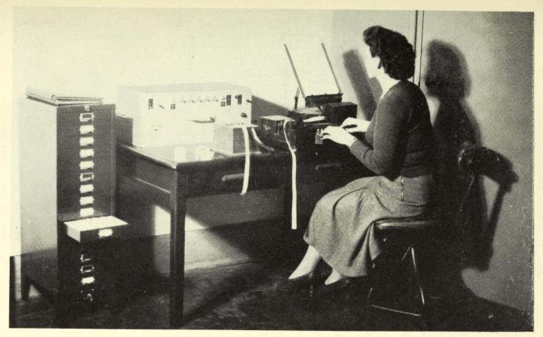

**Second edition report (1951)**

> ... a mathematical calculation usually requires an extended sequence of orders. It is often convenient
to break up this sequence of orders into self-contained groups of orders
called _subroutines_.

**Rewriting addresses**

> The written and punched form is called the
_external form_, and the form inside the machine the _internal form_.

----------------------------------------------------------------------------------------------------
- template: lists
- style: p { font-size:24pt; line-height:1.1em; } h1 { margin-bottom:10px; font-size:42pt; } img { margin:20px; }
- class: nologo

# Open vs. closed subroutines

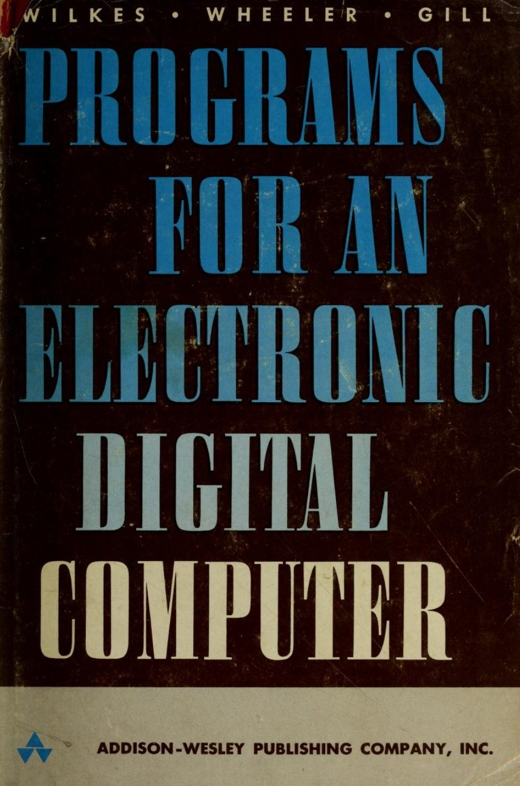

## Open subroutine
Entered immediately after the execution of
the order coming before it (...) control passes to the order immediately following it.

## Closed subroutine
Placed anywhere in the store, entered by a jump order and left by
another jump order

## Interpretive subroutines

Order code different from the basic order code of the machine.
Extracted one by one, by the interpretive subroutine, which
examines them, and carries out the appropriate operations.


<!--
Hopper's A-0
program = "a sequence of subroutines and its arguments"; "compiling" = assembling a program from programs made up previously
Mauchly's Short Code
talks about "library of functions"
-->

----------------------------------------------------------------------------------------------------
- template: largeicons

# Early machines

- *fa-subscript* Subroutines implementing functions (since 1947)
- *fa-arrow-right* Links to logic (Curry, von Neumann) but not functions
- *fa-book* Library of functions as intuitive metaphor
- *fa-bridge* Engineering concerns about address rewriting
- *fa-calculator* Numerical analysis of computation processes

****************************************************************************************************
- template: subtitle

# Functions
## From FORTRAN to Algol

----------------------------------------------------------------------------------------------------
- template: image

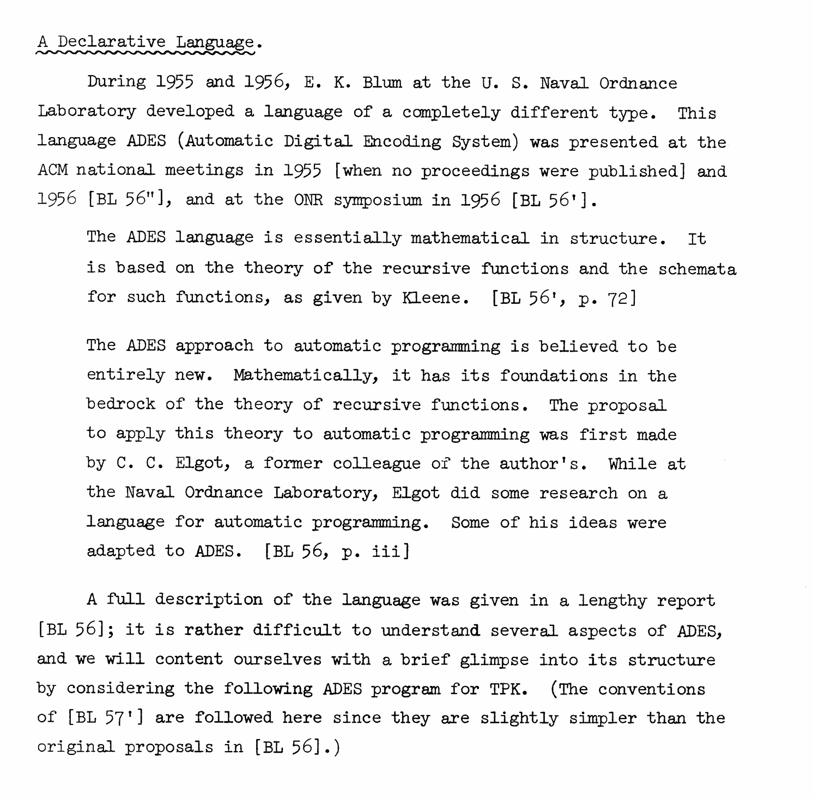

# Automatic Digital Encoding System

Recursive functions theory of Kleene

Left Polish notation

**Before FOTRAN, but largely forgotten**

<!-- see knuth-trabb-pardo, p81 -->

----------------------------------------------------------------------------------------------------
- template: lists
- class: smaller nologo
- style: h1 { margin-bottom:10px; } h2 { font-size:30pt; margin:10px 0px 0px 0px; }

# Functions in FORTRAN

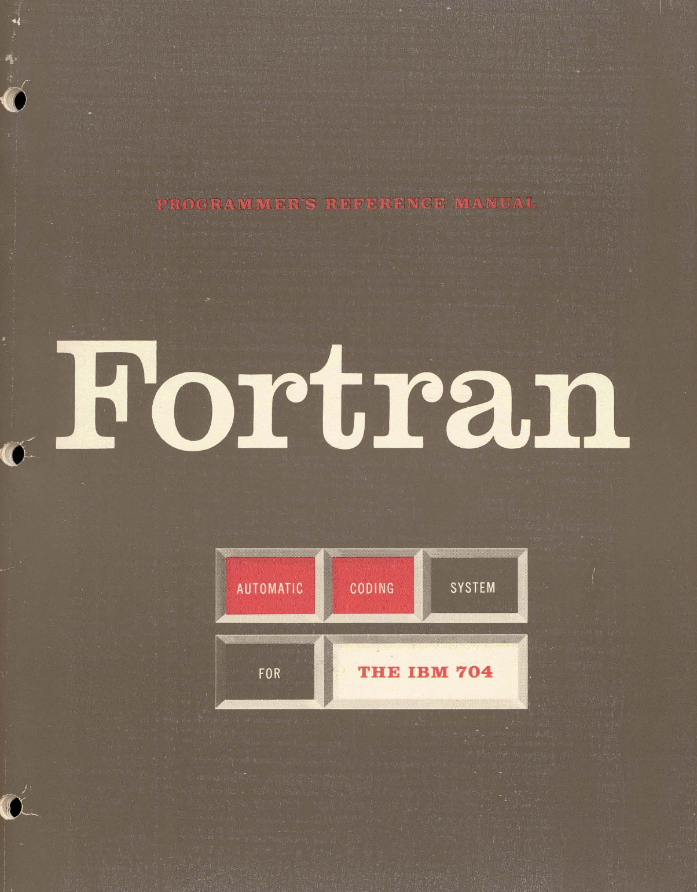

## FORTRAN report (1954)

- Control formulas (goto), IO formulas
- List of functions but no subroutines

## FOTRAN for IBM 704 (1956)

- "Pre-written routines to evaluate any single-valued functions of any number o f arguments"
- Library .. on the master tape in relocatable form

## FORTRAN II (1958)

- Subroutines (`SUB DEF`) called using `CALL` statement
- Functions defined by formula, or subprogram (`FUNCTION`)

<!--
1954 report
https://softwarepreservation.computerhistory.org/FORTRAN/BackusEtAl-Preliminary%20Report-1954.pdf
1956 manual
https://archive.computerhistory.org/resources/text/Fortran/102649787.05.01.acc.pdf
and
see towards FORTRAN II: https://mcjones.org/dustydecks/archives/2005/08/07/46/ on
adding CALL, SUB DEF
...
1958  FOTRAN II
 `CALL` / `SUBROUTINE` (called using `CALL`) / `FUNCTION` (called as functions)
 uses `<name> = expr` for returns (`RETURN` dropped)
-->

----------------------------------------------------------------------------------------------------
- template: lists
- class: smaller nologo
- style: h1 { margin-bottom:20px; } h2 { font-size:30pt; margin:0px 0px 0px 0px; } ul { margin-bottom:20px;}

# Procedures and functions in Algol

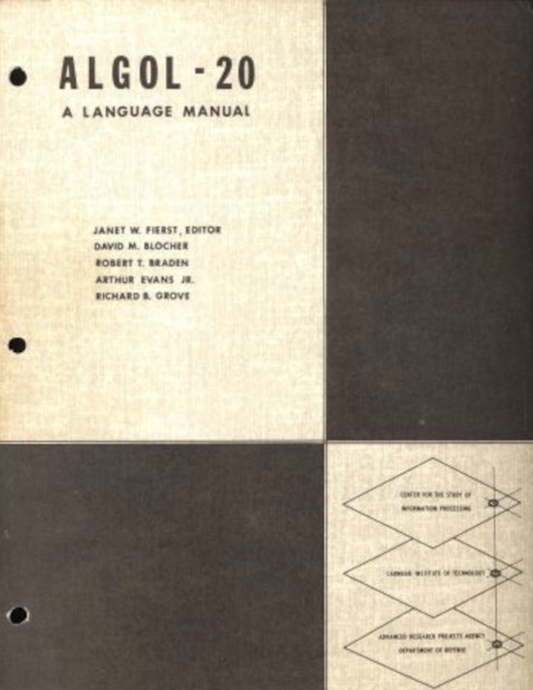

## Preliminary report (1958)

- Function definition (`=expr`), call is expression
- Procedures (`PROCEDURE`) call is a statement

## Revised Algol 60
- Unified procedures and functions (return)
- Many calling conventions and recursion make it hard!

## Restrictionists vs. Trickologists
"The mathematical concept of a _function as a mapping from domain to range_ ... which absolutely excludes any kind of so-called side effects."

<!--
essentially the mathematical concept of a function as a mapping from domain to range ...
absolutely excludes any kind of so-called side effects.
c.f. The remaining trouble spots in ALGOL 60
[Preliminary report (1958)](https://dl.acm.org/doi/pdf/10.1145/377924.594925)
-->

----------------------------------------------------------------------------------------------------
- template: icons

# Functions
## In early programming languages

- *fa-signature* Subroutine terminology slowly abandoned
- *fa-list* Function becomes sequence of instructions
- *fa-scissors* Distinction between functions vs. procedures
- *fa-terminal* Mathematical ideas, worry about side effects


****************************************************************************************************
- template: subtitle

# Functions
## From CLP to C

----------------------------------------------------------------------------------------------------
- template: content
- style: li { font-size:24pt; }

# CPL programming language (1963)

### Functions and routines
- _Function_ (named expression), _routine_ (command sequence)
- A function defined with `≡` uses its free variables directly (by reference), one defined with `=` has them evaluated ... (by value).

---

### Logical influence
- Designers include Strachey and Landin (c.f. semantics)
- Explicit reference to Church and $\lambda$ calculus (`where` clauses)
- "...the results of functions
may be lists, arrays and functions themselves,
but not routines." (1963)


<!--
reference to Church from:
https://www.holypython.com/wp-content/uploads/2022/10/CPL_Main_Features.pdf
Free variables in function definitions - 1965 manual: https://www.chilton-computing.org.uk/acl/pdfs/cpl.pdf
-->

----------------------------------------------------------------------------------------------------
- template: content
- style: blockquote { margin:0px; } h3 { letter-spacing:-0.5px;}

# First-class functions (Strachey)

### Fundamental Concepts in Programming Languages (1967)

> Procedures in ALGOL are second class (...) we can write:
>
> ```
> (if x > 1 then a else b) + 6
> ```
>
> We cannot correctly write:
>
> ```
> (if x > 1 then sin else cos)(x)
> ```
>
> nor can we write a type procedure (ALGOL’s nearest approach to a function) with a result
which is itself a procedure.

<!--
https://facweb.cdm.depaul.edu/smitsch/courses/csc447fa23/assets/articles/strachey-fundamental-concepts-in-programming-languages.pdf
-->

----------------------------------------------------------------------------------------------------
- template: largeicons

# History
## From CPL to BCPL and B

- *fa-church* **CPL (1963) Cambridge Programming Language**  
  Slow to be implemented - returning functions is hard!
- *fa-cogs* **BCPL (1967) Basic Combined Programming Language**  
  Drops closures; uses only 'functions', no routines
- *fa-terminal* **B (1969) - Thompson & Ritchie**   
  BCPL subset with new syntax; only function definitions
  <!--
  https://web.archive.org/web/20150611114427/https://www.bell-labs.com/usr/dmr/www/kbman.pdf
  functions can be returned but presumably just pointers
  routine still used informally in the memo
  -->

----------------------------------------------------------------------------------------------------
- template: lists

# Evolution from CPL to C

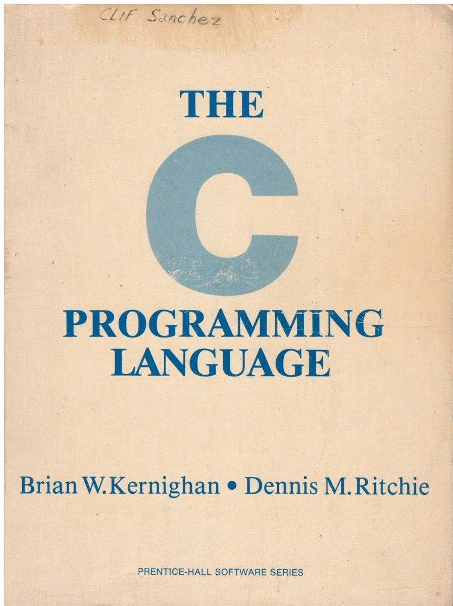

## Logical influence in CPL
- Direct links to lambda calculus
- Strachey's work on semantics
- Variable capture, first class

## Implementation wins in C
- Simplification process (CPL, BCPL, B)
- First-class functions become pointers
- Routines become also functions

****************************************************************************************************
- template: subtitle

# Functions
## Early observations

----------------------------------------------------------------------------------------------------
- template: largeicons

# Early observations

- *fa-tape* **Routines develop on implementation level**  
  Subsidiary sequences, open/closed sub-routines
- *fa-subscript* **Initial intuition from mathematics**  
  Subroutines implement math functions
- *fa-filter* **Meaning of concepts change**  
  Functions equated with subroutines over time
- *fa-spinner* **Implementation forces simplifications**  
  First-class functions and other ideas abandoned
- *fa-graduation-cap* **Formal level exists throughout**  
  Recursive function theory, variable handling, etc.
