- title: Functions, trees, processes (NPRG086)

****************************************************************************************************
- template: title
- style: h1 { font-size:42pt; } h2 { font-size:35pt; margin-top:-30px; }

# NPRG086: **Functions, trees, processes**
## Monads in functional programming

---

**Tomáš Petříček**, 204 (2nd floor)  
_<i class="fa fa-envelope"></i>_ [petricek@d3s.mff.cuni.cz](mailto:petricek@d3s.mff.cuni.cz)  
_<i class="fa-brands fa-bluesky"></i>_ [@tomasp.net](https://bsky.app/profile/tomasp.net)   
_<i class="fa fa-globe"></i>_ [https://tomasp.net](https://tomasp.net)  

****************************************************************************************************
- template: subtitle

# Background
## Thinking about monads

----------------------------------------------------------------------------------------------------
- template: content
- style: .body img { margin:0px 200px; }


----------------------------------------------------------------------------------------------------
- template: content

# Monads in category theory

A _monad_ over a category $\mathcal{C}$ is a triple **$(T, \eta, \mu)$**
where<br /> **$T : \mathcal{C} \rightarrow \mathcal{C}~$** is a functor, **$\eta : {Id}_{\mathcal{C}} \rightarrow T$** and<br />
**$\mu : T^2 \rightarrow T$** are natural transformations such that:

$$$
\begin{array}{l}
\mu_{A} \circ T \mu_A = \mu_{A} \circ \mu_{T A} \\
\mu_{A} \circ \eta_{T A} = \mathit{id}_{T A} = \mu_{A} \circ T \eta_{A}
\end{array}

$$$
\definecolor{mc}{RGB}{137,64,96}
\newcommand{\mbnd}{>\!\hspace{-0.25em}>\!\hspace{-0.27em}=}

----------------------------------------------------------------------------------------------------
- template: content

# Monads in programming

A _monad_ is a triple $(M, \mathit{unit}, \mbnd)$ consisting of a type<br />
constructor $M$ and two operations of the following types:

$$$
\begin{array}{lcl}
\mbnd &::& M x \rightarrow (x\rightarrow M y) \rightarrow M y\\
\mathit{unit} &::& x\rightarrow M x\\
\end{array}

These operations must satisfy the following laws:<br />

$$$
\begin{array}{l}
\mathit{unit}~a~\mbnd~f ~=~ f a\\
m~\mbnd~\mathit{unit} ~=~ m\\
(m~\mbnd~f)~\mbnd~g ~=~ m~\mbnd~(\lambda x.f x~\mbnd~g)
\end{array}

----------------------------------------------------------------------------------------------------
- template: subtitle

# Metaphors
## Explaining monads

----------------------------------------------------------------------------------------------------
- template: content

# Monads as a formal entity

### Monad is a data type

Data type `M a` with operations (satisfying monad laws)

Operation `return` has a type `a -> M a`<br />
Operation `>>=` has a type `(a -> M b) -> (M a -> M b)`

---

### Many examples of monads

- `List a` - list of zero or more `a` values  
- `Maybe a` - either `Just a` or `Nothing`  
- `Reader a` and `State a` for managing state...

----------------------------------------------------------------------------------------------------
- template: content

# Monads as containers

### Monad is like a box of things

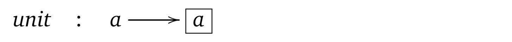
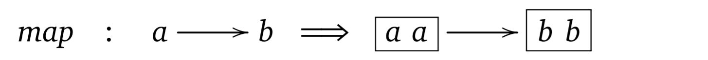

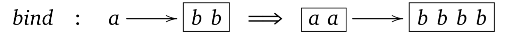

----------------------------------------------------------------------------------------------------
- template: content
- class: noborder

# Monads as computations

### Monad is like a railway track

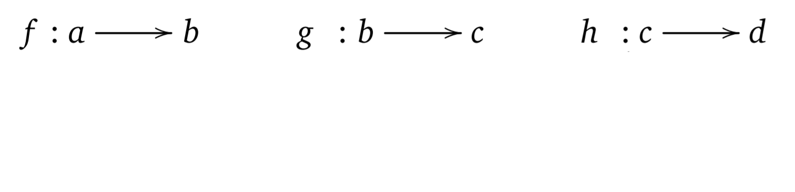
<br />
<br />

----------------------------------------------------------------------------------------------------
- template: content
- class: noborder

# Monads as computations

### Monad is like a railway track

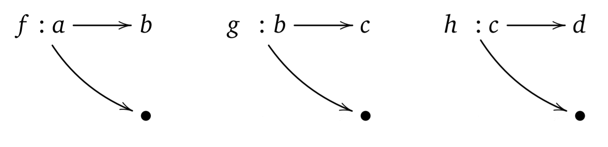
<br />
<br />

----------------------------------------------------------------------------------------------------
- template: content
- class: noborder

# Monads as computations

### Monad is like a railway track

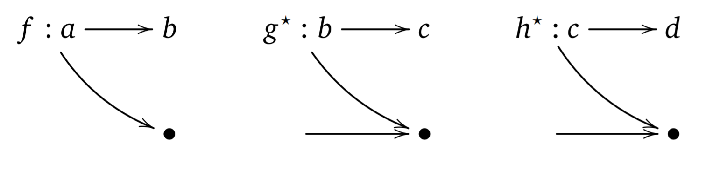
<br />
<br />

----------------------------------------------------------------------------------------------------
- template: content
- class: noborder

# Monads as computations

### Monad is like a railway track

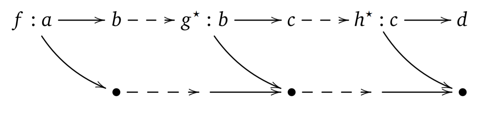
<br />
<br />

----------------------------------------------------------------------------------------------------
- template: icons

# Metaphors
## Thinking about monads

- *fa-brain* Cognitive view of maths (Lakoff & Núñez)
- *fa-car-side* Movement when composing computations
- *fa-gift* Inside/outside when using containers
- *fa-rainbow* Metaphors criticised as too concrete!
- *fa-cart-shopping* Symbol pushing also a metaphor...

****************************************************************************************************
- template: subtitle

# Origins
## Programming with monads (1985-95)

----------------------------------------------------------------------------------------------------
- template: icons

# Functions
## Problematic extra behaviour

- *fa-arrow-rotate-right* **Partiality** - function not defined / not terminating
- *fa-heart-crack* **Exceptions** - computations fail with no result
- *fa-computer-mouse* **Input/output** - interaction with the environment
- *fa-code-fork* **Non-determinism** - produce multiple results
- *fa-font* **Parsers** - detect patterns in input stream

----------------------------------------------------------------------------------------------------
- template: lists

# Two struggles with extra behaviour

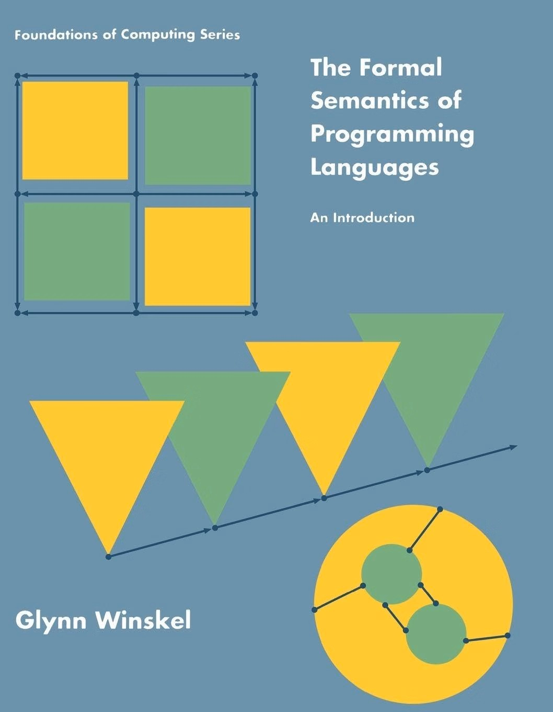

## Formal semantics
- Formal model of real-world programming languages
- Deal with messy aspects of reality

## Language design

- Unify handling of multiple aspects
- Encode extras in pure languages
- Most can be encoded already,  
  but some cannot (input/output)

----------------------------------------------------------------------------------------------------
- template: image
- class: smaller nologo

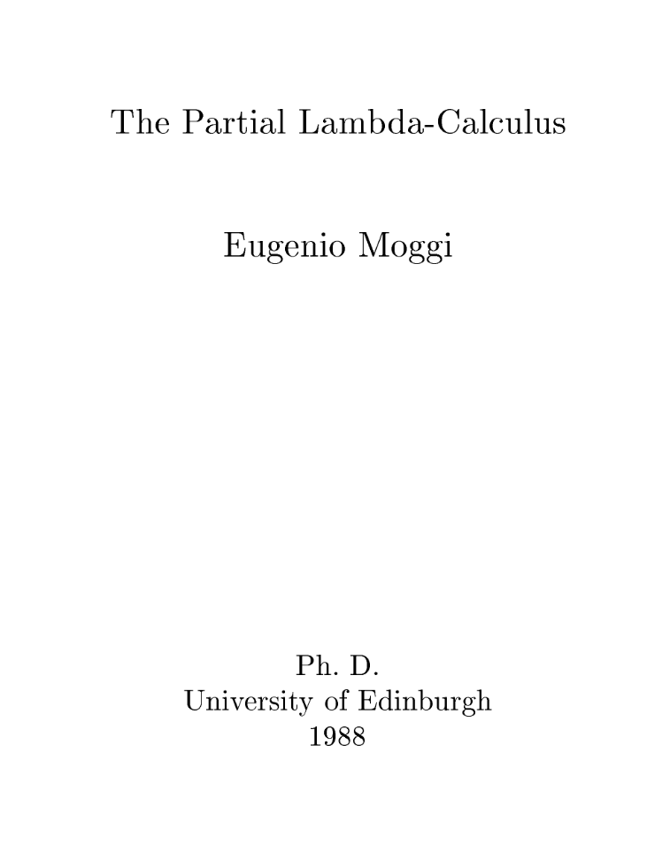

# Case #1: Partiality

## (Moggi, 1988)

Reasoning about partial functions that may fail or may not terminate

**Defines category of  
partial functions**

Dana Scott's domain-theoretic models & LCF

**Language semantics**

----------------------------------------------------------------------------------------------------
- template: lists
- style: h1 em { font-weight:400; font-style:normal; } h1 { font-size:37pt; }
    img { max-width:450px !important;}

# Case #2: Lists of successes _(Wadler, 1985)_

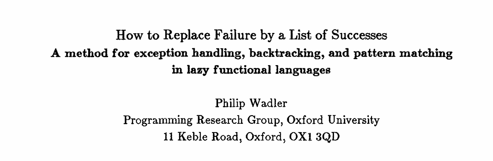

## Model extras as lists

- Failures (one or zero)
- Backtracking (lazy lists)
- Parsing (list of matches)

## List comprehensions notation

- Miranda's `[ a + b | a <- foo, b <- foo ]`
- Translated to list-processing primitives  
  `flatMap : a list -> (a -> b list) -> b list`
- Syntax works for many extras!
- Not recognized as monadic (yet)


----------------------------------------------------------------------------------------------------
- template: lists
- style: h1 em { font-weight:400; font-style:normal; } h1 { font-size:37pt; }
    li { list-style-type:square; }

# Lists and exceptions _(Spivey, 1989 & 1990)_

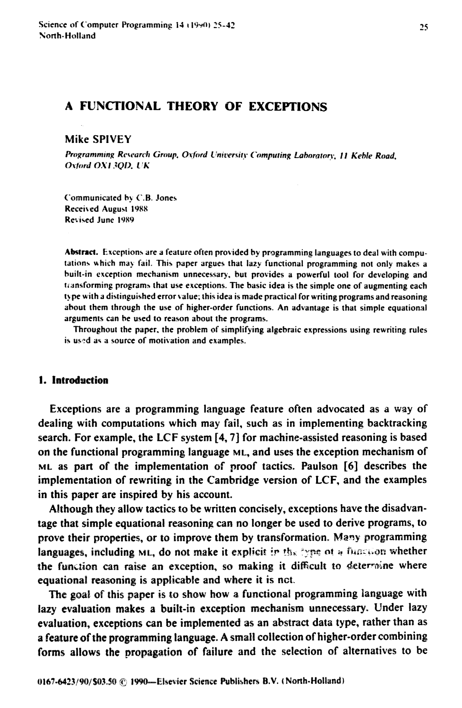

## Theory of lists (1989)

- Categorical model of lists & expr trees
- "monads seem especially promising"

## Theory of exceptions (1990)

- $\bullet : (\alpha \rightarrow \beta) \rightarrow \textnormal{maybe}~\alpha \rightarrow \textnormal{maybe}~\beta$  
- $prop : \textnormal{maybe}~(\textnormal{maybe}~\alpha) \rightarrow \textnormal{maybe}~\alpha$  
- $succeed : \alpha \rightarrow \alpha$ [sic]
- Monad, forming category via Kleisli construction
- Derive laws of list comprehensions

----------------------------------------------------------------------------------------------------
- template: content
- style: img { float:right; max-width:350px; margin-top:-20px; } h1 { font-size:36pt; }

# Kent Applicative Operating System


**John Cupitt** (Kent, 1988, 1989)
14,000 lines of Miranda code

Refined Simon Thompsons interaction combinators

```text
return : a -> interact a
comp : (a -> interact b) -> (interact a -> interact b)
```

Based on stream-based input/output model (Landin, 1970s)  
`Dialogue = [Response] -> [Request]` (Haskell 1.2, 1985)

Monadic operations but without reference!

----------------------------------------------------------------------------------------------------
- template: content
- style: h1 em { font-weight:200; font-style:normal; } h1 { font-size:34pt; letter-spacing:-1.5px; }
    img { max-width:700px; margin-left:80px; }

# Notions of computation & monads _(Moggi, 89-91)_

Cites discussion with Martin Hyland at PhD defence  
Categorical semantics of computation based on monads

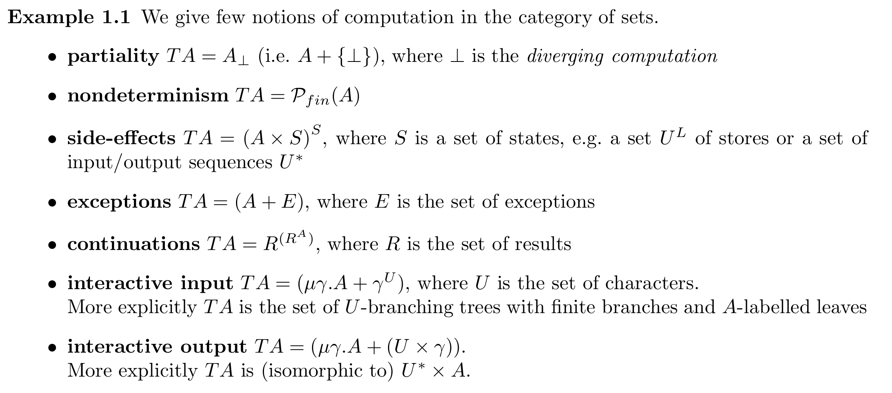

----------------------------------------------------------------------------------------------------
- template: icons

# Model
## Supercooled liquid?

- *fa-arrow-left* List comprehensions syntax
- *fa-square* Two ways of expressing monads (bind/join)
- *fa-repeat* Links to monads in category theory
- *fa-list* Definitions of monads for common extras
- *fa-building-columns* Oxford, Edinburgh, Kent, Glasgow

----------------------------------------------------------------------------------------------------
- template: image
- class: smaller
- style: h1 { font-size:28pt; } h2 { font-size:26pt; }

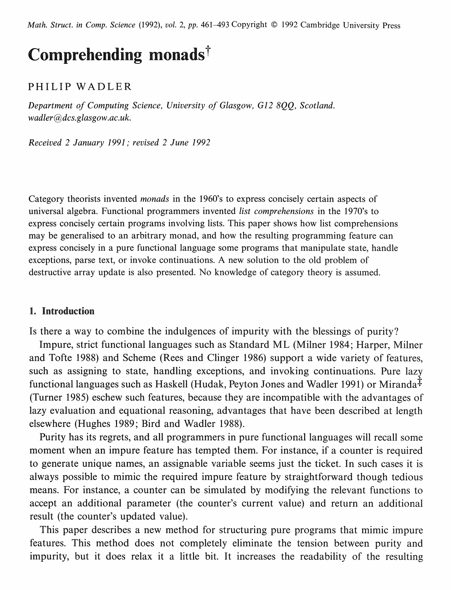

# Comprehending monads
## (Wadler, 1990-92)

**Monads for design**

Examples of monads from Moggi - strictness, parsers, state, exceptions, IO

From list comprehensions to monad comprehensions

Join or "container" model

****************************************************************************************************
- template: subtitle

# Applications
## Lazy functional IO

----------------------------------------------------------------------------------------------------
- template: content
- style: p { font-size:30pt; font-style:italic; } h1 em { font-style:normal; font-weight:300; }

# Changing world _(Wadler, 1990)_

An old canard against functional languages is that they cannot change the world:

They do not "naturally" cope with changes of state, such as altering a location in memory,
changing a pixel on a display, or sensing when a key is pressed.

----------------------------------------------------------------------------------------------------
- template: lists

# Earlier ways of handling IO

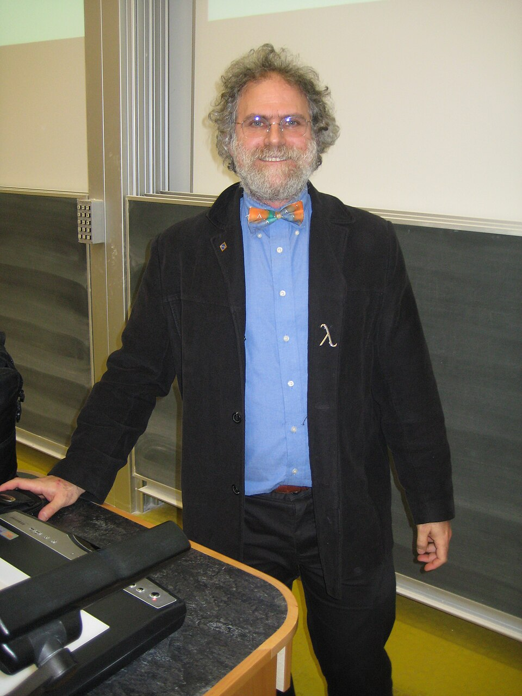

## Stream-based models

- `[Response]->[Request]` function
- Recursion to manage state
- Use combinators to compose
- Haskell 1.2 original model

## World-based models

- Take `World` and return new `World`
- Can be duplicated, used & discarded!

----------------------------------------------------------------------------------------------------
- template: image
- class: smaller

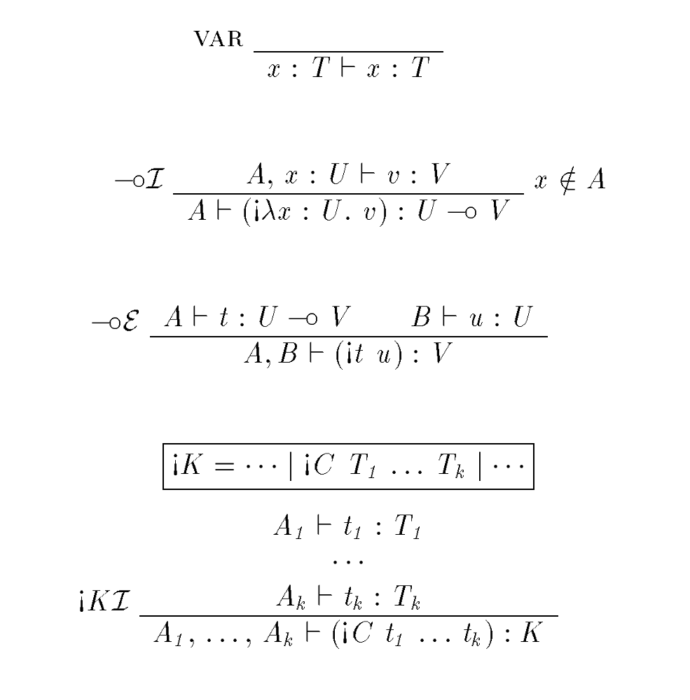

# Linear types can change the world
## (Wadler, 1990)

Two operations to rule out!

- `dup a = (a, a)`
- `kill a = ()`

Type system based on ideas from linear logic

**Lot to add to Haskell!**

----------------------------------------------------------------------------------------------------
- template: content
- style: h1 { font-size:30pt; } h1 em { font-style:normal; font-weight:200; } img { max-height:250px; margin-left:80px;}
- class: bigger

# Imperative functional programming<br> _(Peyton Jones & Wadler, 1993)_

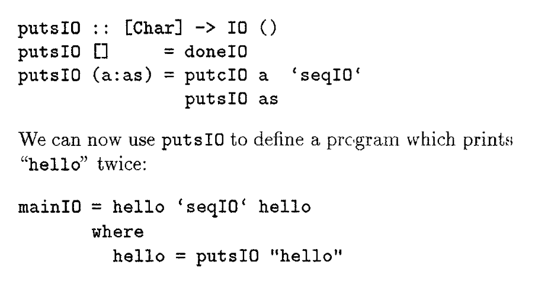

### Works thanks to laziness!

- Type `IO a` for effectful computations
- Operation `seqIO : IO () -> IO a -> IO a`

----------------------------------------------------------------------------------------------------
- template: icons

# Monads
## Handling input and output

- *fa-ice-cream* Linear types fit research programme!
- *fa-cogs* Sound theory, impractical for implementation
- *fa-computer* Monads as an alternative practical solution
- *fa-clipboard-question* Unclear what the IO monad denotes
- *fa-comments* Criticisms - is it even a monad??

****************************************************************************************************
- template: subtitle

# Not the essence
## Metaphors and syntax

----------------------------------------------------------------------------------------------------
- template: content
- style: h1 { font-size:30pt; } h1 em { font-style:normal; font-weight:200; }
   img { margin-bottom:40px;}

# Essence of Functional Programming _(Wadler, 1992)_

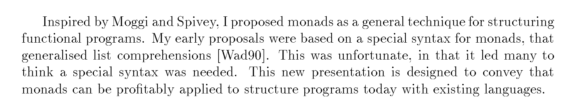

---

### Why have regrets about syntax?

Syntax is not **the essence** of the idea!  
Becomes very useful and important in practice...  
Not part of the research programme?

----------------------------------------------------------------------------------------------------
- template: content
- class: two-column

# Two notations for monads

### Comprehensions

Existed before for lists  
Used to handle extras!

```
  [ a + b |
      a <- foo
      b <- bar ]
```

Generalized but dropped    
**Monad as container**

---

### Monad syntax

Introduced in IO context
Launchbury's Gofer (1993)

```text
{ a <- foo;
  b <- bar
  return (a + b) }
```

Added to Haskell in 96  
**Monad as computation**

----------------------------------------------------------------------------------------------------
- template: image
- class: smaller

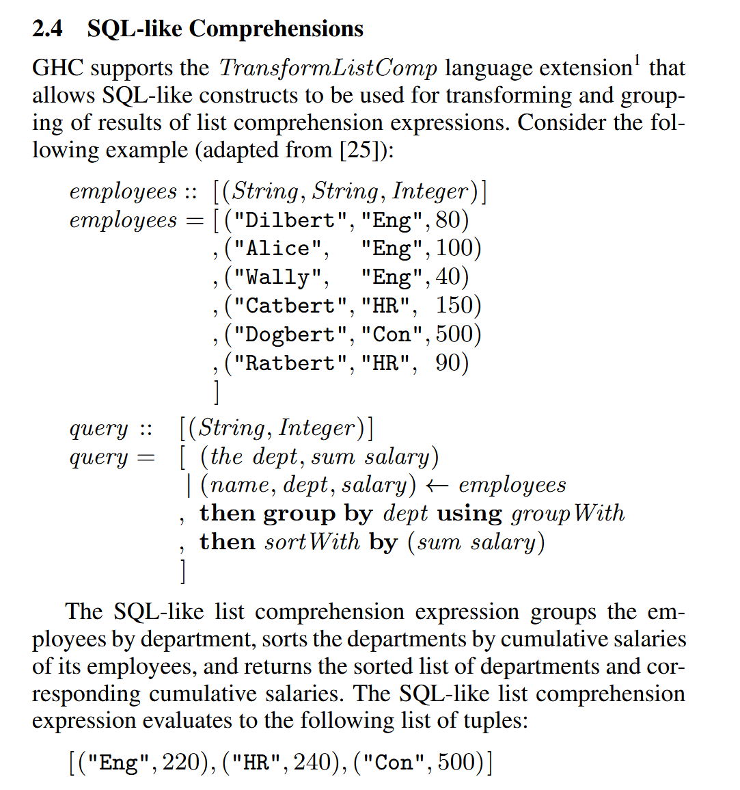

# SQL comprehensions

**Bringing back monad comprehensions**

Requires additional operations: groupWith, filter, zipWith, etc.

Practical motivation, no categorical model!

----------------------------------------------------------------------------------------------------
- template: content
- style: .body img { transform: scale(1.1); margin-left:40px; }

# The F# Computation Zoo

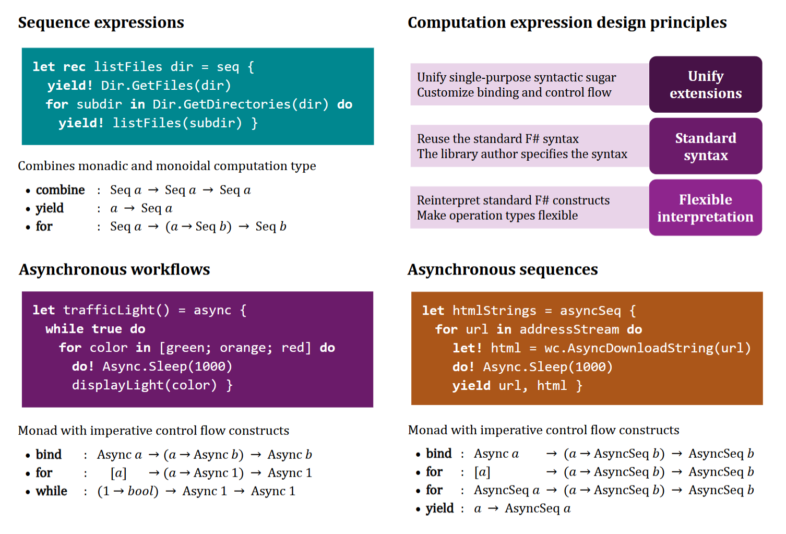

----------------------------------------------------------------------------------------------------
- template: icons

# Monads
## Comprehensions and do notation

- *fa-seedling* Essential part of the origins!
- *fa-box-archive* Comprehensions for containers
- *fa-circle-play* Do notation for computations
- *fa-newspaper* Interesting research extensions
- *fa-wand-sparkles* Syntax seen as spurious design aspect
- *fa-hand* In principle not needed, but...


****************************************************************************************************
- template: subtitle

# Challenges
## Monadic parsers (or not)

----------------------------------------------------------------------------------------------------
- template: content

# Tempting harmful abstraction?

`Parser a` reads input string and produces value `a`

---

- Parse one thing and then another thing<br />
 `Parser a -> Parser b -> Parser (a * b)`

- Try parsing in two ways, use the first success<br />
 `Parser a -> Parser a -> Parser a`

---

Parsers can be extended to support  
monadic operations `>>=` and `return`.

----------------------------------------------------------------------------------------------------
- template: code
- class: smaller

```haskell
-- Parse array literal
ints :: Parser [Int]
ints =
 [ n:ns |
    _ <- char ’[’
    n <- int
    ns <- many nint
    _ <- char ’]’]

-- Parse int after comma
nint :: Parser Int
nint =
 [ x |
    _ <- char ’,’
    x <- int ]    
```

# Monadic parsers

Monadic compre&shy;hensions helpful for readability!

**Variables `n` and `ns` in  
scope after bound**

Useful for IO and other monads, not much here...

----------------------------------------------------------------------------------------------------
- template: largeicons

# Parsers
## Monadic operations

 - *fa-square-xmark* **Hutton (1989-90)** - no monadic bind
 - *fa-square-minus* **Wadler (1987)** - using `flatMap`
 - *fa-square-plus* **Wadler (1990-92)** - monadic bind added
 - *fa-square-plus* **Hutton & Meijer (1996)** - monadic parsers!
 - *fa-square-up-right* **Wadler (1997)** - far superior style!
 - *fa-square-xmark* **Swierstra & Duponcheel (1996)** - drop bind

---------------------------------------------------------------------------------------------------
- template: content

# Tempting harmful abstraction?

### Swierstra & Duponcheel (1996)

The normal disadvantages of conventional [monadic] parsers,
such as their lack of speed and their poor error reporting are remedied.

The techniques [do not] extend to monadic parsers. [T]he monadic
formulation [causes] the evaluation of the parser construction over and over (...).

****************************************************************************************************
- template: subtitle

# Challenges
## Composing monadic effects

----------------------------------------------------------------------------------------------------
- template: largeicons
- style: h1 { font-size:36pt; }

# Monad transformers to effect handlers

- *fa-layer-group* **Composing using monad transformers (1995)**  
  Layers of effects, `lift` operations through the stack
- *fa-link-slash* **Transformers break down**  
  Order fixed early, liftings multiply, `catch` and `callcc` hard
- *fa-shapes* **Algebraic effects, revisiting theory (2001)**  
  Semantics with effects as operations with equations
- *fa-hand-sparkles* **From exception handlers to effect handlers**  
  Shift to design, add practically-motivated handlers


****************************************************************************************************
- template: subtitle

# Conclusions
## Monads in programming

----------------------------------------------------------------------------------------------------
- template: largeicons
- style: h1 { font-size:36pt; }

# History & philosophy of monads

- *fa-arrow-right* **Still dealing with functions...**   
  How to model or implement extra behaviours?
- *fa-not-equal* **Strong "Algol" research programme**  
  Language should have a clean formal model!
- *fa-search* **Same structure discovered repeatedly**  
  Multiple implementations, discoveries in theory
- *fa-worm* **Less room for entity evolution?**   
  Equivalent definitions chosen as needed
