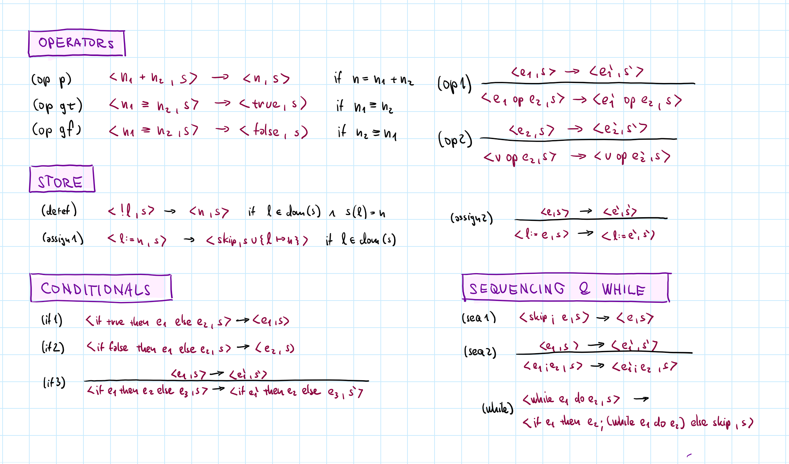
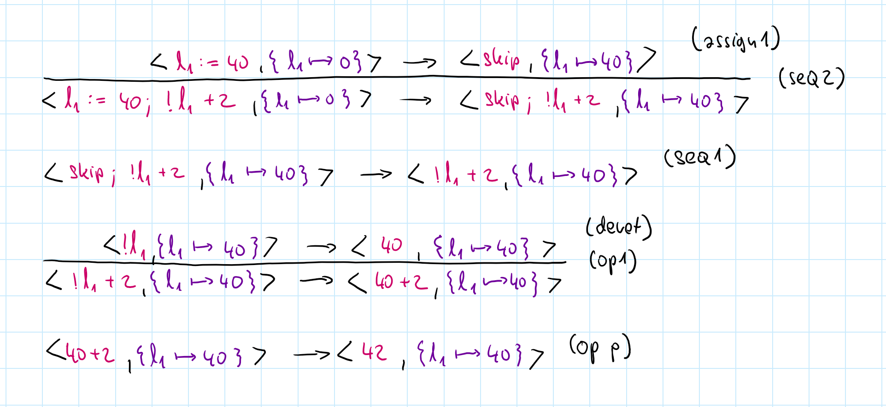
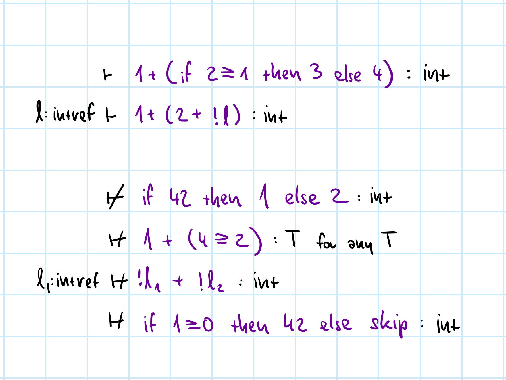
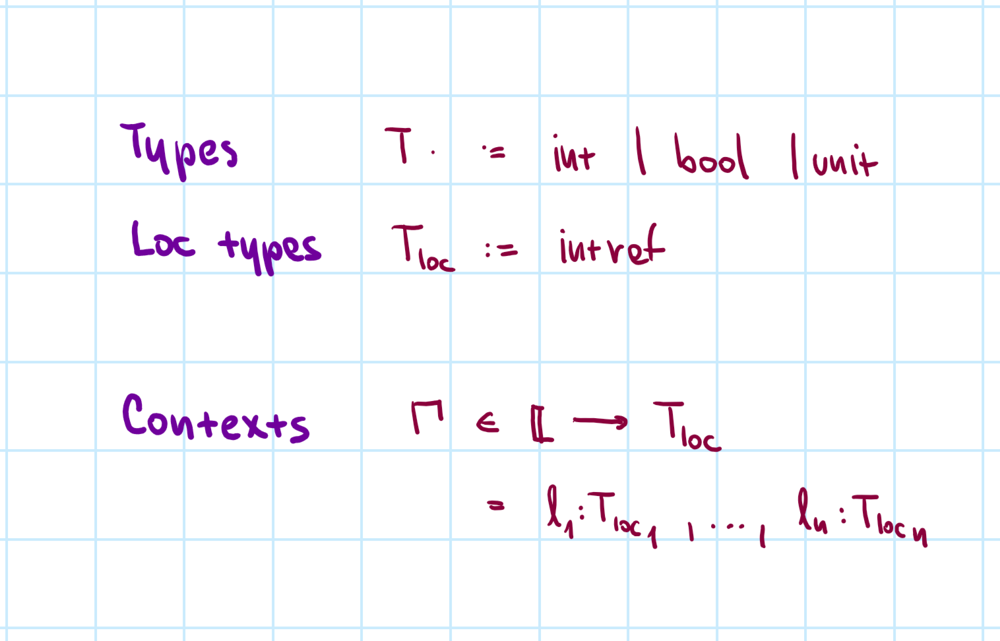
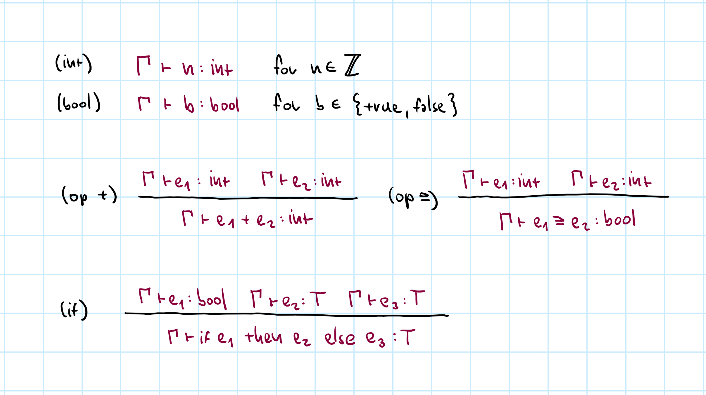
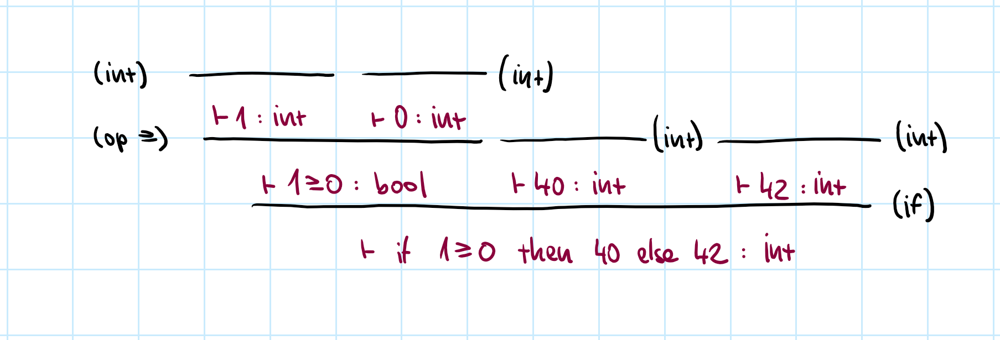
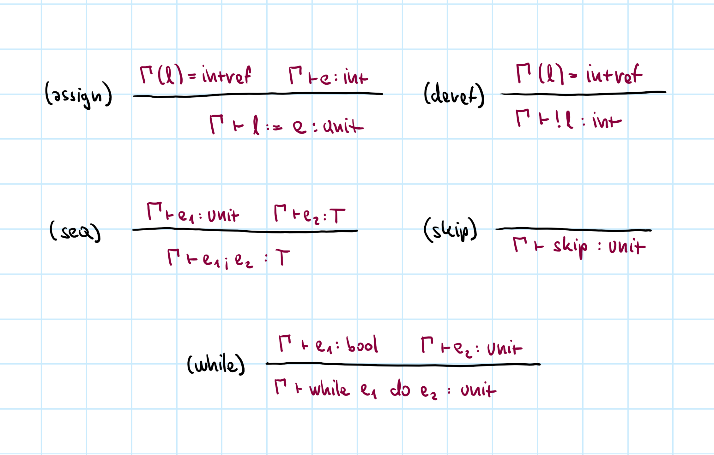
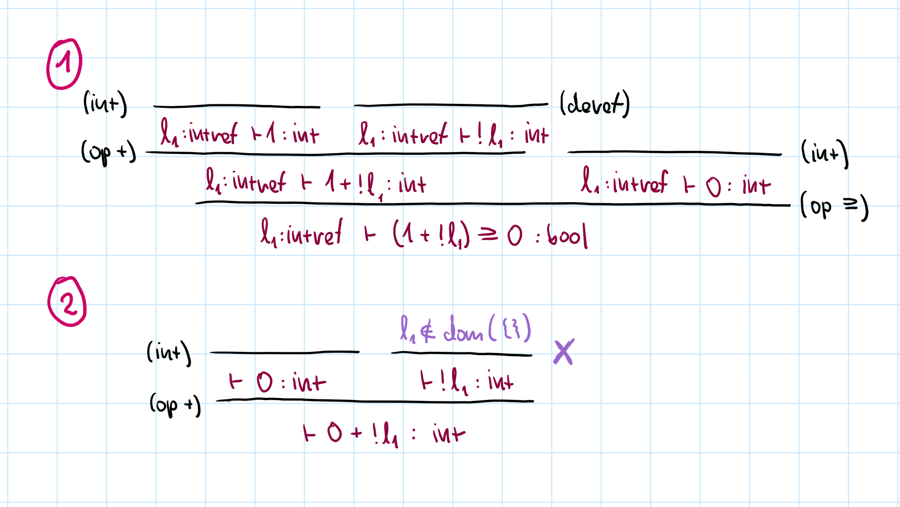

- title: Theory of Programming Languages

****************************************************************************************************
- template: title
- style: h1 { font-size:36pt; letter-spacing:-1px } h2 { font-size:32pt; margin-top:-35px; }

# NPRG085: **Theory of Programming Languages**
## Types for imperative language

---

**Tomáš Petříček** and **Vít Šefl**  

_<i class="fa fa-envelope"></i>_ [petricek@d3s.mff.cuni.cz](mailto:petricek@d3s.mff.cuni.cz) | [sefl@ksvi.mff.cuni.cz](mailto:sefl@ksvi.mff.cuni.cz)  
_<i class="fa fa-globe"></i>_ [@tomasp.net](https://bsky.app/profile/tomasp.net) &nbsp;|&nbsp; [https://tomasp.net](https://tomasp.net)  

****************************************************************************************************
- template: subtitle

# Reminder
## Operational semantics

----------------------------------------------------------------------------------------------------
- template: content
- style: .body img { width:98%;}

[](img/types/semantics.png)

**Derivation rules for the full L1 language**

----------------------------------------------------------------------------------------------------
- template: content
- style: .body img { width:80%;}

[](img/types/derivation.png)

**Step-by-step derivation example**  
Sequence using individual $\rightarrow$ steps   
Every $\rightarrow$ justified using a rule name!

****************************************************************************************************
- template: subtitle

# Types
## Motivation and background

----------------------------------------------------------------------------------------------------
- template: icons

# Types
## Different uses of types

- *fa-brain* Define what programs make sense
- *fa-bug* Prevent errors before execution
- *fa-square-check* Guarantee other program properties
- *fa-book* Useful information for the programmer
- *fa-cogs* Guide compiler optimizations

----------------------------------------------------------------------------------------------------
- template: lists
- class: smaller noborder

# Types across languages


## TypeScript
- Editor tooling and documentation
- No strict formal guarantees

## OCaml
- Guarantee safety properties
- Allow efficient compilation

## Agda, Idris, Lean
- Use types to prove (program) properties!

----------------------------------------------------------------------------------------------------
- template: code

```
$ cat test.c
#include <stdio.h>

int main(void) {
  char msg[] = "Hello world";
  char buf[4];

  buf[4] = 'J';
  printf("%s\n", msg);
  return 0;
}
```

# What types guarantee?

**No undefined behavior!**


----------------------------------------------------------------------------------------------------
- template: code

```
$ cat test.c
#include <stdio.h>

int main(void) {
  char msg[] = "Hello world";
  char buf[4];

  buf[4] = 'J';
  printf("%s\n", msg);
  return 0;
}

$ gcc test.c && ./test
Jello world
```

# What types guarantee?

**No undefined behavior!**

---

Writing to a value out of array bounds

C does not specify how arrays are allocated

----------------------------------------------------------------------------------------------------
- template: largeicons

# Types
## What is correctness?

- *fa-explosion* **There is no undefined behavior**  
  Out of bounds access, reading non-existent field, etc.

- *fa-pencil* **Expressing undefined behavior formally**  
  It never happens that there is no reduction $\langle e, s \rangle \not\rightarrow$

- *fa-arrow-rotate-right* **Beware of non-termination**  
  There may be no $v$ such that $\langle e, s \rangle \rightarrow^{*} \langle v, s' \rangle$

- *fa-memory* **Beware of starting with valid $s$**  
  Even the $(\text{assign})$ rule requires that $l \in \text{dom}(s)$

****************************************************************************************************
- template: subtitle

# Types
## Defining type systems

----------------------------------------------------------------------------------------------------
- template: content
- style: .big { transform: scale(1.7); transform-origin: top left; float:right; margin:0px 200px 0px 50px; } h3 { margin-top:30px; }

# Typing judgement

<div class="big">

$\boxed{\Gamma \vdash e : \tau}$

</div>

Given a typing context $\Gamma$, the  
type of the expression $e$ is $\tau$.

- $\Gamma$ - locations in store, variables in scope
- $e$ - expression we want to type check
- $\tau$ - type that we want to verify
- Relation defined using inference rules

---

### Type checking only

- Know the context $\Gamma$, expression $e$ and type $\tau$!
- Looking for a derivation tree using typing rules
- Type inference & program synthesis harder!

----------------------------------------------------------------------------------------------------
- template: image
- class: bigger



# Examples

---

Arguments of correct types

References  
are available

No mismatched return values

----------------------------------------------------------------------------------------------------
- template: image



# Syntax of types

**Primitive types only**

Contexts $\Gamma$ are finite partial maps from location names $\mathbb{L}$ to location types $T_{loc}$

Location types are  
only ints (for now)

----------------------------------------------------------------------------------------------------
- template: content
- class: nologo



**Typing rules for primitives, operators and if**  
Assumptions are other judgements or side-conditions

----------------------------------------------------------------------------------------------------
- template: content

# Example typing derivation



Look at the syntactic structure, choose a rule to apply  
Repeat for all sub-expressions until done  
**Conditional expression can be of any type!**

----------------------------------------------------------------------------------------------------
- template: image
- class: bigger



# Store and sequencing

Store access requires $l$ is in $\Gamma$

No construct modifies $\Gamma$ (now)

----------------------------------------------------------------------------------------------------
- template: content



**Example #1**: Arguments match and $l_1$ is in the context  
**Example #2**: Accessing undefined location $l_1$

----------------------------------------------------------------------------------------------------
- template: icons

# Typing rules
## Interesting design alternatives

- *fa-spell-check* Syntax directed rules determined by structure
- *fa-arrow-down-short-wide* Context is a set, not ordered list
- *fa-bag-shopping* We never add to or remove from the store
- *fa-trash-can* Sequencing requires `skip` like the semantics

****************************************************************************************************
- template: subtitle

# Properties
## What is a good type system?

----------------------------------------------------------------------------------------------------
- template: content

# Well-typed programs do not go wrong

----------------------------------------------------------------------------------------------------
- template: content

# Well-typed programs do not get stuck

### Theorem (Progress)

If $\Gamma \vdash e : \tau$ and $dom(\Gamma)\subseteq dom(s)$ then either $e$ is a  
value or there exist $e', s'$ such that $\langle e, s \rangle \rightarrow \langle e', s'\rangle$.

<br>

---

### Theorem (Preservation)

If $\Gamma \vdash e : \tau$ and $dom(\Gamma) \subseteq dom(s)$ and
$\langle e, s \rangle \rightarrow \langle e', s'\rangle$  
then $\Gamma \vdash e' : \tau$
and $dom(\Gamma) \subseteq dom(s')$.

----------------------------------------------------------------------------------------------------
- template: content

# Well-typed programs do not get stuck

### Theorem (Safety)

If $\Gamma \vdash e : \tau$ and $dom(\Gamma)\subseteq dom(s)$ and
$\langle e, s \rangle \rightarrow^{*} \langle e', s'\rangle$  
then either
$e'$ is a value or there exist $e'', s''$ such  
that $\langle e', s' \rangle \rightarrow \langle e'', s''\rangle$.

<br>

---

### What this means

- Well-typed programs never get stuck
- Well-typed programs never reach undefined behavior
- They may still run forever

****************************************************************************************************
- template: subtitle

# Conclusions
## Types for imperative language

----------------------------------------------------------------------------------------------------
- template: icons

# Conclusions

- *fa-palette* Types serve many purposes in practice
- *fa-square-check* Our models are about type safety
- *fa-ban* No undefined behavior / no stuck state
- *fa-shield-heart* Safety = Progress + Preservation
