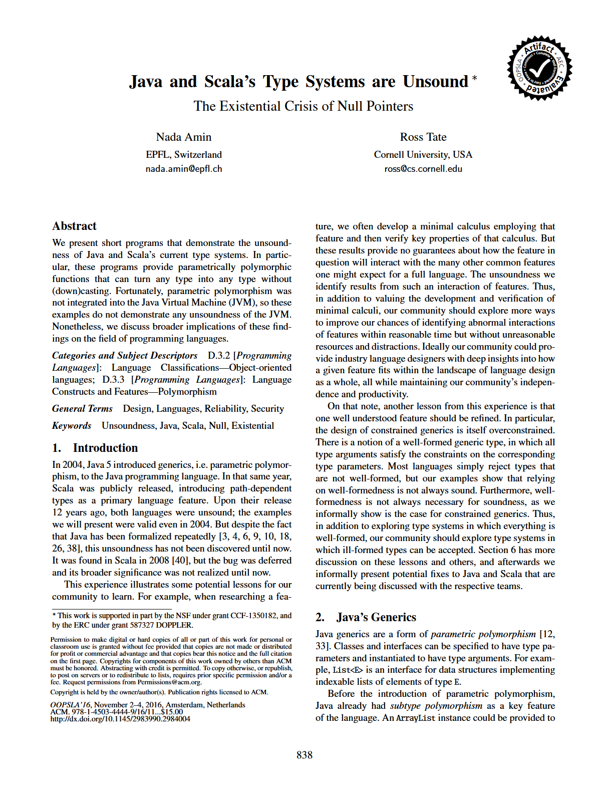
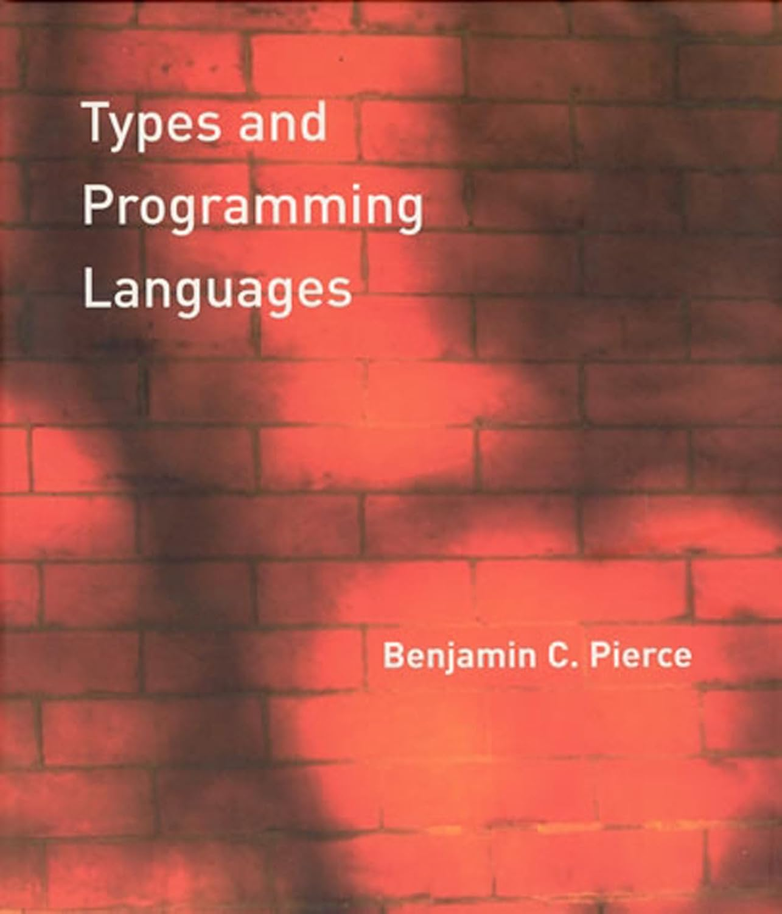
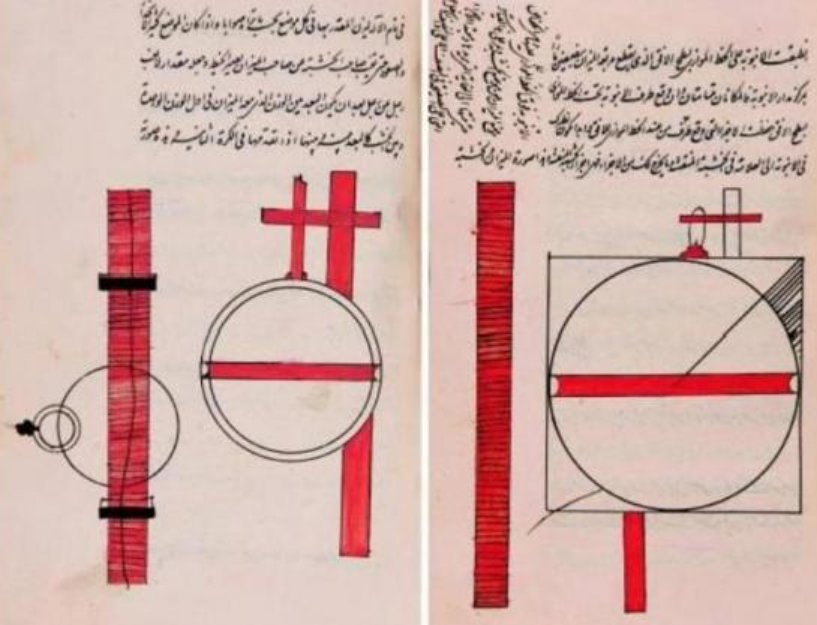
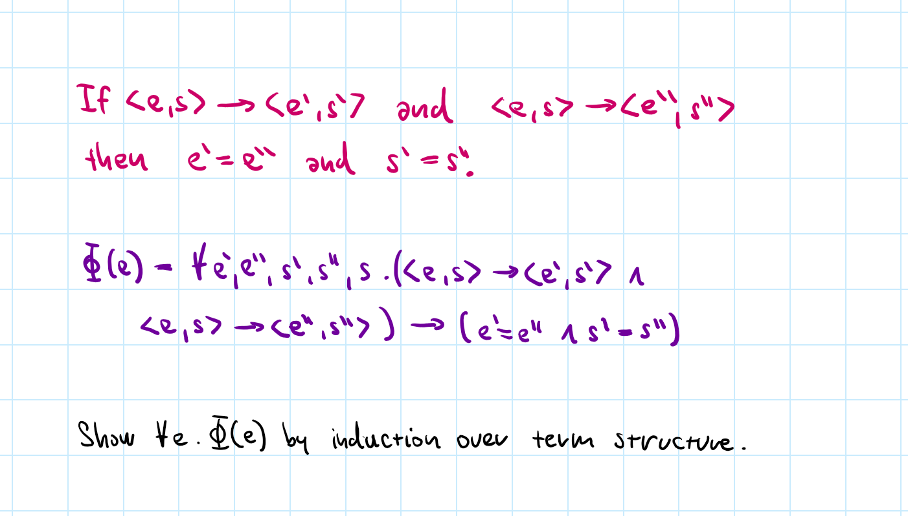
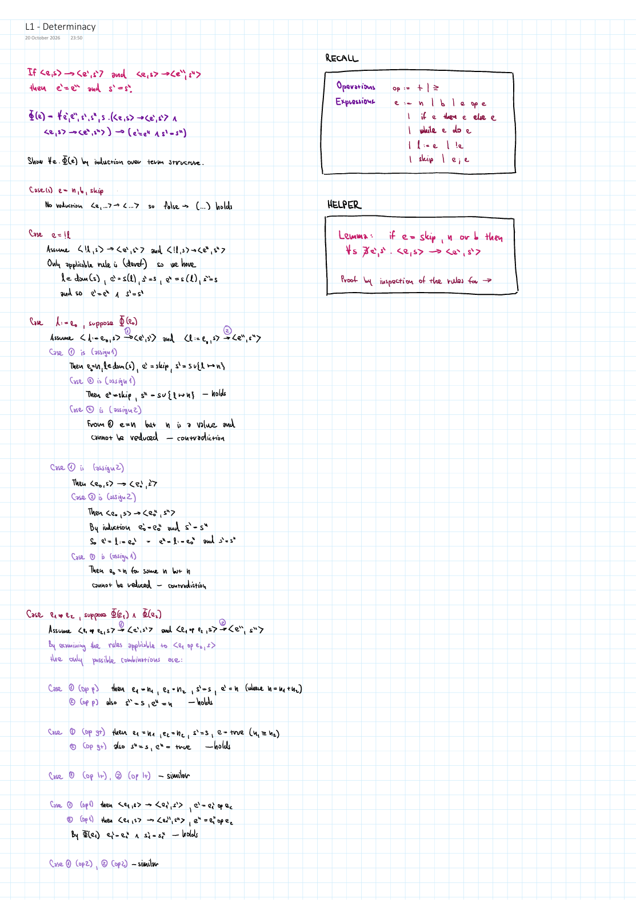
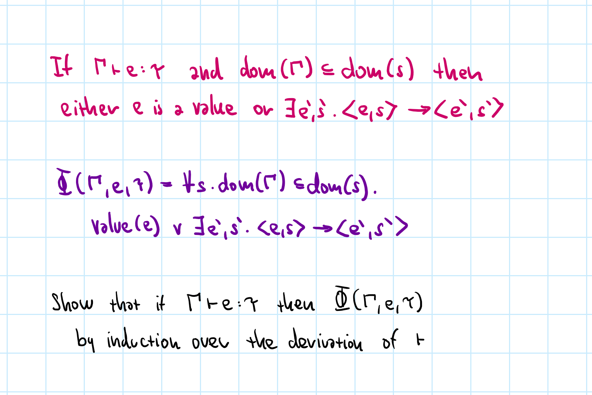
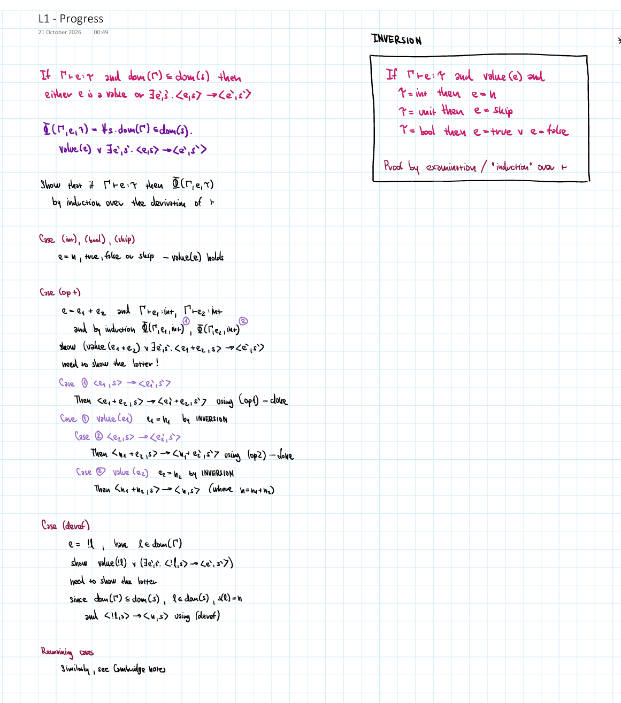
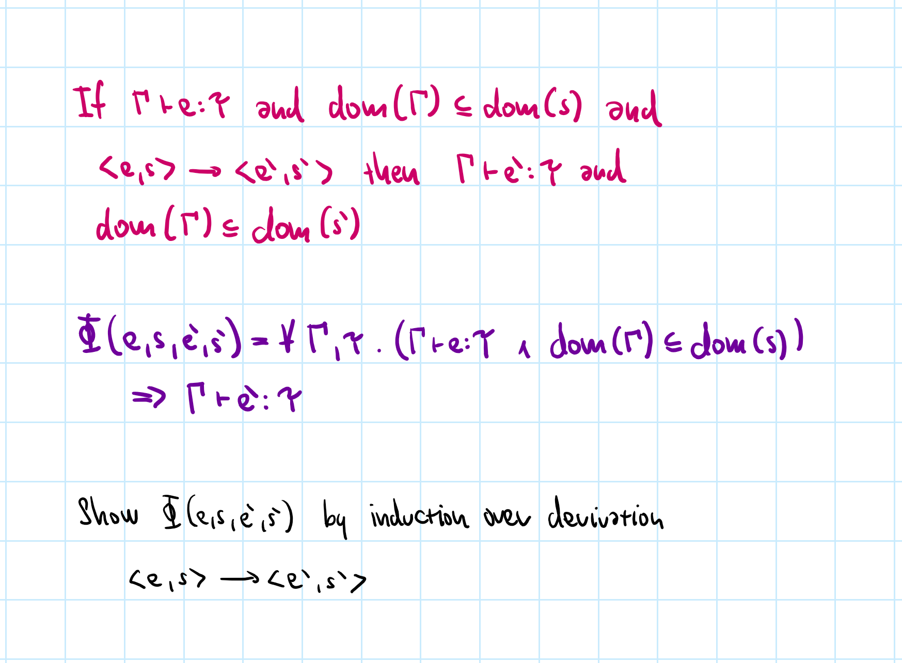
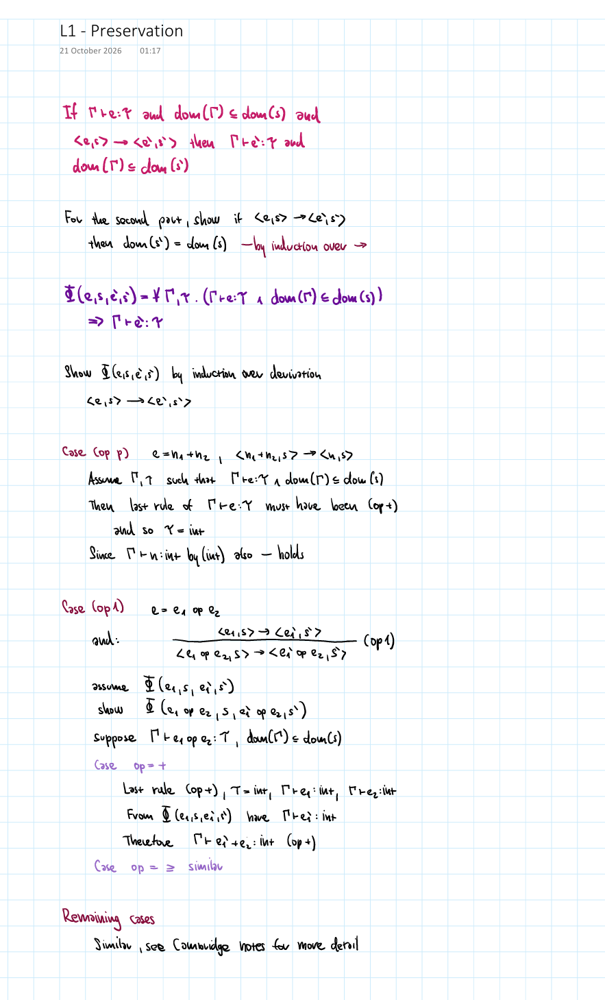

- title: Theory of Programming Languages

****************************************************************************************************
- template: title
- style: h1 { font-size:36pt; letter-spacing:-1px } h2 { font-size:32pt; margin-top:-35px; }

# NPRG085: **Theory of Programming Languages**
## Properties of a small imperative language

---

**Tomáš Petříček** and **Vít Šefl**  

_<i class="fa fa-envelope"></i>_ [petricek@d3s.mff.cuni.cz](mailto:petricek@d3s.mff.cuni.cz) | [sefl@ksvi.mff.cuni.cz](mailto:sefl@ksvi.mff.cuni.cz)  
_<i class="fa fa-globe"></i>_ [@tomasp.net](https://bsky.app/profile/tomasp.net) &nbsp;|&nbsp; [https://tomasp.net](https://tomasp.net)  

****************************************************************************************************
- template: subtitle

# Properties
## Programming language theories

----------------------------------------------------------------------------------------------------
- template: image

# Scala and Java  are unsound

Unexpected interaction between _subtyping_ and _implicit nulls_.

**Sound in isolation!**

----------------------------------------------------------------------------------------------------
- template: lists

# Why bother with properties?

## Understanding subtle cases
- What relates to what
- Corner cases worth checking
- Basis for larger proofs

## What we want to know
- Language evaluation is deterministic
- Type system is sound
- Type inference is decidable

----------------------------------------------------------------------------------------------------
- template: content

# Language evaluation is deterministic

### Theorem (Determinacy)

If $\langle e, s \rangle \rightarrow \langle e', s'\rangle$ and
also $\langle e, s \rangle \rightarrow \langle e'', s''\rangle$  
then $e'=e''$ and $s'=s''$.

 

---

### Property of evaluation
- No mention of types - just reduction relation
- Not necessarily through the same reduction!
- Does not hold for some languages (e.g., concurrency)

----------------------------------------------------------------------------------------------------
- template: content

# Well-typed programs do not get stuck

### Theorem (Safety)

If $\Gamma \vdash e : \tau$ and $dom(\Gamma)\subseteq dom(s)$ and
$\langle e, s \rangle \rightarrow^{*} \langle e', s'\rangle$  
then either
$e'$ is a value or there exist $e'', s''$ such  
that $\langle e', s' \rangle \rightarrow \langle e'', s''\rangle$.

 

---

### Combination of two properties

- **Progress** - a well-typed program is a value or can reduce
- **Preservation** - reduction preserves the type of a program

****************************************************************************************************
- template: subtitle

# Induction
## Proof technique

----------------------------------------------------------------------------------------------------
- template: lists
- class: smaller nologo

# Three forms of induction

## Induction over natural numbers
$\forall x\in\mathbb{N}.\Phi(x)$  if $\Phi(0)$ and $\Phi(x)\Rightarrow\Phi(x+1)$

## Induction over structure of a term
Show that $\forall e\in\mathbb{E}.\Phi(e)$ by showing $\Phi(e)$ holds for  
leaves and $\Phi(e_1),\ldots,\Phi(e_n) \Rightarrow \Phi(\texttt{op}(e_1, \ldots, e_n))$

## Induction over a relation
Show that $\forall x.R(x) \Rightarrow \Phi(x)$ by showing $\Phi(J)$ holds for axioms (no assumptions) and $\Phi(x)$ follows from assumptions $\Phi(x_1), \ldots, \Phi(x_n)$ for each rule
$\dfrac{x_1, \ldots, x_n}{x}$.  

----------------------------------------------------------------------------------------------------
- template: icons

# Induction
## Three properties

- *fa-arrows-to-dot* **Determinacy** - induction over term structure
- *fa-arrow-right* **Progress** - induction over $\vdash$ relation
- *fa-lock* **Preservation** - induction over $\rightarrow$ relation
- *fa-regular fa-square-check* **Safety** - induction over $\rightarrow^{*}$ relation

****************************************************************************************************
- template: subtitle

# Determinacy
## Property of evaluation

----------------------------------------------------------------------------------------------------
- template: content
- style: img { max-width:650px; }

# Determinacy

Induction over the structure of expressions

----------------------------------------------------------------------------------------------------
- template: image

# Determinacy

See [details (PDF)](img/properties/l1-determinacy.pdf)

---

 

**Remarks**

Values do not reduce

Careful treatment of what rules could have been used

****************************************************************************************************
- template: subtitle

# Soundness
## Progress and preservation

----------------------------------------------------------------------------------------------------
- template: content
- style: img { max-width:650px; }

# Progress

Induction over the derivation of $\vdash$

----------------------------------------------------------------------------------------------------
- template: image

# Progress

See [details (PDF)](img/properties/l1-progress.pdf)

---

 

**Remarks**

Inversion lemma to know what values can have a given type

----------------------------------------------------------------------------------------------------
- template: content
- style: img { max-width:650px; }

# Preservation

Induction over the derivation of $\rightarrow$

----------------------------------------------------------------------------------------------------
- template: image

# Progress

See [details (PDF)](img/properties/l1-preservation.pdf)

---

 

**Remarks**

Induction over reduction relation, assuming any  
context $\Gamma$ and type $\tau$

----------------------------------------------------------------------------------------------------
- template: content

# Well-typed programs do not get stuck

### Theorem (Safety)

If $\Gamma \vdash e : \tau$ and $dom(\Gamma)\subseteq dom(s)$ and
$\langle e, s \rangle \rightarrow^{*} \langle e', s'\rangle$  
then either
$e'$ is a value or there exist $e'', s''$ such  
that $\langle e', s' \rangle \rightarrow \langle e'', s''\rangle$.

---

### Proof by induction

Induction over $\rightarrow^{*}$. Reduction preserves type (preservation)
and thus becomes value or can continue further (progress).

****************************************************************************************************
- template: subtitle

# Conclusions
## Properties of a small imperative language

----------------------------------------------------------------------------------------------------
- template: icons

# Conclusions

- *fa-regular fa-square* Phew, proving this is really hard!
- *fa-robot* Same structure for verified proofs in Rocq/Lean
- *fa-chess* Induction over terms or relations is useful!
- *fa-arrow-right-arrow-left* Progress and preservation is a good framing
