- title: Theory of Programming Languages

****************************************************************************************************
- template: title
- style: h1 { font-size:36pt; letter-spacing:-1px } h2 { font-size:32pt; margin-top:-35px; }

# NPRG085: **Theory of Programming Languages**
## Tuples, records and subtyping

---

**Tomáš Petříček** and **Vít Šefl**  

_<i class="fa fa-envelope"></i>_ [petricek@d3s.mff.cuni.cz](mailto:petricek@d3s.mff.cuni.cz) | [sefl@ksvi.mff.cuni.cz](mailto:sefl@ksvi.mff.cuni.cz)  
_<i class="fa fa-globe"></i>_ [@tomasp.net](https://bsky.app/profile/tomasp.net) &nbsp;|&nbsp; [https://tomasp.net](https://tomasp.net)  

****************************************************************************************************
- template: subtitle

# Demo
## Can we formalise something useful?

----------------------------------------------------------------------------------------------------
- template: icons

# Covariant arrays
## TypeScript, Java and others

- *fa-dog* Dog can be used where Animal is expected
- *fa-fish* Dog is a subtype of Animal (`Dog <: Animal`)
- *fa-cat* Covariant arrays, i.e. `T1 <: T2` then `T1[] <: T2[]`
- *fa-file* Conscious decision in TypeScript and Java
- *fa-explosion* Not sound! Can we show this?

****************************************************************************************************
- template: subtitle

# Tuples and records
## Extending the language

----------------------------------------------------------------------------------------------------
- template: content
- class: nologo
- style: h1 { margin-bottom:20px; }

# Tuples and records

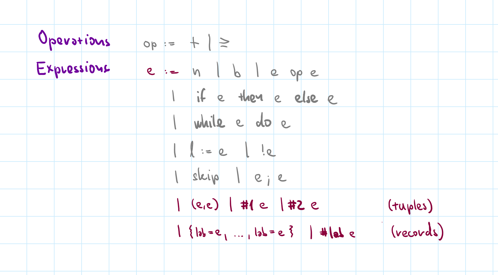

----------------------------------------------------------------------------------------------------
- template: subtitle

# Demo
## Tuples and records in F#

----------------------------------------------------------------------------------------------------
- template: image

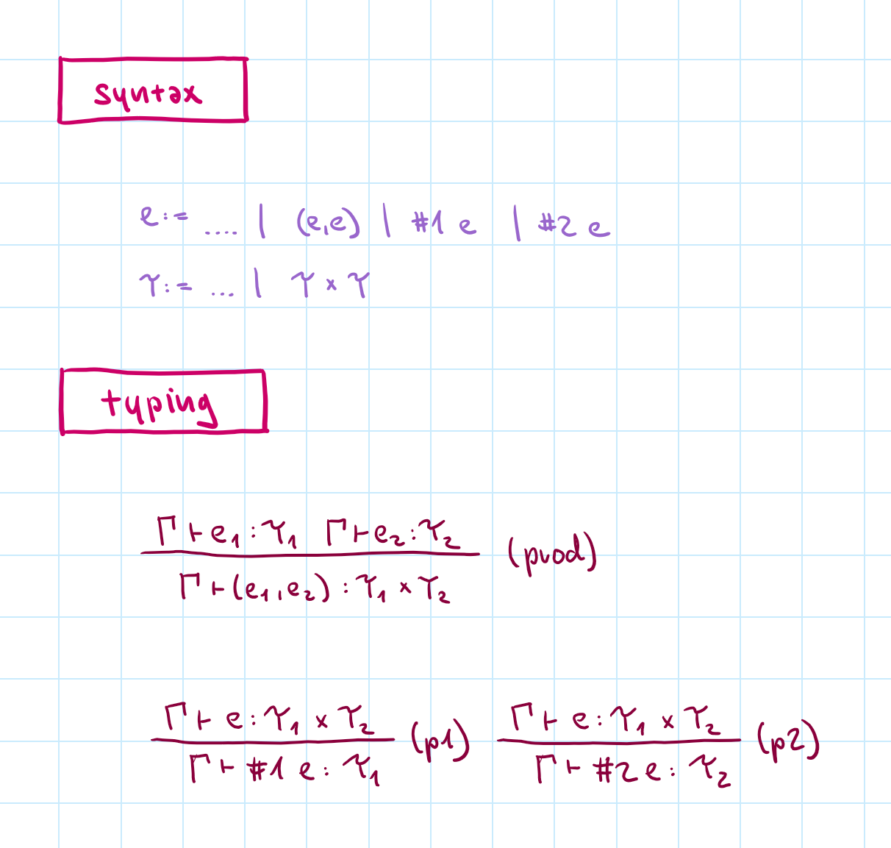

# Syntax and types

Element accessors (`fst` and `snd`) rather than pattern matching

**Obvious typing rules!**

----------------------------------------------------------------------------------------------------
- template: image

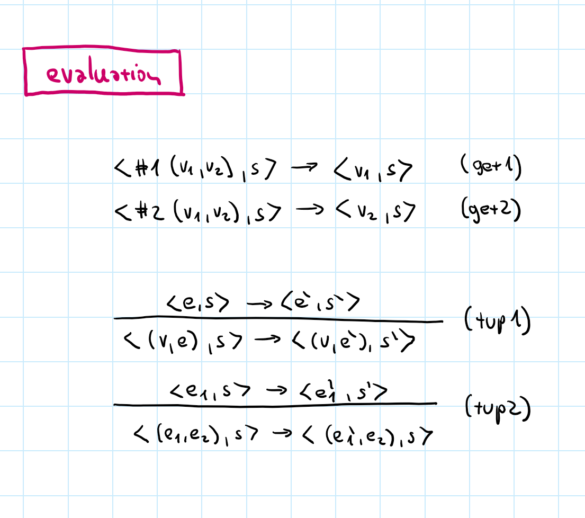

# Evaluation rules

**Eliminating destructor & constructor pair is a common pattern!**

\#1 of tuple of values  
\#2 of tuple of values

Specify left-to-right evaluation order of sub-expressions

----------------------------------------------------------------------------------------------------
- template: lists
- class: bigger

# Evaluation contexts

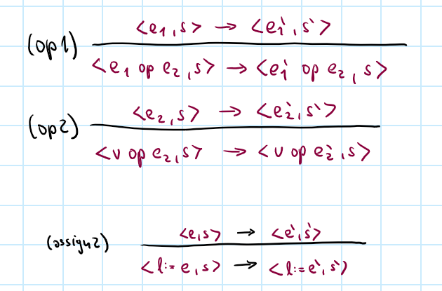

## Specifying evaluation order

- Expression reduces
- In a given syntactic form
- When sub-expression reduces

## Use just a single rule

- Specify evaluation context $E[-]$
- Expression in a context $E[e]$
- $E$ includes $(v + -)$ and $(- + e)$ but not $(e + -)$

----------------------------------------------------------------------------------------------------
- template: image

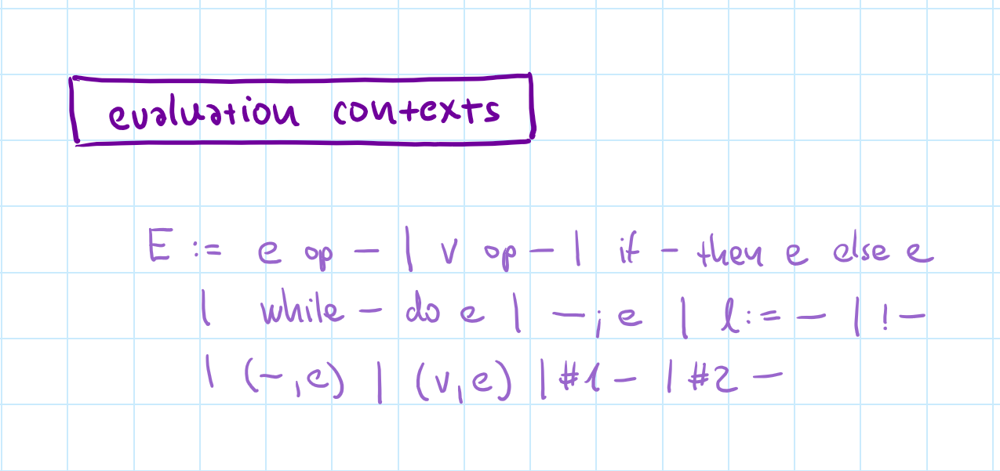

# Evaluation context

**Left to right order**

Specify all the positions where sub-expression can reduce

----------------------------------------------------------------------------------------------------
- template: image

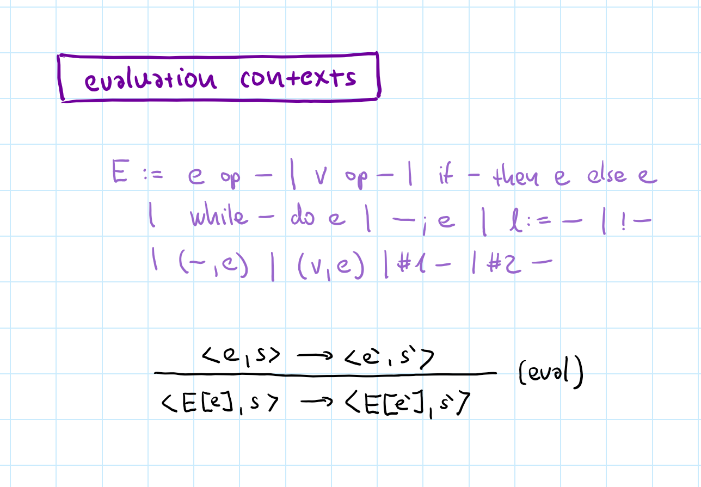

# Evaluation context

**Left to right order**

Specify all the positions where sub-expression can reduce

**Single rule for sub-expression reduction!**

Makes proofs harder

----------------------------------------------------------------------------------------------------
- template: code

```typescript
// Structural types
// (not named in advance)
let pt : { x:number, y:number }
  = { x: 0, y: 0 }

// Type can be inferred
let pt = { x: 0, y: 0 }

// Field access checked
pt.x + pt.y
```

# Records

---

**Structural types**  
as in TypeScript

**Nominal types**  
as in ML/F# or Java

Structural types are easier - no definitions in advance

----------------------------------------------------------------------------------------------------
- template: image

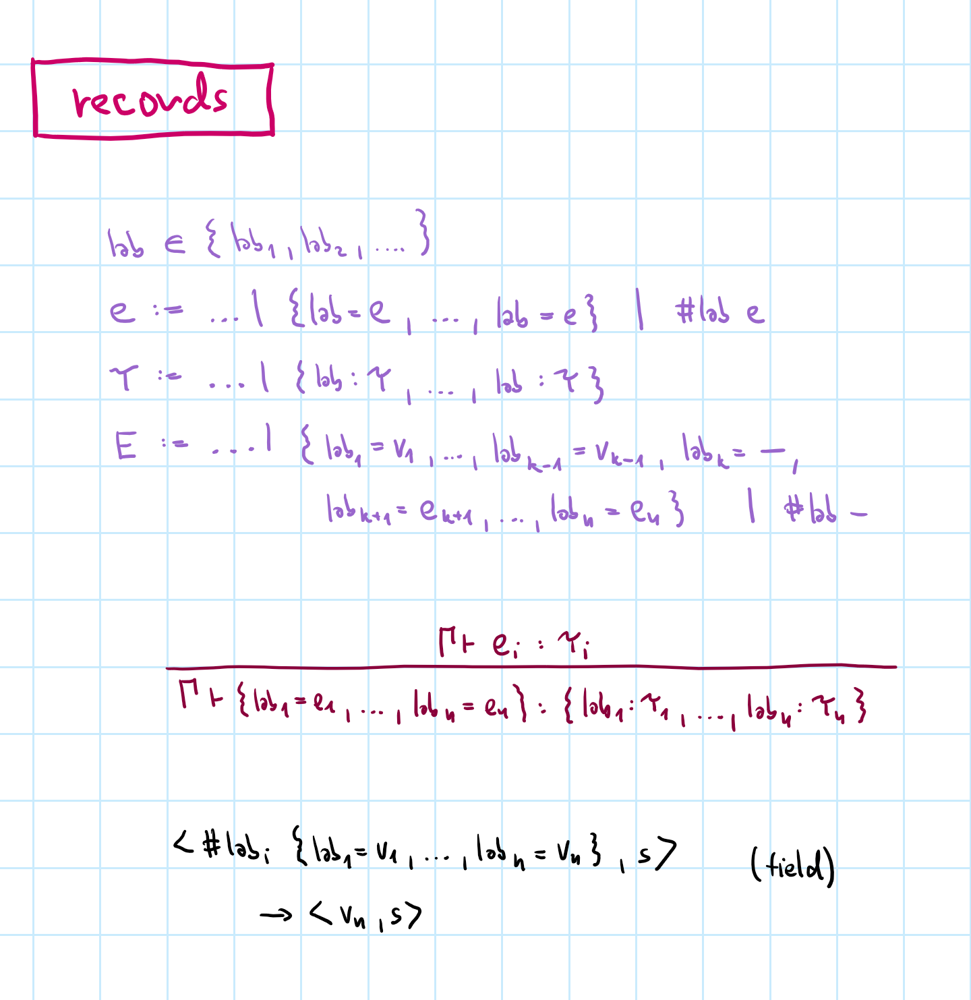

# Adding records

**Type syntax mirrors expression syntax**

Type uses `lab:T`  
Value uses `lab=e`

**Destructor/constructor evaluation pattern**

Sub-expression reduction for free!

****************************************************************************************************
- template: subtitle

# Subtyping
## Formal model

----------------------------------------------------------------------------------------------------
- template: lists

# Subtyping


## Definition

- A subtype `S` can be used anywhere where a supertype `T` is expected
- Written as `S <: T`

## In practice
- **Dynamic types** - based on runtime
- **Static types** - subtyping relation
- Inheritance introduces subtyping
- Type structure, interfaces, etc.

----------------------------------------------------------------------------------------------------
- template: lists
- class: bigger

# Extending type system

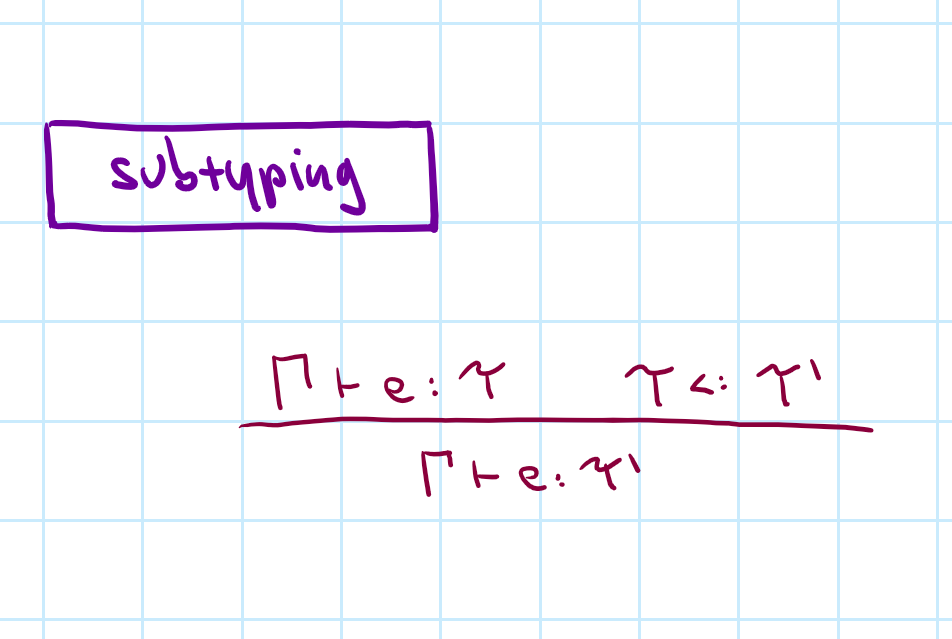

## Easy to define

- Expression of subtype $\tau$ can be types using any supertype $\tau'$

## Breaks nice properties!

- Type preservation gets tricky
- Uniqueness of types no longer holds
- Not syntax-directed typing rule

----------------------------------------------------------------------------------------------------
- template: image
- class: smaller

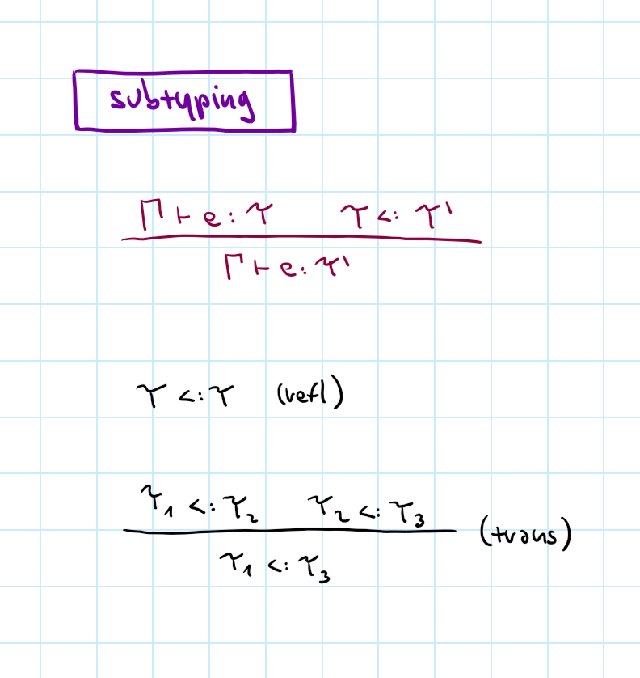

# Subtyping rules

Typing judgement using subtyping relation

**Derivation rules for subtyping - preorder**

- Reflexive
- Transitive

Neither symmetric  
nor anti-symmetric

----------------------------------------------------------------------------------------------------
- template: content
- style: img { max-width:480px; float:right; margin:0px 0px 40px 20px; }

# Subtyping for records

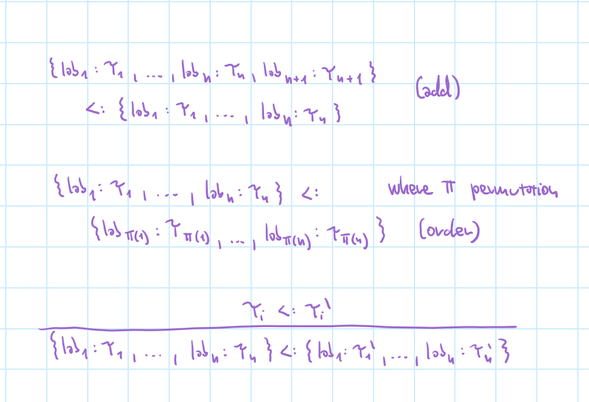

### Three record rules

Additional field at the end  
Reordering of fields  
Subtypes of nested values  

<br><br>

### Primitive rules!

Often need a combination

----------------------------------------------------------------------------------------------------
- template: content

# Which of these are true?

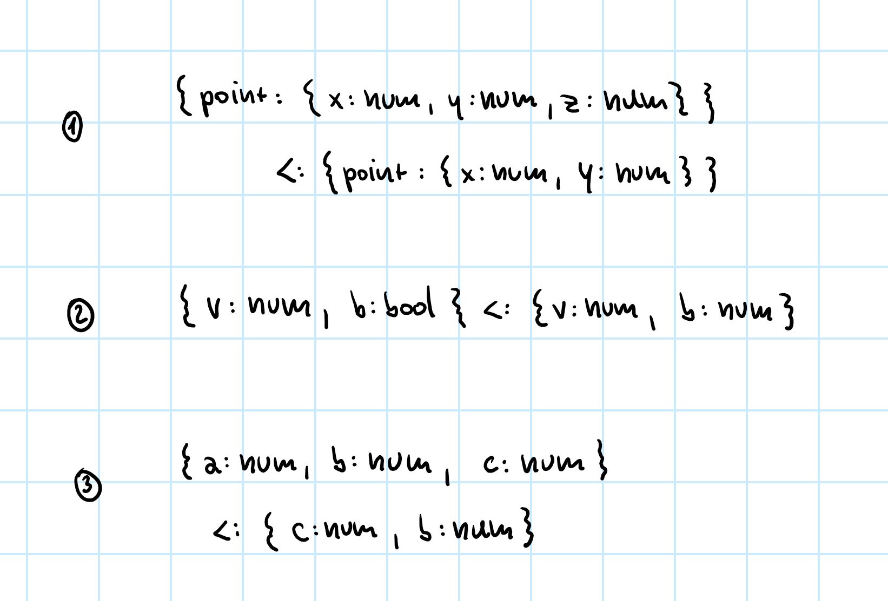

----------------------------------------------------------------------------------------------------
- template: content
- class: nologo
- style: h1 { margin-bottom:20px; } img { max-width:700px;}

# Writing subtyping derivation

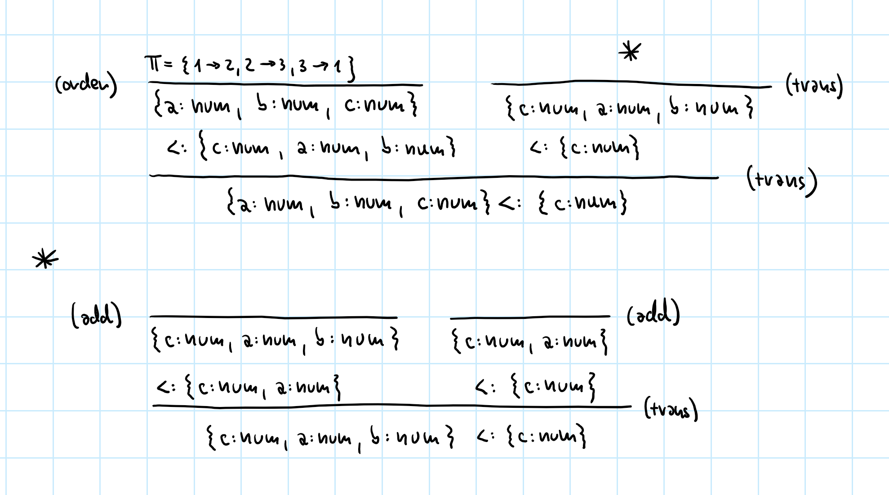

**Same as typing derivation or reduction derivation**  
One relation can have multiple different derivations!


----------------------------------------------------------------------------------------------------
- template: subtitle

# Arrays
## Subtyping and arrays

----------------------------------------------------------------------------------------------------
- template: image

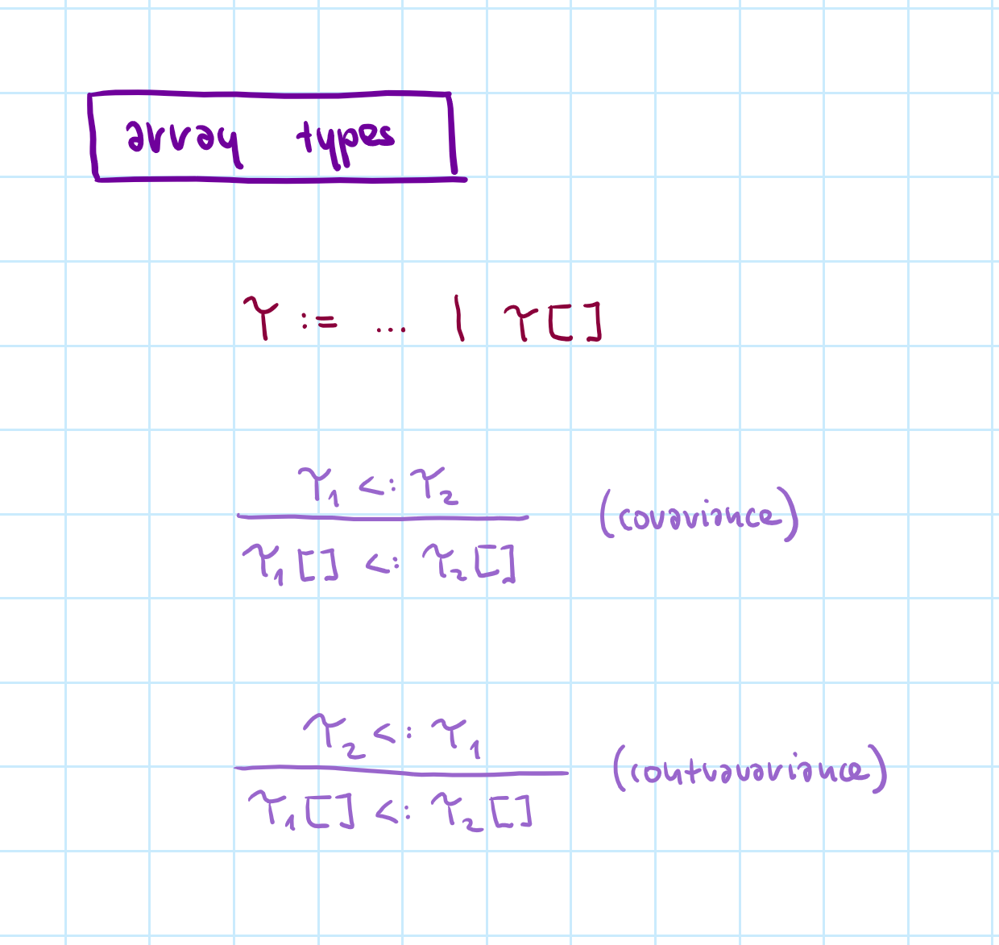

# TypeScript arrays

**What subtyping rule  
is right for arrays?**

- Covariance
- Contravariance

---

Both of them break!

----------------------------------------------------------------------------------------------------
- template: lists
- class: larger

# The trouble with arrays

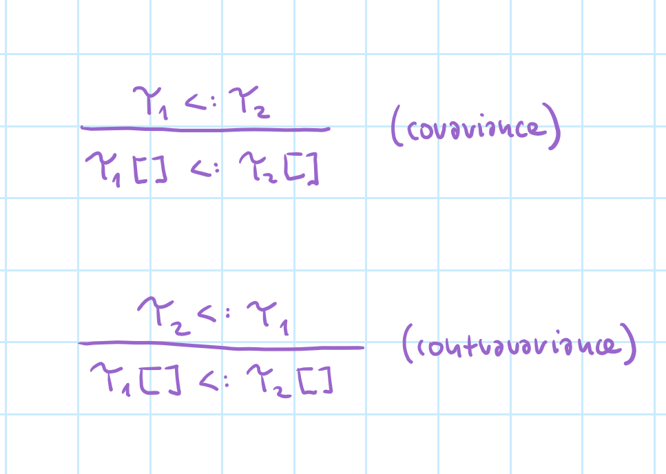

## How the rules break
Covariance - can put `Cat` in `Dog[]`  
Contravariance - can get `Cat` from `Dog[]`  

## Would the proofs fail?
- Typing preservation would break!

## Correct array handling
- Covariance for read-only access
- Contravariance for write-only access

****************************************************************************************************
- template: subtitle

# Conclusions
## Tuples, records and subtyping

----------------------------------------------------------------------------------------------------
- template: icons

# Conclusions
## Tuples, records and subtyping

- *fa-arrow-right* Reduction using destructor/constructor pattern
- *fa-tree* Subtyping as yet another kind of derivation
- *fa-cag* Getting close to formalizing useful things!
- *fa-dumpster-fire* Real-world languages are large and messy
